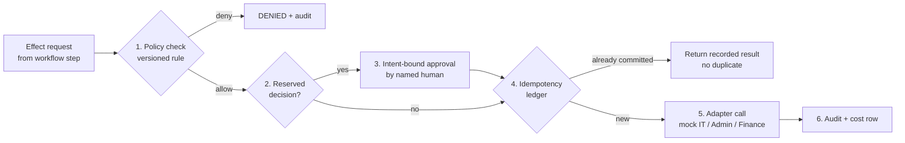
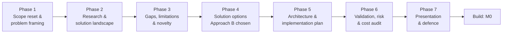
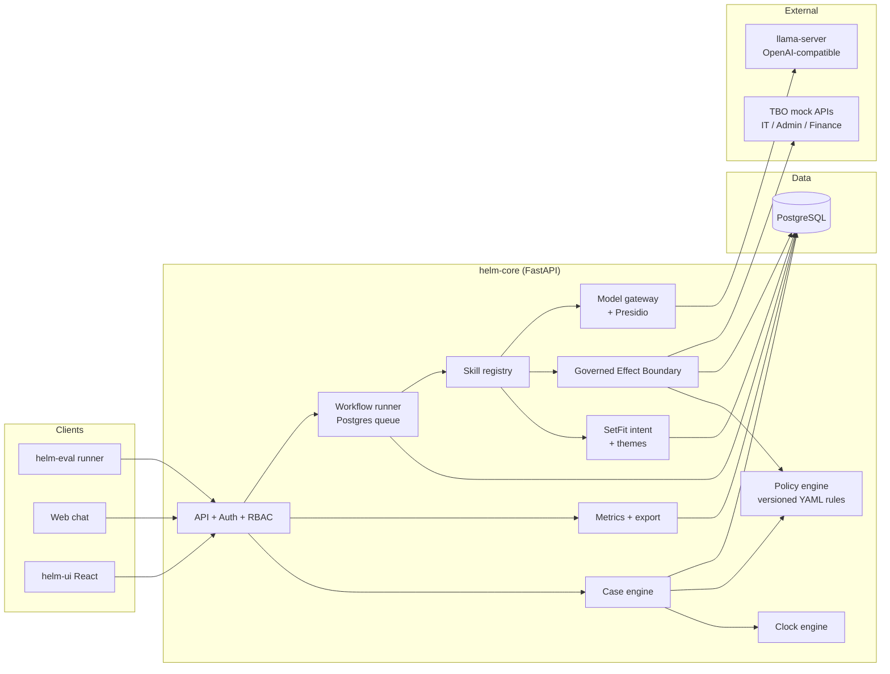
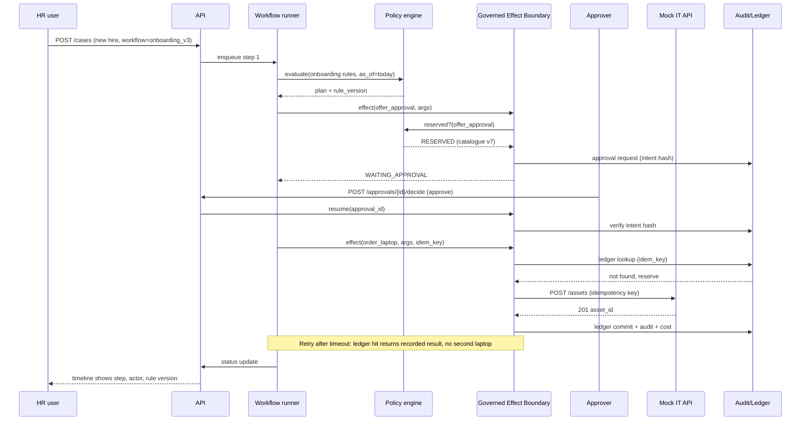
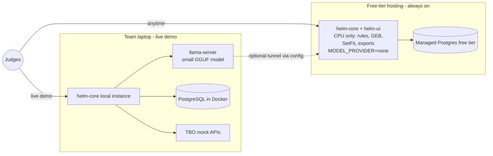

# TBO Helm — Combined Research & Design README

**Governed automation for TBO operations: one open core for travel ticketing (OpsDesk) and HR onboarding.**

> This README consolidates every research and design document produced for TBO Helm (all dated 9 November 2026) into a single file. Each document's content is reproduced in full below, in phase order, including all tables, decisions, sources, the architecture (with diagrams redrawn as Mermaid), the evaluation plan, the licence and cost audit, the presentation outline and the Round 1 slide deck.
>
> **Status as of the source documents:** research and design phases complete; no code yet. Next step is build milestone **M0**. All results are *Expected* or *Target*; nothing has been measured.

---

## Project at a glance

| Item | Summary |
| --- | --- |
| **Problem** | TBO's operations and HR work is fragmented across tickets and teams (Zendesk, Darwinbox). Context, urgency and ownership are lost; every improvement is a metered vendor add-on; no automation stops at legally or financially consequential decisions. |
| **Solution** | Helm: one open-source core (Python/FastAPI, PostgreSQL, React) running two configuration-defined service lines, OpsDesk and HR onboarding. Agents execute declarative workflows; every side effect passes through the **Governed Effect Boundary (GEB)**; language models are confined to typed outputs for intent, themes and chat. |
| **Potential contribution** | The GEB (policy, reserved decisions, intent-bound approval, idempotency, on-behalf-of permissions, cost, audit) plus a Governed-Ops evaluation suite that adds duplicate-effect and statutory-deadline metrics, compared against an LLM-only agent. An evaluated integration, not a new algorithm. |
| **Stack** | Python 3.12, FastAPI, SQLAlchemy, PostgreSQL 16, React/Vite/Tailwind, llama.cpp, Qwen3 or Gemma 4 small models (Apache-2.0), SetFit, scikit-learn, Presidio, Docker Compose; Neon + Render free tiers. |
| **Hard targets** | Reserved-decision violations 0 · duplicate effects 0 · unauthorised access 0 · deadline correctness 100% · linkage recall 100% · export ≥50K rows · 5/5 journeys · new workflow with 0 core-line diff. |
| **Team / effort** | Two people, ~56 person-days, cut list defined. |
| **Cost** | Hackathon cash ≈ ₹0–100 (electricity); hosting ₹0 on free tiers. |
| **Decision** | GO for Round 1; conditional GO for build (pending VRAM check, ONNX classifier spike, TBO terms, provider accounts). |

### The Governed Effect Boundary in one picture



### Research decision trail



---

## Source documents

| # | File | Phase | Content | Ledger version |
| --- | --- | --- | --- | --- |
| 1 | `Phase1.docx` | 1 (early draft) | Problem understanding & scope reset, with state-of-the-art papers and repositories | v1.1 |
| 2 | `TBO_Helm_Phase1_Problem_Framing.docx` | 1 (final) | Problem framing, users, scope, requirements (F-01…F-33, N-01…N-12), success metrics, unknowns U1–U12, MVP boundary | v2 |
| 3 | `TBO_Helm_Phase2_Research_Landscape.docx` | 2 | Academic papers P1–P18, GitHub projects, models, datasets, industry comparison, baselines B0–B5, shortlist | v3 |
| 4 | `TBO_Helm_Phase3_Gaps_Novelty.xlsx` | 3 | Limitation map, gaps G1–G8, differentiators D1–D7, novelty stress test, weighted ranking, claims to avoid | v4 |
| — | *(Phase 4 document not provided)* | 4 | Solution options A / B / C. Outcome recorded elsewhere: Approach B chosen (matrix scores A 3.95 / **B 4.20** / C 3.35) | v5 |
| 5 | `TBO_Helm_Phase5_Architecture.pdf` | 5 | System architecture, diagrams, component spec, stack, data pipeline, API, security, repo structure, milestones, scaling | v6.1 |
| 6 | `TBO_Helm_Phase6_Validation_Risk_Cost.docx` | 6 | Hypotheses H1–H5, metrics, protocol, ablations A1–A6, reproducibility, Tier 3 licence audit, cost, risks R1–R16, go/no-go | v7 |
| 7 | `TBO_Helm_Phase7_Presentation_Defence.docx` | 7 | 10-slide outline, related work, novelty statement, defence Q&A, final summary, complete source list | v8 |
| 8 | `TBO_Helm_Round1_Deck.pptx` | 7 | Round 1 slide deck (10 slides) with speaker notes | — |
| 9 | `TBO_Helm_Research_Ledger_v8.docx` | All | Consolidated research ledger across Phases 1–7 | v8 |

> **Note on Phase 1:** two Phase 1 documents exist. `Phase1.docx` is the earlier draft (scope reset plus state-of-the-art references, ledger v1.1). `TBO_Helm_Phase1_Problem_Framing.docx` is the later framing-only version (ledger v2). Both are included in full.
>
> **Note on Phase 4:** the Phase 4 document (solution options and scoring matrix) was not among the uploaded files. Its outcome is referenced in Phases 5–7 and the ledger: Approach A = rules-first monolith without evaluation harness; **Approach B = Governed Boundary + Evidence Harness on a single-service substrate (selected)**; Approach C = distributed platform (Temporal, OPA, LiteLLM proxy, vLLM, stream bus, Kubernetes), documented as the scale path.

---

## Table of contents

1. [Phase 1 (draft): Problem Understanding & Scope Reset, with State-of-the-Art References](#phase-1-draft-problem-understanding--scope-reset-with-state-of-the-art-references)
2. [Phase 1: Problem Framing and Success Criteria](#phase-1-problem-framing-and-success-criteria)
3. [Phase 2: Academic Research and Existing Solution Landscape](#phase-2-academic-research-and-existing-solution-landscape)
4. [Phase 3: Research Gaps, Limitations and Novelty Analysis](#phase-3-research-gaps-limitations-and-novelty-analysis)
5. [Phase 4: Solution Options (summary only)](#phase-4-solution-options-summary-only)
6. [Phase 5: System Architecture and Implementation Plan](#phase-5-system-architecture-and-implementation-plan)
7. [Phase 6: Validation, Reproducibility, Risk and Cost Audit](#phase-6-validation-reproducibility-risk-and-cost-audit)
8. [Phase 7: Presentation, Report and Project Defence](#phase-7-presentation-report-and-project-defence)
9. [Round 1 Slide Deck](#round-1-slide-deck)
10. [Consolidated Research Ledger (v8)](#consolidated-research-ledger-v8)
11. [Glossary](#glossary)

---

---

## Phase 1 (draft): Problem Understanding & Scope Reset, with State-of-the-Art References

> Source: `Phase1.docx` · Research Ledger v1.1 · Status in document: draft for team approval

*Prepared 9 November 2026  ·  Combined TBO brief (OpsDesk + AI-native HR)  ·  Status: draft for team approval*

**Confirmed inputs:** 3 rounds over about 5–6 weeks; a laptop with a decent GPU; a team of 2–3 people.

**About this document:** Sections 1–5 frame the problem and reset scope. Sections 6–8 pull the state-of-the-art research (papers and repositories) forward from Phase 2 so the team has a citable reference base now. The formal gap analysis, weighted scoring and shortlist approval remain the Phase 2 checkpoint.

### 1. What the new inputs change

**A team of 2–3 is the dominant constraint.** The combined brief asks for two service lines, eight HR objectives, seven OpsDesk MVPs and a live extension test. That much custom code is not feasible for 2–3 people. Engineering judgement (not a measured estimate): the plan only works if roughly 70% of the work is one generic core, and each service line is mostly configuration (workflow definitions, rule sets, seed data) plus a few screens. The unified-platform decision is now a necessity, not an elegance.

**A GPU laptop makes local inference viable.** The free-first policy can be honoured on the default path: a small open-weight model served locally, with no per-call API dependency. The TBO cost rule still applies, because self-hosting is not free; laptop/GPU amortisation and power must be counted. For the monthly projection at TBO volumes, compare a rented GPU server against a hosted open-weight inference provider (Phase 3), behind a config-switchable gateway.

**Three rounds favour design-first.** Round 1 is judged on design soundness, governance and cost logic, with no code. That gives a small team time to get the architecture right before building.

### 2. Verified framing facts

#### 2.1 Regulatory: what the system must encode

| **Fact (verified, with source)** | **Implication for Helm** |
| --- | --- |
| MeitY notified the DPDP Rules on 13 Nov 2025; the Act and Rules phase in over 18 months, ending around May 2027 (AZB & Partners). | Substantive duties are not yet in force (as of 9 Nov 2026), but we design for them now: the brief requires it and a production rollout would land inside the window. |
| Consent Manager provisions become operational 13 Nov 2026; the substantive phase follows 13 May 2027. Sources differ by one day (13 vs 14) on milestone dates. | Consent capture, purpose tags and retention timers belong in the core data model. Exact dates marked "not verified against the gazette." |
| The Rules require data-principal grievances to be resolved within a reasonable time, capped at 90 days (Khaitan & Co). | A natural statutory SLA: DPDP access/correction requests become a case type on the same SLA engine. |
| The four Labour Codes came into force together on 21 Nov 2025 (BusinessToday). | The HR policy layer must reflect the Codes, not the repealed Acts. |
| Wages due on resignation, dismissal, removal or retrenchment must be paid within two working days; current F&F cycles often run 15–45 days (BusinessToday; greytHR). | A hard statutory clock and the best test case for "policy as versioned config." |
| Fixed-term employees qualify for gratuity after one year; the Codes replaced 29 laws but not the EPF Act, 1952 (BusinessToday; Legal500). | Eligibility rules must be versioned by effective date; EPF stays under its own Act. |
| Draft Central Rules were published 30 Dec 2025, with state timelines expected to vary (Employsome). | State-specific rules are a policy-layer dimension. Final-rule status not verified. |

#### 2.2 Incumbent baseline: evidence that TBO’s pain is structural

| **TBO problem** | **Verified evidence** |
| --- | --- |
| P6 API / data limits | Zendesk Support API limits range from 200 requests/min (Team) to 700 (Enterprise); a paid High Volume add-on raises this to 2,500. Updating the same ticket is capped at 30 updates per 10 minutes per agent; incremental exports at 10 requests/min (30 with the add-on). Offset pagination stops at 100 pages / 10,000 records. (Zendesk developer docs; Knit) |
| P3 Side conversations | A high-volume customer reported on Zendesk’s community forum that an agent who did not start a child ticket and lacks access to its group cannot continue the conversation, nor see its status, group or ID. User-reported, not official documentation, but consistent with TBO’s description. |
| P5 AI costs extra | Copilot is a $50 per agent per month add-on (billed yearly, Suite Professional and above). Since May 2026, AI agents bill per automated resolution after a monthly allowance of 5 / 10 / 15 per agent depending on plan. Zendesk does not publish the per-resolution rate; figures come from independent analyses. |
| P6 3K-row export cap | Client-stated. Official confirmation not found; treated as given. |

### 3. Unified problem decomposition

Stripped of product names, the combined brief reduces to six capability problems, each solved once in the shared core.

| **#** | **Capability problem** | **OpsDesk need** | **HR need** | **Solved by** |
| --- | --- | --- | --- | --- |
| C1 | Contextual case model: work items with identity, links, history | P1, MVP-1 | O5 system of record | Rules / data model |
| C2 | Policy-driven routing & clocks: who owns it, how urgent | P2, P4 | O3 approver routing; statutory timelines | Rules engine |
| C3 | Governed action execution: approvals, idempotency, audit, kill switch | P4 escalation | O1, O3, O4, O6, guardrails | Workflow engine + policy layer |
| C4 | Multi-party threads: explicit recipients, survive transfer | P3 | Cross-team IT/Admin/Finance threads | Data model |
| C5 | Language understanding at the edges: intent, themes, chat | P1 intent, P5 themes | O7 chat | The only place for models |
| C6 | Measured, uncapped data: exports, metrics, cost | P6 | O8 dashboard | Data layer |

**Key finding:** only C5 needs a model. Routing, SLA, linkage by TBOH, eligibility, dates, approvals and idempotency are all deterministic. This is the core of the cost story and matches TBO’s rule that using an LLM where a rule would do counts against a team.

### 4. Measurable success criteria

Measured in Round 2, not estimated.

| **Metric** | **Source of requirement** | **Proposed target (to validate)** |
| --- | --- | --- |
| % onboarding steps with no human touch | HR O1 | Report actual; reserved steps excluded by design and disclosed |
| Reserved decisions completed by an agent | Guardrails | 0, proven by automated tests |
| Duplicate side-effects on retry | HR O6 | 0, proven by fault-injection tests |
| INR per completed workflow (both lines) | HR cost rule | Report actual, plus monthly projection |
| Intent suggestion accuracy (top-1 / top-3) | OpsDesk MVP-1 | Measured on a labelled seed set |
| Share of model calls escalated to the larger model | HR cost rule | Report with a justified threshold |
| Export size without cap | OpsDesk P6 | ≥50K rows streamed at demo scale |
| Time to add a new workflow (rehearsal) | HR O2 | Measured in drills |

### 5. Scope reset for a 2–3 person team

Every “must” from both briefs is kept, but built thin and generic. Depth goes where the score is.

| **Priority** | **Scope** |
| --- | --- |
| Must, deep (governance + extensibility = 40%) | Policy layer with versioned rules and tests; reserved-decision config; approvals queue; audit and explainability log; RBAC with agents acting on behalf of users; kill switch; workflow definitions + agent/skill registry; idempotent integration adapters; developer guide |
| Must, solid | Case engine (links, timeline, status); routing with reasons; SLA engine; escalation; side threads; OpsDesk journeys A–D; onboarding flow on TBO mock APIs; metrics/cost dashboard; streaming export |
| Must, thin | Insights (journey E): themes plus sample cases. Conversational interface: web chat only. |
| Could | Slack/Teams bot, realtime dashboard, CSAT, macros, webhooks, supplier portal |
| Won’t | Omnichannel, multi-tenant, production SSO, migration tooling |

**HR depth line: onboarding (provisional).** Most cross-team loops and the highest achievable automation rate. Exits remains the alternative; the two-working-day F&F rule will be implemented as a policy-layer example regardless.

#### Proposed roles

- **Person A, Core & governance:** case engine, workflow engine, policy layer, approvals, audit, RBAC, kill switch, developer guide.
- **Person B, Service lines & UI:** OpsDesk screens and journeys, onboarding flow, mock API adapters, chat UI, dashboard.
- **Person C (if available), AI, data & delivery:** model gateway, local inference, PII masking, cost metering, intent/themes, exports, seed data, documents and demo.

With only 2 people: A also takes the model gateway and cost metering; B takes seed data, exports and the demo.

### 6. State of the art: research papers

Every paper below was confirmed on arXiv or its official page during this session (Tier 1). Results are as reported by the authors; none were reproduced by us.

#### 6.1 Cost-aware model routing (supports the cost rule)

| **Paper** | **Reported finding** | **Relevance to Helm** |
| --- | --- | --- |
| [FrugalGPT: How to Use LLMs While Reducing Cost and Improving Performance](https://arxiv.org/abs/2305.05176) — Chen, Zaharia, Zou (Stanford), arXiv, May 2023 | Proposes an LLM cascade that learns which models to query; reports matching the best single LLM (GPT-4) with up to 98% cost reduction on their benchmarks. | Foundational evidence for a small-model-first cascade with escalation on low confidence: exactly the routing the TBO cost rule asks us to justify. |
| [RouteLLM: Learning to Route LLMs with Preference Data](https://arxiv.org/abs/2406.18665) — Ong et al. (UC Berkeley / Anyscale), ICLR 2025. Code: [lm-sys/RouteLLM](https://github.com/lm-sys/RouteLLM) | Trains routers between a strong and weak model from preference data; reports over 2x cost reduction on public benchmarks with little quality loss, and transfer to unseen model pairs. | Reference design for a learned router. Our calls are narrow classification tasks, so a simpler confidence-threshold router may suffice; measuring that trade-off is a Phase 3 experiment. |

#### 6.2 Governed agents: runtime enforcement, privilege, prompt injection (supports governance, 20%)

| **Paper** | **Reported finding** | **Relevance to Helm** |
| --- | --- | --- |
| [AgentSpec: Customizable Runtime Enforcement for Safe and Reliable LLM Agents](https://arxiv.org/abs/2503.18666) — Wang, Poskitt, Sun (SMU), arXiv Mar 2025; v3 lists a 2026 conference version | A lightweight DSL whose rules combine a trigger, predicate conditions and an enforcement action (e.g. require user confirmation when a transaction exceeds a threshold). Evaluated on code, embodied and driving agents. | Closest academic analogue to our reserved-decision layer: trigger = agent action, predicate = HR-configured rule, enforcement = route to named human. Gap: not evaluated on HR/ops workflows. |
| [Progent: Programmable Privilege Control for LLM Agents](https://arxiv.org/abs/2504.11703) — Shi et al. (UC Berkeley et al.), arXiv Apr 2025 (v2 Aug 2025). Code: [sunblaze-ucb/progent](https://github.com/sunblaze-ucb/progent) | Enforces least privilege at the tool-call level via a policy DSL, blocking calls not needed for the user’s task. Integrates with minimal changes to agent internals. | Directly maps to the brief’s rule that an agent can never do more than the person it acts for. |
| [Defeating Prompt Injections by Design (CaMeL)](https://arxiv.org/abs/2503.18813) — Debenedetti et al. (Google DeepMind / ETH Zürich), arXiv Mar 2025. Code: [google-research/camel-prompt-injection](https://github.com/google-research/camel-prompt-injection) | Separates control flow (from the trusted query) from untrusted data so retrieved content cannot change program flow. On AgentDojo, reported tasks solved with provable security were 67% (v1) and 77% (v2, vs 84% undefended). | Agency emails, supplier replies and uploaded documents are untrusted input. CaMeL’s principle (untrusted text never drives control flow) informs our design; full adoption is likely too heavy for a 2–3 person team. |

#### 6.3 Evaluating policy-following agents

| **Paper** | **Reported finding** | **Relevance to Helm** |
| --- | --- | --- |
| [τ-bench: A Benchmark for Tool-Agent-User Interaction in Real-World Domains](https://arxiv.org/abs/2406.12045) — Yao, Shinn, Razavi, Narasimhan (Sierra), arXiv Jun 2024. Code: [sierra-research/tau-bench](https://github.com/sierra-research/tau-bench) (MIT); successor [tau2-bench](https://github.com/sierra-research/tau2-bench) | Agents must use domain APIs and follow a written domain policy while conversing with a simulated user; introduces pass^k for reliability across repeated trials. The authors note a correct end state can still hide a policy violation (e.g. acting without user confirmation). | Template for our evaluation harness: replay seeded scenarios repeatedly and score both outcome and policy compliance (pass^k on reserved-decision handling). |

#### 6.4 Intent classification, theme extraction and ticket routing (supports C5 and OpsDesk P1/P5)

| **Paper** | **Reported finding** | **Relevance to Helm** |
| --- | --- | --- |
| [Efficient Few-Shot Learning Without Prompts (SetFit)](https://arxiv.org/abs/2209.11055) — Tunstall et al. (Hugging Face / Intel), arXiv Sep 2022. Code: [huggingface/setfit](https://github.com/huggingface/setfit) | Contrastive fine-tuning of a sentence transformer plus a light classification head; comparable to PEFT/PET methods while an order of magnitude faster to train, with no prompts. | Strong candidate for intent auto-suggest: trains from a few labelled examples per intent, runs on CPU, no LLM call per ticket, so it is cheap and deterministic to evaluate. |
| [BERTopic: Neural topic modeling with a class-based TF-IDF procedure](https://arxiv.org/abs/2203.05794) — Grootendorst, arXiv Mar 2022 | Embeds documents, clusters them (UMAP + HDBSCAN) and labels topics with class-based TF-IDF; supports guided and dynamic (over-time) topics. | Candidate for the weekly Insights themes, with guided seed topics (refund delay, inventory sync, special request). |
| [End-to-end automated helpdesk email ticket assignment](https://arxiv.org/abs/1808.02636) — Mandal et al. (IBM), arXiv 2018 | Industrial system dispatching email tickets to resolver groups with ensemble classifiers; reports human-level accuracy and about 23,000 person-hours saved per year. | Industry evidence that classification-then-dispatch works at scale. It does not model travel urgency or agent availability, which our rules engine adds. |
| [TaDaa: Ticket Assignment Deep learning Auto Advisor](https://arxiv.org/abs/2207.11187) — Feng, Senapati, Liu, arXiv Jul 2022 | Transformer-based suggestion of groups and resolvers for help-desk tickets. | Background reference for learned routing; we keep routing rule-based for explainability. |
| [Classifying the Unstructured IT Service Desk Tickets Using Ensemble of Classifiers](https://arxiv.org/abs/2103.15822) — Ramya, Paramesh, Shreedhara, arXiv Mar 2021 | Ensemble classifiers on real service-desk data to predict ticket category and reduce misrouting. | Baseline comparison for our intent classifier. |

### 7. Open-source repositories and licence classification

Policy categories: (a) open-source software, (b) open-weight model, (c) source-available / restricted, (d) free tier, (e) research-only / non-commercial, (f) proprietary paid. **Verification:** “Confirmed” = licence seen in an official or corroborating source this session; “Not re-verified” = stated from prior knowledge, must be checked in the Tier 2/3 audit.

| **Project** | **Role in Helm** | **Licence (as reported)** | **Cat.** | **Status** |
| --- | --- | --- | --- | --- |
| [temporalio/temporal](https://github.com/temporalio/temporal) | Durable workflow execution (candidate) | MIT; managed cloud is separate | a | Confirmed |
| [langchain-ai/langgraph](https://github.com/langchain-ai/langgraph) | Agent orchestration with human-in-the-loop interrupts and checkpointing (candidate) | MIT; LangSmith platform is a separate paid product | a | Confirmed |
| [open-policy-agent/opa](https://github.com/open-policy-agent/opa) | Policy engine for versioned, testable rules (candidate) | Apache-2.0; CNCF graduated | a | Confirmed |
| [cedar-policy/cedar](https://github.com/cedar-policy/cedar) | Authorization policy language (alternative to OPA) | Apache-2.0; CNCF sandbox | a | Not re-verified (licence) |
| [BerriAI/litellm](https://github.com/BerriAI/litellm) | Provider-agnostic model gateway, cost tracking | MIT, except enterprise/ directory under a separate licence that forbids production use without a subscription | a / c | Confirmed; avoid enterprise/ features |
| [microsoft/presidio](https://github.com/microsoft/presidio) | PII detection and masking before model calls | MIT. Maintainers warn it cannot guarantee finding all PII | a | Confirmed |
| [huggingface/setfit](https://github.com/huggingface/setfit) | Few-shot intent classifier | Apache-2.0 | a | Not re-verified (licence) |
| [MaartenGr/BERTopic](https://github.com/MaartenGr/BERTopic) | Theme extraction for Insights | MIT | a | Not re-verified (licence, canonical URL) |
| Qwen3 dense 0.6B–32B ([Qwen blog](https://qwenlm.github.io/blog/qwen3/)) | Small open-weight LLM for chat / fallback classification | Apache-2.0 | b | Confirmed; check for newer releases in Phase 3 |
| Ollama / llama.cpp / vLLM | Local and server inference runtimes | MIT / MIT / Apache-2.0 | a | Not re-verified |
| [sierra-research/tau2-bench](https://github.com/sierra-research/tau2-bench) | Evaluation methodology reference | MIT | a | Confirmed (via repo metadata) |
| [zammad/zammad](https://github.com/zammad/zammad) | Benchmark only (feature reference, not a dependency) | AGPL-3.0 (network copyleft) | a | Confirmed |
| [frappe/helpdesk](https://github.com/frappe/helpdesk) | Benchmark only | AGPL-3.0 | a | Confirmed |
| Frappe HR, OrangeHRM | HRMS feature benchmarks | GPL family | a | Not re-verified |
| Gemma, Llama model families | Excluded as defaults: open-weight under custom licences with use restrictions; not open-source | Custom terms | b (restricted) | Not re-verified |

**Licence notes.** Copying code from AGPL helpdesks would impose network-copyleft obligations on Helm; we study them for features only. LiteLLM is usable in production only from its MIT tree. Qwen3 is open-weight under Apache-2.0, which is permissive; that still does not make it “open-source” in the training-data sense, and the reviewer note on vendor provenance should be recorded for TBO.

### 8. Preliminary gap observations (input to Phase 2, not final)

- **Domain-specific governed agents.** AgentSpec, Progent and CaMeL are evaluated on generic agent settings (code execution, embodied agents, AgentDojo). None targets enterprise HR/ops workflows with HR-editable reserved decisions and effective-dated statutory rules (e.g. the two-working-day F&F clock). Candidate gap: a configuration-driven reserved-decision layer, proven by tests and pass^k-style replay, on a realistic HR + ops workload.
- **Routing for narrow tasks.** FrugalGPT and RouteLLM study open-ended QA and chat. Helm’s model calls are mostly narrow classification. A measured cascade (SetFit classifier, then small local LLM, then larger model only below a confidence threshold) with real INR costs would be practical evidence the brief explicitly asks for.
- **Travel-aware routing is an engineering gap, not a research one.** Ticket-routing literature focuses on text classification to resolver groups. Combining check-in/LCD urgency, region and availability is straightforward rules engineering; we should not claim research novelty there.
- **Open-source helpdesks and HRMS are copyleft.** They are valuable feature benchmarks, but building on permissive components (Temporal or LangGraph, OPA, LiteLLM MIT tree, Presidio) keeps Helm’s licensing clean for TBO.

### 9. Phase summary

#### Key findings

- The combined brief reduces to six capability problems; only C5 (language understanding) needs a model.
- Indian regulation is moving: Labour Codes in force with a two-working-day F&F rule; DPDP substantive duties arrive May 2027, Consent Manager phase starts this week. The policy layer must be effective-date-versioned.
- Zendesk pain points are corroborated by official rate-limit documentation and published add-on pricing; side-conversation limits only by user reports.
- Research on governed agents (runtime enforcement, least privilege, prompt-injection isolation) and cost-aware routing directly supports Helm’s design, but none of it is evaluated on HR/ops workflows.

#### Decisions / recommendations

- Generic core with configuration-driven service lines (mandatory at this team size).
- Models confined to intent, themes and chat; everything else deterministic.
- Default inference: local open-weight model on the team GPU behind a config-switchable gateway (final choice in Phase 3).
- Onboarding stays the HR depth line; the F&F rule is included as a policy example.

#### Unknowns and risks

- Delivery risk (high): two service lines with 2–3 people. Mitigated by thin-and-generic scope and early extension-test drills.
- Client details: TBO mock API contracts, dataset schema, volumes; meaning of TBOH and LCD; the 3K export cap (client-stated only).
- Regulatory: exact DPDP milestone dates (sources differ by a day); final Labour Code and state rules not verified against the gazette.
- Licences marked “not re-verified” in Section 7 must pass the Tier 2/3 audit before adoption.

#### Research Ledger (v1.1)

| **Item** | **Status** |
| --- | --- |
| Confirmed context | 3 rounds / ~5–6 weeks; GPU laptop; team of 2–3 |
| Decisions | Unified core (mandatory); models only for C5; local open-weight default (provisional); onboarding depth line with F&F rule as policy example; governance and extensibility built deep |
| Rejected | Separate codebases; frontier model on the routine path; LLMs for routing, SLA, linkage or eligibility; reusing AGPL helpdesk code |
| Verified facts | DPDP Rules notified Nov 2025 with 18-month phase-in; Labour Codes in force 21 Nov 2025 with 2-working-day F&F; Zendesk rate limits; Zendesk AI pricing structure; 10 papers and core repository licences listed in Sections 6–7 |
| Not verified | Exact DPDP dates (±1 day); final Labour Code / state rules; 3K export cap; Zendesk per-resolution rate; licences marked in Section 7 |
| Open questions | TBO starter-kit schemas and volumes; TBOH/LCD definitions |
| Next phase | Phase 2: formal gap analysis, Tier 2 checks on shortlisted candidates, weighted scoring, shortlist for approval |

#### Input needed before Phase 2

- Confirm the scope reset in Section 5 (Insights and chat thin; governance and extensibility deep).
- Confirm onboarding as the HR depth line, or switch to exits.

### 10. Sources

#### Regulatory

- [AZB & Partners via Mondaq — DPDP phased rollout (19 Nov 2025)](https://webiis08.mondaq.com/india/data-protection/1706878/indias-digital-personal-data-protection-act-phased-rollout-and-key-compliance-milestones)
- [Khaitan & Co via Mondaq — DPDP Rules highlights (20 Nov 2025)](https://www.mondaq.com/india/privacy-protection/1707558/digital-personal-data-protection-rules-2025-highlights)
- [HSA Advocates via Mondaq — DPDP Rules analysis (21 Nov 2025)](https://www.mondaq.com/india/data-protection/1708434/operationalising-indias-data-protection-regime-analysing-the-newly-notified-dpdp-rules-2025)
- [Mondaq — Cross-border transfers under DPDP, 2027 roadmap](https://www.mondaq.com/india/data-protection/1844060/cross-border-data-transfers-under-indias-dpdp-act-rules-restrictions-and-compliance-roadmap-for-2027)
- [AMSS — DPDP enforcement dates](https://www.amsshardul.com/?p=17621)
- [BusinessToday — 10 months of new labour codes (25 Sep 2026)](https://www.businesstoday.in/latest/corporate/story/10-months-of-new-labour-codes-what-has-changed-for-employees-and-employers-557677-2026-09-25)
- [greytHR — Labour Code F&F and gratuity changes](https://www.greythr.com/greythr-help/admin/answers/Aa_TXZJ0TgaxIptDNayk-g/)
- [Legal500 — Labour Codes implementation](https://www.legal500.com/developments/?p=53456)
- [Employsome — Labour Codes and draft rules](https://employsome.sda.company/?p=7083)

#### Incumbent (Zendesk)

- [Zendesk developer docs — Rate limits](https://developer.zendesk.com/api-reference/introduction/rate-limits/)
- [Knit — Zendesk Ticketing API guide (Jun 2026)](https://lb.getknit.dev/?p=743)
- [Zendesk community — Side Conversation Limitations (Oct 2023)](https://support.zendesk.com/hc/ko/community/posts/6245545265946-Side-Conversation-Limitations)
- [Pluno — Zendesk AI pricing 2026](https://pluno.ai/blog/zendesk-ai-pricing)
- [Helply — Zendesk pricing 2026](https://helply.com/blog/zendesk-pricing)
- [Richpanel — Zendesk AI agents guide](https://www.richpanel.com/learn/zendesk-ai-agents-guide)

#### Papers and repositories

All paper and repository links are given inline in Sections 6 and 7.

---

## Phase 1: Problem Framing and Success Criteria

> Source: `TBO_Helm_Phase1_Problem_Framing.docx` · Research Ledger v2

*Prepared 9 November 2026  ·  Combined TBO brief (OpsDesk + AI-native HR)  ·  Status: awaiting confirmation*

**Scope of this phase:** framing only. No literature review and no architecture selection. Requirements are stated in tool-neutral terms. **[A]** marks a safe assumption; **[P]** marks a provisional target.

### A. Problem definition

TBO needs a single-tenant, extensible operations platform that replaces two SaaS workflows that fragment work: Zendesk for B2B travel-ops ticketing and Darwinbox-style HR service delivery. Technically, it must provide:

- **A case model:** a persistent, relational work-item model linking cases by booking reference (TBOH), agency, intent and history.
- **Deterministic logic:** routing, SLA and escalation logic driven by configurable, versioned policy, including travel urgency (check-in date and LCD) and statutory clocks.
- **Governed agents:** an orchestration layer in which software agents run multi-system workflows (IT, Admin, Finance mock APIs) end to end, while actions classed as reserved decisions are blocked until a named human approves.
- **Safety properties:** idempotent side effects under retry, a complete audit and explainability trail, role-scoped access (an agent never exceeds the permissions of the principal it acts for), PII minimisation before any external model call, and an operator kill switch.
- **Language at the edges:** natural-language understanding only for intent suggestion, theme extraction and conversational access.
- **Data and cost:** uncapped data access, plus measured cost (INR per completed workflow) and automation metrics.
- **Extensibility:** a new service line or workflow can be added through configuration and registered components, without modifying the core. This is tested live by the panel.

The expected outcome is evidence, from a working system on synthetic data, that this is feasible, safe and cheaper than paying for add-ons or third-party API glue.

### B. Plain-language explanation

At TBO, two kinds of work fall through the cracks today:

- **Travel agencies’ problems.** A travel agency writes in about a refund three times, and each message becomes a fresh ticket. Nobody sees the history, urgent bookings near check-in wait in the same queue as routine ones, and conversations with hotels break when the ticket changes hands.
- **New hires.** Someone joins, and HR still emails IT for a laptop, Admin for an access card and Finance for payroll, then chases each team by hand.

We want one system where every piece of work is a tracked case with its full history. Routine steps happen automatically, urgent things jump the queue for stated reasons, and anything that genuinely needs a human decision stops and waits for a named person. Examples are approving a salary or accepting a resignation. Every action, by a person or by software, is recorded with who did it and why. The system has to be cheap to run, safe with personal data, and easy for TBO’s own developers to extend to new kinds of work.

#### Underlying need vs. requested feature

| **Requested feature** | **Underlying need** |
| --- | --- |
| Linked tickets by TBOH | Agents need full context, so agencies don’t repeat themselves and refunds don’t stall |
| Smarter routing | The right person handles urgent work first, and anyone can see why |
| Side conversations that survive transfer | Supplier and agency communication never breaks or reaches the wrong recipients |
| Agents automating onboarding | Cross-team loops close without people acting as message couriers |
| Reserved decisions | Automation must never take legally, financially or personally consequential decisions |
| Cost dashboard | Proof that owning the platform is cheaper than renting add-ons |
| Extension model | TBO can keep adapting the platform without vendors or rewrites |

#### Problem, solution assumptions and expected outcome

|  | **Content** |
| --- | --- |
| **Problem** | Work is fragmented across tickets and teams; context, urgency and ownership are lost; improvements cost incremental vendor fees; there is no governed automation. |
| **Proposed solution assumptions** | One shared core can serve both domains. Most logic is deterministic. Models are needed only for language tasks. A 2–3 person team can deliver a credible vertical slice in about 5–6 weeks. |
| **Expected outcome** | A working demo on synthetic data with measured automation rate, cost per workflow, zero reserved-decision violations, zero duplicate side effects, and a passed live extension test. |

### C. Users and workflow

#### Primary users

| **User** | **Current workflow** | **Pain points** |
| --- | --- | --- |
| Ops Agent | Picks tickets from FIFO/LIFO queues; reads each ticket in isolation; emails suppliers through side conversations | No history or linkage; misrouting; side-conversation recipients wrong after transfer; manual intent tagging |
| Agency (requester) | Emails or raises tickets; follows up repeatedly | Repeats context; no status visibility; duplicate tickets |
| Escalation Manager | Learns of urgent cases via followers or email triggers | No direct escalation queue; check-in and LCD urgency invisible |
| HR Operations | Records hires, then emails IT, Admin and Finance and chases replies | Manual coordination; no single status view; policy knowledge in people’s heads |
| Named HR approver | Approves offers, compensation, payroll runs and exits via email or the HRMS | Decisions not bound to an audit trail of the automation around them |
| New hire / employee | Fills forms; emails HR with questions | Opaque status; slow answers |

#### Secondary users

| **User** | **Need** |
| --- | --- |
| Hiring / line manager | Approve and track through chat; day-one readiness |
| IT, Admin, Finance teams | Receive well-formed, non-duplicated requests; touched only on exceptions |
| Ops Lead / Governance | Queue health, SLA risk, uncapped reporting |
| Product / Insights team | Recurring themes as backlog input |
| TBO developers | Add service lines and workflows without core changes |
| TBO leadership / judges | Cost, automation and safety evidence |

#### Operating context and constraints

- **Environment:** a single TBO organisation, run as a web application (browser) plus a conversational interface (web chat first). The demo runs on a laptop with a GPU, optionally with a hosted deployment. HR integrations must use the TBO-provided mock APIs and synthetic dataset.
- **Privacy:** India’s DPDP framework applies to employee, agency and traveller data. The Act and Rules are being phased in over the 18 months to around May 2027. We design for full compliance now: purpose limitation, consent where needed, retention limits, and access and correction requests. No real personal data is allowed. PII must be minimised or masked before any external model call.
- **Labour law:** statutory obligations must be encoded as rules. For example, wages due on resignation, dismissal, removal or retrenchment must be paid within two working days.
- **Safety and reliability:** reserved decisions can never be completed by an agent; retries never duplicate side effects; low-confidence cases, outages and data conflicts go to a human queue with context; a kill switch can pause any agent or workflow without a code change.
- **Cost:** judged on measured INR per completed workflow, including hosting, GPU and inference. A rule-based step implemented with an LLM counts against us.
- **Latency:** interactive UI and chat must feel responsive to agents; agent workflows are asynchronous, and minutes are acceptable for cross-team steps; SLA timers need minute-level accuracy.
- **Connectivity:** the demo must work offline from external model providers, which is possible because a local model is an option. External calls, if used, must be swappable by configuration.
- **Scale:** demo scale is thousands of cases. Exports must handle at least 50K rows, TBO’s stated commitment. Production volumes are unknown and will come from TBO.
- **Accessibility:** keyboard-navigable core screens and readable contrast [A]. No formal WCAG target is set yet.
- **Team:** 2–3 people.

### D. Scope and non-scope

#### In scope

| **Area** | **Scope** |
| --- | --- |
| Shared core | Case model with links and timeline; configurable routing with reasons; SLA and escalation engine; threads with explicit recipients; versioned policy layer; reserved-decision approvals; workflow definitions; agent/skill registry; integration adapters with idempotency; audit and explainability log; RBAC with on-behalf-of agents; kill switch; human exception queue; model gateway with PII masking and cost metering; metrics dashboard; uncapped export/API |
| OpsDesk service line | Journeys A–E: linkage, routing, side conversation surviving transfer, SLA risk leading to escalation, insights plus large export |
| HR service line | Onboarding end to end on TBO mock APIs, including reserved steps (offer/compensation confirmation, payroll sign-off) and at least one failure path |
| Policy examples | Onboarding policy; travel SLA policy; the two-working-day F&F rule as a versioned statutory rule; a DPDP access/correction request as a case type |
| Conversational access | Web chat for employees and managers: status, policy questions, simple actions |
| Evidence | Measured cost, automation rate, cycle time, escalation rate; test suites for guardrails and idempotency; developer guide; extension drills |

#### Explicitly out of scope

- Omnichannel support (phone, WhatsApp, social)
- Multi-tenancy
- Production SSO and billing
- Migration tooling from Zendesk or Darwinbox
- Full parity with either product
- Payroll calculation itself (Helm triggers and tracks the mock payroll setup only)
- Real statutory filing
- Recruitment ranking and candidate rejection, unless onboarding is swapped for talent acquisition. If touched, the fair-hiring rules apply.
- Exits as a full service line (only the F&F rule is included)

#### Smallest useful MVP

The smallest slice that proves the thesis is one shared core plus:

- The OpsDesk refund case flow: linkage, routing with reason, SLA risk, and escalation to an Escalation Manager.
- The onboarding happy path across IT, Admin and Finance, with one reserved approval and one injected failure going to the human queue.
- An audit trail and a metrics view showing automation rate and INR per workflow for both flows.

#### MVP requirements vs. future enhancements

| **MVP (needed for the thesis)** | **Submission scope (needed for full marks)** | **Future enhancements** |
| --- | --- | --- |
| Core case model, routing, SLA, escalation, policy layer, approvals, audit, idempotency, kill switch | Side conversations (journey C), Insights (journey E), uncapped export, web chat, developer guide, extension drills, F&F rule, DPDP request case type | Slack/Teams bot, realtime dashboard sync, CSAT, macros, webhooks, supplier portal, multi-tenant, exits service line |

### E. Requirements

**Priority key:** M (must) = required by a brief, or a guardrail; S (should) = strongly expected; C (could) = stretch goal. Functional and non-functional requirements are grouped in separate tables below.

#### E.1 Functional requirements: OpsDesk

| **ID** | **Requirement** | **Rationale** | **Pri.** | **Acceptance test** | **Measure** |
| --- | --- | --- | --- | --- | --- |
| F-01 | Create cases with title, description, agency, TBOH, priority, intent, check-in date and LCD | OpsDesk MVP-1 | M | Creating a case with all fields persists and displays them; invalid dates are rejected | Field validation tests pass |
| F-02 | Link cases automatically by TBOH, agency and intent; allow manual link/unlink | Problem 1 | M | Seeded refund with 2 prior cases on the same TBOH shows both in the linked view | Linkage recall on seeded pairs (target 100%) |
| F-03 | Suggest intent from text; agent can accept or override | Problem 1 | M | New case shows a suggested intent; override is recorded on the timeline | Top-1/top-3 accuracy on a labelled set |
| F-04 | Status flow New → Open → Pending → Escalated → Resolved → Closed, with invalid transitions blocked | MVP-1 | M | Invalid transition returns an error; valid ones appear on the timeline | State-machine tests |
| F-05 | Activity timeline of status, assignment, link, escalation and thread events | MVP-1 | M | Each event type appears with actor and time | Event coverage test |
| F-06 | Assign, reassign and unassign with a single clear owner | MVP-2 | M | Case never has two owners; ownership changes are logged | Invariant test |
| F-07 | Route using at least two of: region, time window, priority, availability | MVP-2 | M | An urgent ticket from region X routes to an available region-X agent | Routing test matrix |
| F-08 | Record a human-readable routing reason | MVP-2 | M | Every routed case shows its reason and rule version | 100% of routed cases have a reason |
| F-09 | Queue views: triage, my queue, by region, by intent, linked cases | MVP-2 | M | Each view returns the correct seeded subset | View query tests |
| F-10 | Side-conversation threads with an explicit recipient list | Problem 3 | M | Thread created with named supplier recipients | Recipient persistence test |
| F-11 | Thread recipients unchanged after case transfer or reassignment | Problem 3 | M | Transfer the case; recipients are identical before and after | Pre/post diff = 0 |
| F-12 | Internal notes kept distinct from external replies | MVP-3 | M | Notes never sent externally; visually distinct | Outbound message audit |
| F-13 | SLA due time computed from priority plus check-in/LCD proximity, with optional regional calendar | Problem 4 | M | Seeded cases produce the expected due times | 100% match to the rule table |
| F-14 | At-risk and breached indicators on queues | MVP-4 | M | Seeded at-risk and breached cases flagged correctly | Flag correctness |
| F-15 | First-class “Escalate to Escalation Manager” action that changes owner and queue | MVP-4 | M | Escalated case appears in the EM queue with the new owner and a timeline entry | Escalation test |
| F-16 | Theme tagging and a weekly Insights view with sample cases | Problem 5 | M | Insights shows top themes for the seeded week with linked samples | Theme coverage on seeded data |
| F-17 | “Suggested link to product/bug” field | MVP-5 optional | C | Field saved and visible | — |
| F-18 | Export/API not capped at 3K rows | Problem 6 | M | Export of ≥50K seeded rows completes | Row count and duration |

#### E.2 Functional requirements: HR

| **ID** | **Requirement** | **Rationale** | **Pri.** | **Acceptance test** | **Measure** |
| --- | --- | --- | --- | --- | --- |
| F-20 | Onboarding workflow raises and completes IT (laptop, email/directory), Admin (access card) and Finance (payroll setup) tasks via mock APIs | HR O1 | M | New-hire event produces completed mock API records with no manual email | % steps with no human touch |
| F-21 | Reserved decisions stop at a named human approver | HR O3, guardrails | M | Agent attempt to complete a reserved action is blocked and an approval task is created | Violations = 0 |
| F-22 | Reserved-decision list editable by HR as configuration | HR O3 | M | HR adds a new reserved action in the UI or config; it is enforced without a deploy | Config change enforced |
| F-23 | Policy and legal rules versioned, testable and effective-dated | HR O4 | M | Rule v2 applies only after its effective date; v1 remains auditable | Rule test suite passes |
| F-24 | Low confidence, system outage or data conflict sends work to a human queue with context | HR O6 | M | Injected mock API failure creates a queue item with inputs and error | Fault-injection pass rate |
| F-25 | Retries never duplicate side effects | HR O6 | M | Replaying the same step N times yields one laptop order | Duplicates = 0 |
| F-26 | Conversational interface for status, policy Q&A and simple actions | HR O7 | M | Employee asks for onboarding status in chat and gets the correct answer | Task success on scripted conversations |
| F-27 | Kill switch to pause any agent or workflow without code change | Guardrail | M | Pausing a workflow stops new steps within seconds; in-flight steps park safely | Time to halt |
| F-28 | F&F two-working-day rule encoded as a statutory rule | Labour law | S | Test cases compute the correct deadline across weekends and holidays | 100% on test cases |
| F-29 | DPDP data-principal access/correction request as a tracked case type | DPDP | S | Request case created with a statutory clock and audit trail | Present and tested |

#### E.3 Functional requirements: platform

| **ID** | **Requirement** | **Rationale** | **Pri.** | **Acceptance test** | **Measure** |
| --- | --- | --- | --- | --- | --- |
| F-30 | New service line or workflow added via definitions and registered components only | HR O2 | M | Drill: a new workflow is added with a zero-line diff in core modules | Core diff = 0; time to add |
| F-31 | Integrations exposed and consumed API-first | HR O2 | M | Every adapter is reachable via a documented API | API coverage |
| F-32 | Metrics dashboard: cost per workflow (INR), automation rate, cycle time, escalation rate | HR O8 | M | Dashboard values reconcile with raw run logs | Reconciliation error = 0 |
| F-33 | Developer guide for adding workflows, agents and integrations | HR Round 2 | M | A teammate unfamiliar with a module follows the guide successfully | Drill success |

#### E.4 Non-functional requirements

| **ID** | **Requirement** | **Rationale** | **Pri.** | **Acceptance test** | **Measure** |
| --- | --- | --- | --- | --- | --- |
| N-01 | Durable storage for cases, links, threads, audit and workflow state | MVP-6 | M | Restarting the app loses nothing | Pre/post restart diff = 0 |
| N-02 | Role-based access: agency sees only its own cases; agents act with their principal’s permissions | MVP-7, guardrail | M | Cross-agency and privilege-escalation test suite | Unauthorised access = 0 |
| N-03 | Full audit trail of every change: actor (human/agent), inputs, rule/prompt version, model, reasoning | HR O5, explainability | M | Every state change has a complete audit record | Audit completeness = 100% |
| N-04 | PII minimised or masked before any external model call; data-flow inventory documented | DPDP, guardrail | M | Outbound model payloads scanned in tests | Unmasked PII in external calls = 0 on test set |
| N-05 | Model provider switchable by configuration | Cost rule | M | Switch provider in config; flows still pass | Code diff = 0 |
| N-06 | Deterministic steps never call a model | Cost rule | M | Call-trace audit of routing, SLA, linkage and eligibility | Model calls in deterministic steps = 0 |
| N-07 | Escalation to a larger model only above a documented confidence/complexity threshold | Cost rule | M | Trace shows the threshold applied; justification documented | % of calls escalated |
| N-08 | Retention and archival policy defined and enforced at demo scale | MVP-6, DPDP | S | Expired synthetic records are archived or purged per policy | Policy test |
| N-09 | Empty, loading and error states on main screens | Technical expectation | M | UI checklist | Checklist pass |
| N-10 | No hardcoded secrets; input validation on all endpoints | Security basics | M | Secret scan and validation tests | Findings = 0 |
| N-11 | Interactive responsiveness at demo scale | Usability | S | p95 page/API latency measured | [P] see section F |
| N-12 | Only commercially licensed dependencies, all listed in the README | Rules | M | Licence audit | Non-compliant = 0 |

### F. Success metrics and acceptance criteria

#### Technical metrics

| **Metric** | **Method** | **Target** | **Justification** |
| --- | --- | --- | --- |
| Reserved-decision violations | Automated tests attempt every reserved action through agents, plus replay of seeded scenarios | **0** | Guardrail; any violation is disqualifying |
| Duplicate side effects on retry | Fault injection: timeouts, crashes and retries at every adapter call | **0** | Explicit brief requirement |
| Unauthorised data access | Cross-role and cross-agency test suite | **0** | Brief requirement |
| Audit completeness | Compare state changes with audit records | **100%** | Brief requirement |
| Model calls in deterministic steps | Call-trace audit | **0** | Cost rule |
| SLA and statutory-date correctness | Table-driven tests including holidays and weekends | **100%** | Deterministic logic, so anything less is a bug |
| Linkage recall on seeded related cases | Seeded ground truth | **100%** | Exact-match linkage on TBOH and agency is deterministic |
| Export capacity | Export ≥50K rows; record duration | **≥50K rows, completes** | TBO’s stated commitment |
| Intent top-1 / top-3 accuracy | Held-out labelled set | [P] Must beat a keyword-trigger baseline by a margin set after the baseline is measured | No justified absolute number before we have labelled data |
| Escalation rate to larger model | Gateway logs | [P] Set after measuring the small model’s confidence distribution | Threshold must be justified from data |
| Core change for a new workflow | Git diff of core modules during drills | **0 lines** | Objective 2 |

#### Outcome and user-facing metrics

| **Metric** | **Method** | **Target** | **Justification** |
| --- | --- | --- | --- |
| Onboarding automation rate | Non-human steps ÷ total steps, per run | [P] Report the actual rate, and the rate as a share of the theoretical maximum (non-reserved steps ÷ all steps). Aim to reach that maximum on happy-path runs. | An absolute % depends on how TBO counts steps, which is unknown |
| INR per completed workflow (each line) | Metered tokens, GPU time × amortised cost, hosting share | [P] Must be below a measured baseline where a single larger model does every language step | No absolute target is justifiable before measurement; TBO volumes are needed for the monthly projection |
| Onboarding cycle time | Event timestamps from hire to all tasks complete (mock) | [P] Report it; compare against a manual-email baseline only if TBO provides one | The mock APIs make absolute times artificial |
| Human escalation rate | Exception-queue items ÷ workflow runs | [P] Report it, split by cause (low confidence, outage, conflict) | Reflects safety as much as automation; lower is not always better |
| Agent task success (OpsDesk journeys A–E) | Scripted walkthrough per journey | **5/5 journeys pass** | Demo requirement |
| Chat task success | Scripted conversations (status, policy Q&A, simple action), repeated k times | [P] pass^k on the scripted set, k set after first measurement | Measures reliability, not one lucky run |
| Interactive latency | p95 API latency at demo scale; chat time to first token on the laptop GPU | [P] Set after a hardware benchmark; VRAM is unknown | Hardware not yet characterised |

### G. Assumptions and unknowns

Ranked by impact on architecture or research direction, then by uncertainty.

| **#** | **Unknown / assumption** | **Impact** | **Uncert.** | **Why it matters** | **How to resolve** |
| --- | --- | --- | --- | --- | --- |
| U1 | TBO mock API contracts: do they support idempotency keys, async callbacks, error codes? | High | High | Decides whether idempotency is enforced by the mocks or by our adapters, and how failures are detected | Read the starter kit on release; ask TBO |
| U2 | Synthetic HR dataset schema and onboarding policy content | High | High | Shapes the data model and the policy rules | Starter kit |
| U3 | How judges count “steps” for automation rate | High | Medium | Changes the headline metric | Ask TBO; otherwise define and disclose our method |
| U4 | Whether both briefs are judged by one rubric | High | Medium | Changes where depth goes | Ask TBO |
| U5 | Live extension test scope and time limit | High | Medium | Determines how generic the workflow and definition model must be | Ask TBO; rehearse with varied drills |
| U6 | Laptop GPU VRAM and whether the demo must be hosted | Med-high | High | Decides model size, local vs. hosted inference, and cost accounting | Team to report the GPU model; ask TBO about deployment |
| U7 | TBO production volumes (headcount, tickets, HR transactions) | Medium | High | Needed for the monthly cost projection | TBO to share |
| U8 | Exact semantics of TBOH and LCD [A: TBOH = booking reference; LCD = last cancellation deadline] | Medium | Medium | Linkage keys and SLA formula | Confirm with TBO |
| U9 | Language mix in agency messages (English only, or Hindi and others) | Medium | Medium | Intent classifier design and labelled-data needs | Ask TBO; inspect any sample data |
| U10 | Availability of a Slack/Teams sandbox | Low-med | Medium | Channel choice for O7 | Default to web chat |
| U11 | Accepted method for amortising laptop GPU cost | Medium | Medium | Cost credibility | Propose a method in Round 1 and invite feedback |
| U12 | Whether the side-conversation failure mode TBO sees matches the user-reported Zendesk behaviour | Low | Medium | Demo framing only | Ask TBO for an example |

### H. Initial feasibility and risks

**Technical feasibility: feasible.** Every required capability (case model, rules, approvals, idempotent adapters, audit, small-model classification, chat) uses well-established engineering patterns. Nothing requires frontier research. The hard parts are integration discipline and proof (tests, metrics), not invention.

**Implementation complexity: high relative to team size.** Two service lines, governance machinery, metrics, chat and a live extension test is a lot for 2–3 people in about 4 build weeks. This is feasible only if the core is generic and service lines are mostly configuration.

#### Data availability

| **Data** | **Status** |
| --- | --- |
| HR data | Provided by TBO (synthetic). Not yet seen. |
| OpsDesk data | Nothing is provided. We must author synthetic agencies, TBOH bookings, cases and threads. |
| Intent labels | We must author a labelled set (size [P], likely a few hundred examples across intents). |
| Theme seeds | Defined from the brief’s examples (refund delay, inventory sync, special request). |

**Hardware needs (engineering judgement):** a GPU laptop is sufficient for a small classifier and a small quantised open-weight LLM for chat at demo load. Model size depends on VRAM (U6). No training beyond light fine-tuning of a small classifier is expected.

#### Major risks

| **Risk** | **Likelihood** | **Impact** | **Mitigation** |
| --- | --- | --- | --- |
| Scope overrun (team of 2–3) | High | High | Generic core; strict MVP boundary; trim “Must, thin” items first |
| Extension test exposes hard-coded logic | Medium | High | Definition-driven workflows from day one; weekly drills |
| Mock API behaviour differs from assumptions | Medium | High | Adapter layer isolates the mocks; resolve U1 early |
| Guardrail bypass through an unanticipated path (e.g. agent calls an API directly) | Medium | Critical | Single enforced execution path for side effects; deny-by-default tests |
| Cost figures challenged as unrealistic (laptop amortisation) | Medium | Medium | Transparent method; also project costs on rented GPU and hosted inference |
| Prompt injection via agency or supplier text | Medium | High | Untrusted text never triggers actions directly; reserved actions always need a human |
| Thin labelled data makes intent accuracy poor | Medium | Medium | Human override always available; measure against a keyword baseline |
| Regulatory details shift (DPDP dates, Labour Code rules) | Medium | Low (demo) | Effective-dated, versioned rules |

### I. Recommended MVP boundary

#### MVP-0 (internal milestone, end of build week 2): the thesis proof

- Shared core: case model, links, timeline, RBAC, audit, policy layer with versioning, approvals, kill switch, idempotent adapter pattern, human queue.
- OpsDesk journeys A, B and D: linkage plus intent suggestion, routing with reason, SLA risk leading to escalation.
- Onboarding happy path on TBO mock APIs, plus one reserved approval and one injected failure.
- Metrics: automation rate and INR per workflow, from logs.
- Test suites: reserved-decision violations = 0, duplicates = 0, unauthorised access = 0.

#### Submission scope (end of Round 2), added on top of MVP-0

- Journey C (side conversations surviving transfer)
- Journey E (Insights plus a ≥50K-row export)
- Web chat
- F&F statutory rule
- DPDP request case type
- Dashboard
- Developer guide
- Extension drills
- Retention policy

**Explicitly deferred:** everything listed under “Future enhancements” in section D.

### J. Research Ledger update (v2)

| **Item** | **Status** |
| --- | --- |
| Problem definition | Locked as written in A, pending confirmation |
| Confirmed context | 3 rounds / ~5–6 weeks; GPU laptop; team of 2–3; single TBO tenant; synthetic data only |
| Decisions (framing level) | One shared core for both service lines; onboarding as the HR depth line (provisional); MVP-0 boundary as in I; deterministic steps never use models (brief requirement, N-06) |
| Deferred to later phases | Literature review and gap analysis (Phase 2; references from the earlier document carry forward as background only); architecture and technology selection; model choice and routing thresholds |
| Rejected | Separate codebases per service line; LLMs for routing, SLA, linkage or eligibility |
| Safe assumptions [A] | TBOH = booking reference; LCD = last cancellation deadline; keyboard-accessible UI; web chat as the primary channel |
| Provisional targets [P] | Intent accuracy margin; escalation threshold; automation-rate presentation; INR baseline comparison; latency; chat pass^k |
| Open unknowns | U1–U12 in section G. Highest priority: U1 (mock API contracts), U2 (dataset schema), U3 (step counting), U5 (extension test), U6 (GPU VRAM) |
| Verified facts carried forward | DPDP 18-month phase-in to ~May 2027; Labour Codes in force with two-working-day F&F; Zendesk rate limits (200–700 requests/min by plan, 2,500 with a paid add-on) |
| Datasets | None claimed. HR synthetic dataset expected from TBO; OpsDesk seed and intent labels to be authored by us |

#### Confirmation needed before Phase 2

- **Problem framing (A–B):** is anything missing or overstated?
- **Scope and the MVP-0 boundary (D, I):** in particular, onboarding as the HR line and exits limited to the F&F rule.
- **Success criteria (F):** do you accept the hard-zero targets and the provisional approach for the rest?

**Details that would sharpen Phase 2 most:** the laptop’s GPU model and VRAM (U6); anything known about the TBO starter kit (U1, U2); whether TBO has said how automation “steps” are counted (U3).

#### Sources for verified facts

- [AZB & Partners via Mondaq — DPDP phased rollout (19 Nov 2025)](https://webiis08.mondaq.com/india/data-protection/1706878/indias-digital-personal-data-protection-act-phased-rollout-and-key-compliance-milestones)
- [BusinessToday — 10 months of new labour codes (25 Sep 2026)](https://www.businesstoday.in/latest/corporate/story/10-months-of-new-labour-codes-what-has-changed-for-employees-and-employers-557677-2026-09-25)
- [Zendesk developer docs — Rate limits](https://developer.zendesk.com/api-reference/introduction/rate-limits/)

---

## Phase 2: Academic Research and Existing Solution Landscape

> Source: `TBO_Helm_Phase2_Research_Landscape.docx` · Research Ledger v3

*Prepared 9 November 2026  ·  Basis: approved Phase 1 framing and Prompt 0 rules  ·  Status: checkpoint, awaiting review*

**Verification tiers:** T1 = existence and relevance confirmed from a primary or credible source; T2 = primary source checked, licence and status recorded, key claims spot-checked; NV = stated but not verified this session. Nothing in this document was executed or reproduced by us; all results are as reported by their authors.

### 1. Executive summary of the landscape

**1. The pieces Helm needs exist separately; nobody combines them for enterprise HR + ops.**

| **Area** | **What the research covers** | **What it doesn’t cover** |
| --- | --- | --- |
| Governed agents | AgentSpec specifies runtime rules as a trigger, predicate conditions and an enforcement action. Progent enforces least privilege at the tool-call level, blocking calls the user’s task doesn’t need. CaMeL separates control flow from untrusted data so retrieved content can never change program flow. | Code, embodied, driving and generic assistant settings only. None tests HR-editable reserved decisions or effective-dated statutory rules. |
| Cost-aware routing | FrugalGPT’s cascade reported matching GPT-4 with up to 98% cost reduction. RouteLLM reported over 2x cost reduction on public benchmarks. | Open-ended QA and chat benchmarks, not narrow enterprise classification. |
| Ticket intelligence | Classification-then-dispatch is proven in industry; IBM reports about 23,000 person-hours saved per year from automated email ticket assignment. | Travel urgency (check-in, LCD) and agent availability are not modelled. |
| HR agents | Sparse academic work. Amazon’s HR-Agent targets repetitive HR processes and keeps conversation data away from the LLM at inference for confidentiality. | No paper evaluates governed, cross-system HR workflows with reserved decisions. |

**2. The evidence argues against multi-agent architectures for our use.** Multi-agent systems’ gains over single-agent frameworks on popular benchmarks are often minimal. The MAST study built its failure taxonomy from inter-annotator studies with Cohen’s kappa of 0.88; system design issues accounted for 44.2% of observed failures.

**3. Agent reliability is still weak, which supports keeping humans and rules in control.** In AgentDojo, state-of-the-art LLMs fail many tasks even without attacks. τ-bench’s authors note that a correct end state can still hide a policy violation, such as acting without user confirmation.

**4. The open-weight model landscape shifted in 2026 in our favour.** Google released Gemma 4 under Apache 2.0 on 2 April 2026 (Gemma 3 and earlier remain under the Gemma Terms of Use). Qwen3’s dense models (0.6B–32B) are Apache 2.0. Caution: a secondary source reports the newest Qwen3.8 releases use custom or community licences, so licences must be checked per model, not per family.

**5. The incumbents are moving.** Darwinbox announced Cortex, an AI-native HCM platform, on 4 August 2026, and has launched an MCP server so external agents can act on Darwinbox data. Helpdesk AI is metered on top of seats: Freshdesk lists Copilot at about $29 per agent per month (annual) and AI Agent email sessions at about $49 per 100. Helm must beat “buy the AI add-on”, not just “legacy ticketing”.

**6. “Downloadable” often doesn’t mean “usable”.** ai4privacy PII datasets are academic / non-commercial only, with commercial use by negotiation. The SDV synthetic-data library uses the Business Source License 1.1 (not OSI open source) and restricts use in a commercial synthetic data service.

### 2. Academic paper table

Columns: Problem and method = problem addressed, method, model/algorithm. Data, setup and results = datasets, evaluation setup and reported metrics. Limitations: A = acknowledged by authors; V = visible to us.

#### A. Cost-aware model routing

| **#** | **Paper** | **Problem and method** | **Data, setup and results** | **Contribution** | **Limitations (A = authors, V = visible)** | **Relevance** | **Status** |
| --- | --- | --- | --- | --- | --- | --- | --- |
| P1 | [FrugalGPT: How to Use Large Language Models While Reducing Cost and Improving Performance](https://arxiv.org/abs/2305.05176). Chen, Zaharia, Zou. arXiv, May 2023. arXiv:2305.05176 | Reduce LLM API cost via prompt adaptation, LLM approximation and a learned LLM cascade | Per a routing survey: HEADLINES, OVERRULING, COQA (short Q/A, classification). Up to 98% cost reduction at GPT-4 parity, or +4% accuracy at equal cost. | Cascade framing for the cost–quality trade-off | A: not stated in abstract. V: 2023 API prices obsolete; cascade needs a trained answer scorer. | Justifies small-first escalation and how we set the threshold | T2 |
| P2 | [RouteLLM: Learning to Route LLMs with Preference Data](https://arxiv.org/abs/2406.18665). Ong, Almahairi, Wu, Chiang, Wu, Gonzalez, Kadous, Stoica. ICLR 2025. arXiv:2406.18665 | Binary strong/weak router trained on human preference data with augmentation | Chatbot Arena preference labels; several router architectures; augmentation helped all. >2x cost cut; routers held performance when model pairs changed at test time. | Open router framework with released data and code | A: binary routing presented as a basis for N-way. V: needs preference data we lack; open-ended chat benchmarks. | Reference design; simpler confidence threshold likely (Phase 3 test) | T2 |
| P3 | [Doing More with Less: A Survey on Routing Strategies for Resource Optimisation in LLM-Based Systems](https://arxiv.org/abs/2502.00409). Varangot-Reille et al. arXiv 2025 (v3 Jul 2025). arXiv:2502.00409 | Survey and taxonomy: pre-generation routing vs post-generation / cascade routing | Literature review; no new experiments | Formalisation plus industry comparison | A: calls for standardised routing experiments, non-financial cost accounting, adaptive strategies. | Vocabulary for justifying routing to judges | T1 |

#### B. Governed agents: enforcement, privilege, injection, guardrails

| **#** | **Paper** | **Problem and method** | **Data, setup and results** | **Contribution** | **Limitations (A = authors, V = visible)** | **Relevance** | **Status** |
| --- | --- | --- | --- | --- | --- | --- | --- |
| P4 | [AgentSpec: Customizable Runtime Enforcement for Safe and Reliable LLM Agents](https://arxiv.org/abs/2503.18666). H. Wang, C. M. Poskitt, J. Sun (SMU). arXiv Mar 2025; v3 lists a 2026 ACM conference. arXiv:2503.18666 | Unsafe agent actions; DSL of trigger / predicate / enforcement rules on LangChain | Implemented for code execution, embodied agents and autonomous driving. Specific metrics not captured this session. | Claimed first framework for customisable runtime safety enforcement | A: prior work focuses on pre-execution risk assessment. V: hand-written rules; no enterprise/HR evaluation; venue NV. | Closest analogue to our reserved-decision layer | T2 (metrics NV) |
| P5 | [Progent: Programmable Privilege Control for LLM Agents](https://arxiv.org/abs/2504.11703). Shi, He, Wang, Wu, Li, Guo, Song. arXiv Apr 2025 (v2 Aug 2025). arXiv:2504.11703 | Over-privileged tool access; policy DSL restricting tool calls; optional LLM-assisted policy updates | Several agents and attack scenarios; exact metrics NV | Least-privilege mechanism; modular, minimal changes to agent internals | V: LLM-managed policies reintroduce model trust; not evaluated on enterprise workflows. | Maps to “an agent can never exceed the person it acts for” | T2 (metrics NV) |
| P6 | [Defeating Prompt Injections by Design (CaMeL)](https://arxiv.org/abs/2503.18813). Debenedetti, Shumailov, Fan, Hayes, Carlini, Fabian, Kern, Shi, Terzis, Tramèr. arXiv Mar 2025 (v2 Jun 2025). arXiv:2503.18813 | Prompt injection; custom interpreter separates trusted control flow from untrusted data and tracks capabilities | AgentDojo: 77% of tasks solved with provable security vs 84% undefended (v2; v1 reported a lower figure). | Security by design rather than model training | A: utility degradation. V: a third-party review reports larger drops in the Travel suite (NV); heavy for a small team. | Principle to adopt: untrusted agency/supplier text never drives actions | T2 |
| P7 | [NeMo Guardrails: A Toolkit for Controllable and Safe LLM Applications with Programmable Rails](https://arxiv.org/abs/2310.10501). Rebedea, Dinu, Sreedhar, Parisien, Cohen (NVIDIA). EMNLP 2023 Demo. arXiv:2310.10501 | Steering LLM dialogue; Colang rules interpreted by a runtime proxy | Initial results only | Model-agnostic programmable rails | A: rails, especially safety rails, should be thoroughly tested before production. V: dialogue-focused, not action authorisation. | Candidate for chat topic rails only | T2 |

#### C. Benchmarks and failure analyses

| **#** | **Paper** | **Problem and method** | **Data, setup and results** | **Contribution** | **Limitations (A = authors, V = visible)** | **Relevance** | **Status** |
| --- | --- | --- | --- | --- | --- | --- | --- |
| P8 | [τ-bench: A Benchmark for Tool-Agent-User Interaction in Real-World Domains](https://arxiv.org/abs/2406.12045). Yao, Shinn, Razavi, Narasimhan (Sierra). arXiv Jun 2024. arXiv:2406.12045; successor [τ²-bench](https://arxiv.org/abs/2506.07982) arXiv:2506.07982 | Evaluating agents that must follow a written domain policy with a simulated user; introduces pass^k | Retail and airline domains (τ² adds telecom) | Reliability-focused evaluation methodology | A: state match necessary but not sufficient. V: user simulator is an LLM, so scores depend on it. | Template for our evaluation harness (pass^k on reserved-decision handling) | T2 |
| P9 | [AgentDojo: A Dynamic Environment to Evaluate Prompt Injection Attacks and Defenses for LLM Agents](https://arxiv.org/abs/2406.13352). Debenedetti, Zhang, Balunović, Beurer-Kellner, Fischer, Tramèr. NeurIPS 2024 D&B. arXiv:2406.13352 | Extensible environment of tasks, injection attacks and defenses | Initially 97 realistic tasks. With a secondary attack detector, attack success fell to 8%. | Live, extensible security benchmark | A: built-in agents, defenses and attacks are general-purpose, not task-specific. | Pattern for injection tests on agency/supplier messages | T2 |
| P10 | [Why Do Multi-Agent LLM Systems Fail?](https://arxiv.org/abs/2503.13657). Cemri, Pan, Yang, …, Zaharia, Gonzalez, Stoica. arXiv Mar 2025 (v3 Oct 2025); NeurIPS 2025 D&B per secondary source. arXiv:2503.13657 | Empirical failure taxonomy (MAST) with an LLM-as-judge annotator | 1,642 annotated execution traces; 14 failure modes in 3 categories; kappa 0.88 | First empirically grounded multi-agent failure taxonomy | V: annotator uses a proprietary model; traces from research frameworks. | Evidence for avoiding multi-agent designs; failure checklist | T2 |

#### D. Intent, themes and ticket routing

| **#** | **Paper** | **Problem and method** | **Data, setup and results** | **Contribution** | **Limitations (A = authors, V = visible)** | **Relevance** | **Status** |
| --- | --- | --- | --- | --- | --- | --- | --- |
| P11 | [Efficient Few-Shot Learning Without Prompts (SetFit)](https://arxiv.org/abs/2209.11055). Tunstall, Reimers, Jo, Bates, Korat, Wasserblat, Pereg. arXiv Sep 2022. arXiv:2209.11055 | Few-shot text classification via contrastive fine-tuning of a sentence transformer plus a classification head | Public benchmarks. Comparable to PEFT and PET while an order of magnitude faster to train; multilingual by swapping the encoder. | Prompt-free small-model few-shot classification | V: single-label by default; performance on our travel intents unknown. | Lead candidate for intent suggestion | T2 |
| P12 | [BERTopic: Neural topic modeling with a class-based TF-IDF procedure](https://arxiv.org/abs/2203.05794). Grootendorst. arXiv Mar 2022. arXiv:2203.05794 | Embeddings → UMAP + HDBSCAN clustering → class-based TF-IDF labels | Reported coherent topics, competitive with classical and clustering-based models across benchmarks | Modular embedding-based topics; guided and dynamic variants | V: one topic per document can misfile multi-issue tickets. | Candidate for weekly Insights themes | T2 |
| P13 | [Efficient Intent Detection with Dual Sentence Encoders](https://arxiv.org/abs/2003.04807). Casanueva, Temčinas, Gerz, Henderson, Vulić. NLP4ConvAI, ACL 2020. arXiv:2003.04807 | Intent detection with sentence encoders; introduced Banking77 | Banking77; metrics NV | Fine-grained single-domain intent benchmark | V: banking domain only. | Proxy benchmark for classifier sanity checks | T1 |
| P14 | [End-to-end automated helpdesk email ticket assignment](https://arxiv.org/abs/1808.02636). Mandal et al. (IBM). arXiv 2018. arXiv:1808.02636 | Dispatch tickets to resolver groups with ensemble classifiers, offered as a service | Industrial data; reports human-level accuracy at scale (authors believe a first); ~23,000 person-hours/year saved | Industrial deployment evidence | V: proprietary data; no urgency or availability modelling. | Evidence that classify-then-route works | T1 (venue NV) |
| P15 | [TaDaa: real time Ticket Assignment Deep learning Auto Advisor](https://arxiv.org/abs/2207.11187). Feng, Senapati, Liu. arXiv Jul 2022. arXiv:2207.11187 | Transformer-based group and resolver suggestion | Metrics NV | — | V: learned routing is opaque. | Background; we keep routing rule-based | T1 |
| P16 | [Classifying the Unstructured IT Service Desk Tickets Using Ensemble of Classifiers](https://arxiv.org/abs/2103.15822). Ramya, Paramesh, Shreedhara. arXiv Mar 2021. arXiv:2103.15822 | Classical ML ensembles on real service-desk data | Metrics NV | — | V: small proprietary dataset. | Classical baseline idea | T1 |

#### E. HR-domain LLM work

| **#** | **Paper** | **Problem and method** | **Data, setup and results** | **Contribution** | **Limitations (A = authors, V = visible)** | **Relevance** | **Status** |
| --- | --- | --- | --- | --- | --- | --- | --- |
| P17 | [HR-Agent: A Task-Oriented Dialogue (TOD) LLM Agent Tailored for HR Applications](https://arxiv.org/abs/2410.11239). Xu, Desai, Wu, Valvoda, Sengamedu (Amazon). arXiv Oct 2024. arXiv:2410.11239 | Task-oriented dialogue agent for medical claims and access requests; sets five requirements for HR agents (starting with fast response time) | Metrics NV | HR-specific design requirements | V: single-step requests; no cross-team orchestration or reserved-decision governance. | Closest HR analogue; confidentiality-first design | T1 |
| P18 | [Towards Optimizing and Evaluating a Retrieval Augmented QA Chatbot using LLMs with Human in the Loop](https://arxiv.org/abs/2407.05925). Afzal, Kowsik, Fani, Matthes (TUM). arXiv 2024. arXiv:2407.05925 | RAG chatbot for HR support with domain experts in the loop | 6k-sample evaluation set; GPT-4 outperformed other models; reference-free metrics (G-Eval, Prometheus) tracked human judgement closely | Evaluation method for HR Q&A | V: depends on a proprietary model; venue not stated. | Method for evaluating HR chat answers | T1 |

### 3. GitHub project table

Licence links point to repositories; licence files were opened this session only where marked. Maintenance signals come from secondary indexes unless stated.

| **Repo** | **Purpose and how it works** | **Lang.** | **Licence** | **Maintenance signals** | **Strengths** | **Limitations and blockers** | **Reuse, learn or avoid** | **Status** |
| --- | --- | --- | --- | --- | --- | --- | --- | --- |
| [temporalio/temporal](https://github.com/temporalio/temporal) | Durable execution: workflow code runs as functions with each step persisted; retries and resumes after failure | Go server; Python/TS SDKs | MIT; core engine free to self-host | Vendor states 9 years in production | Strong idempotency and retry semantics; mature | Extra server to operate; learning curve for 2–3 people | Candidate for C3 governed execution; compare with a lighter option in Phase 3 | T2 |
| [langchain-ai/langgraph](https://github.com/langchain-ai/langgraph) | Graph-based agent orchestration with checkpointers and human-in-the-loop interrupt() | Python / TS | MIT; paid LangSmith platform is separate and optional | Release 1.2.8 on 2026-07-06 (third-party index) | Native pause-for-approval; durable checkpoints | Frequent API changes (V); invites over-agentic designs | Candidate for agent steps only, not the whole system | T2 |
| [open-policy-agent/opa](https://github.com/open-policy-agent/opa) | General policy engine; Rego policies evaluated against JSON input | Go | Apache-2.0; CNCF graduated | CNCF graduated | Policy-as-code with tests; decoupled from app code | Rego learning curve | Candidate for C2/C3 rules and authorisation | T2 |
| [cedar-policy/cedar](https://github.com/cedar-policy/cedar) | Authorisation language with formal-verification focus | Rust | Apache-2.0 (NV) | CNCF Sandbox project | Type-safe, analysable | Narrower than OPA (authorisation only) | Alternative to OPA | T1 |
| [BerriAI/litellm](https://github.com/BerriAI/litellm) | Unified OpenAI-style API to many providers; SDK plus proxy with spend tracking | Python | MIT outside enterprise/; that folder’s licence forbids production use without a subscription. [LICENSE](https://github.com/BerriAI/litellm/blob/main/LICENSE), [enterprise/LICENSE.md](https://github.com/BerriAI/litellm/blob/main/enterprise/LICENSE.md) | Very active (secondary) | Provider swap by config; cost tracking | Licence carve-out; one review notes the container runs as root (NV) | Candidate gateway, MIT tree only | T2 |
| [microsoft/presidio](https://github.com/microsoft/presidio) | PII detection (NER, regex, checksums) and anonymisation | Python | MIT (badge seen) | NV | Pluggable recognisers; custom entities (e.g. TBOH, PAN) | Maintainers state automated detection cannot guarantee finding all sensitive data | Candidate for pre-call masking (N-04) | T2 |
| [NVIDIA/NeMo-Guardrails](https://github.com/NVIDIA/NeMo-Guardrails) | Colang dialogue rails acting as a proxy | Python | Apache 2.0 (per paper) | NV | Topical and execution rails | Dialogue-focused; adds latency | Optional for chat rails | T2 |
| [huggingface/setfit](https://github.com/huggingface/setfit) | Few-shot classifier training and inference | Python | Apache-2.0 (NV) | NV | Paper reproduction scripts in repo | Single-label default | Candidate intent classifier | T2 (licence NV) |
| [MaartenGr/BERTopic](https://github.com/MaartenGr/BERTopic) | Topic modelling pipeline | Python | MIT (NV) | NV | Guided and dynamic topics | Canonical URL not opened this session | Candidate for Insights | T1 |
| [sierra-research/tau2-bench](https://github.com/sierra-research/tau2-bench) | Policy-following agent benchmark; each domain defines policy, tools and tasks | Python | MIT (secondary) | Last push Oct 2026 (secondary) | Reusable harness design | Domains are not HR or travel ops | Learn the harness pattern; don’t reuse domains | T2 |
| AgentDojo ([site](https://agentdojo.spylab.ai)) | Injection benchmark | Python | NV | NV | Extensible tasks and attacks | — | Learn its test design | T1 |
| [google-research/camel-prompt-injection](https://github.com/google-research/camel-prompt-injection) | CaMeL reference implementation | Python | NV | NV | Provable-security design | Research code; utility cost | Learn the principle; avoid full adoption | T1 |
| [sunblaze-ucb/progent](https://github.com/sunblaze-ucb/progent) | Privilege-policy framework | Python | NV | NV | Least-privilege DSL | Research code | Learn the policy schema | T1 |
| [lm-sys/RouteLLM](https://github.com/lm-sys/RouteLLM) | Router training and serving | Python | NV | NV | Pretrained routers | Needs preference data | Reference only | T1 |
| [MAST](https://github.com/multi-agent-systems-failure-taxonomy/MAST) | Failure taxonomy, data and annotator | Python | NV | NV | Failure checklist | Annotator uses a proprietary model | Learn the taxonomy | T1 |
| [zammad/zammad](https://github.com/zammad/zammad) | Open-source helpdesk | Ruby | AGPL-3.0 | Actively maintained (secondary) | Feature benchmark | Network copyleft | Feature reference only; never copy code | T2 |
| [frappe/helpdesk](https://github.com/frappe/helpdesk) | Open-source helpdesk with SLAs | Python / Vue | AGPL-3.0 | 3,115 commits in last 12 months (third-party index) | SLA and ticket UX reference | Network copyleft | Feature reference only | T2 |
| [sdv-dev/SDV](https://github.com/sdv-dev/SDV) | Synthetic tabular data | Python | BSL-1.1 ([LICENSE](https://github.com/sdv-dev/SDV/blob/master/LICENSE)) | Active | Relational synthesis | Source-available, not OSS | Excluded | T2 |

### 4. Models and frameworks table

| **Code** | **Meaning** |
| --- | --- |
| a | Open-source software |
| b | Open-weight model (permissive licence) |
| b-r | Open-weight model with a restricted licence |
| c | Source-available |
| d | Free tier |
| e | Research-only |
| f | Proprietary |

| **Candidate** | **Cat.** | **What it does / why relevant** | **Input → output** | **Size / compute** | **Licence and restrictions** | **Documented performance** | **Integration** | **Alternatives** |
| --- | --- | --- | --- | --- | --- | --- | --- | --- |
| Qwen3 dense (0.6B–32B) | b | Default small LLM for chat and fallback classification | Text → text, tool calls | At Q4 about 3–4 GB for 4B, 5–6 GB for 8B (secondary) | Apache-2.0 (official blog) | Vendor benchmarks only | Low (local runtime) | Gemma 4, Granite |
| Qwen3.5 (small sizes) | b | Newer generation | Text (+image) → text | NV | Apache-2.0 (secondary) | Vendor / secondary only | Low | Qwen3 |
| Gemma 4 (E2B–31B) | b | Strong small models; switched to Apache in 2026 | Text, image (+audio small sizes) → text | Edge sizes up to 31B | Apache-2.0 since Apr 2026 (Wikipedia, secondary) | Secondary only | Low | Qwen3 |
| IBM Granite 4.x | b | Enterprise / tool-calling small models | Text → text | 350M–32B, hybrid Mamba/MoE (secondary) | Apache-2.0 (secondary) | Secondary only | Low | Qwen3 |
| gpt-oss-20b | b (+ usage policy) | Larger local escalation model | Text → text | Runs in about 16 GB (secondary) | Apache-2.0 plus usage policy (secondary) | NV | Medium (VRAM) | Qwen3-14B/32B |
| Gemma 3, Llama 3.x/4 | b-r | — | — | — | Custom terms | — | — | Excluded as defaults |
| Newest Qwen3.8 series | b-r / f | — | — | — | Custom or community licences (secondary) | — | — | Excluded pending check |
| SetFit + sentence-transformer body | a + b | Intent classifier from few examples | Text → label + probability | CPU-capable (V) | Apache-2.0 (NV); body model licence NV | P11 | Low | LogReg on embeddings; keyword baseline |
| BERTopic | a | Theme extraction | Documents → topics | CPU/GPU | MIT (NV) | P12 | Low–medium | Guided keyword themes; LLM labelling |
| Presidio | a | PII masking before model calls | Text → spans / masked text | CPU | MIT | No completeness guarantee | Low | Regex-only masking |
| LiteLLM (MIT tree) | a (+c carve-out) | Provider-agnostic gateway with cost logging | API calls → normalised responses | Small | MIT except enterprise/ | — | Low | Thin in-house adapter |
| OPA / Cedar | a | Versioned, testable policy | JSON → decision | Small | Apache-2.0 | Production-proven (OPA) | Medium | In-code rules with versioned YAML |
| Temporal | a | Durable workflows, retries, idempotent activities | Workflow code → durable execution | Server plus database | MIT | Production-proven (vendor) | Medium–high | DB job queue with idempotency keys; LangGraph checkpoints |
| LangGraph | a | Agent graphs with human-in-the-loop interrupts | State → state | Small | MIT | — | Medium | Plain code plus a job queue |
| NeMo Guardrails | a | Chat topical rails | Messages → filtered messages | Small | Apache-2.0 | Demo-level | Medium | Simple intent gating |
| Ollama / llama.cpp / vLLM | a | Local and server inference | — | Laptop GPU / server | MIT / MIT / Apache-2.0 (NV) | — | Low / low / medium | — |
| Zendesk AI, Freddy AI, Darwinbox Cortex | f | Benchmarks only | — | — | Proprietary | Vendor claims | n/a | — |

### 5. Dataset and benchmark table

| **Dataset** | **Source** | **Task / type** | **Scale** | **Labels / format** | **Licence** | **Access** | **Known issues** | **Suitability** | **Practical?** |
| --- | --- | --- | --- | --- | --- | --- | --- | --- | --- |
| TBO synthetic HR dataset | TBO starter kit | Employees, org chart, candidates, leave, exits | Unknown | Unknown | Per TBO terms | On release | Not yet seen | Mandatory for HR evaluation | Yes (required) |
| OpsDesk seed set (to author) | Us | Agencies, TBOH bookings, cases, threads, intents | We choose | Our schema | Ours | — | Author bias; must be documented | Mandatory for journeys A–E | Yes |
| Banking77 | [PolyAI/banking77](https://huggingface.co/datasets/PolyAI/banking77) | Intent classification | 13,083 queries, 77 intents (10,003 train / 3,080 test) | text, label (CSV/parquet) | CC BY 4.0 | Open | Banking domain; English only | Proxy sanity check for the classifier pipeline only | Yes |
| Bitext customer support | [HF dataset](https://huggingface.co/datasets/bitext/Bitext-customer-support-llm-chatbot-training-dataset) | Intent and response | 27 intents in 10 categories; 26,872 Q/A pairs (~1,000 per intent) | flags, instruction, category, intent, response | CDLA-Sharing-1.0 (share-alike for data) | Open | Generic e-commerce intents with templated entities | Augmentation for refund/complaint intents; weak travel coverage | Yes, noting share-alike |
| τ²-bench domains | [GitHub](https://github.com/sierra-research/tau2-bench) | Policy-following agent tasks | Airline, retail, telecom | Tasks + policies | MIT (secondary) | Open | Not HR or travel ops | Methodology, not data | Pattern only |
| AgentDojo | [site](https://agentdojo.spylab.ai) | Injection security tasks | 97 tasks (initial) | Task suites | NV | Open | General-purpose | Pattern for injection tests | Pattern only |
| MAST-Data | [HF](https://huggingface.co/datasets/mcemri/MAST-Data) | Multi-agent failure traces | 1,642 traces | Annotated traces | NV | Open | Research frameworks | Failure checklist | Reference |
| ai4privacy PII masking | Hugging Face | PII token classification | Large | BIO spans | Academic / non-commercial; commercial by negotiation | Open download | Licence | Would be ideal for N-04 tests | No (licence) |
| Synthetic generation options | Faker (NV); LLM generation with Apache-2.0 models; SDV (BSL, excluded) | Generate cases, people, threads | Any | Ours | Faker MIT (NV) | — | Synthetic realism; must not mimic real PII | Primary route for OpsDesk data and PII test sets | Yes (Faker + LLM) |

### 6. Industry comparison table

| **Product / org** | **Core capability** | **Target users** | **Differentiators** | **Public technology** | **Limitations / gaps (evidence)** | **Pricing (public)** | **Expectation it sets for Helm** |
| --- | --- | --- | --- | --- | --- | --- | --- |
| Zendesk (incumbent) | Ticketing plus AI agents and Copilot | Support teams | Mature ecosystem | Not disclosed | API limits from 200 requests/min (Team) to 700 (Enterprise), 2,500 with a paid add-on; side-conversation limits reported by users | Seats $19–115+/agent/month; Copilot $50/agent/month billed yearly; per-resolution meter (rate unpublished) | Helm’s per-case cost must be credibly below seat + Copilot + resolution fees |
| Freshdesk / Freddy AI | Ticketing plus AI agent and Copilot | SMB to enterprise support | Lower entry price | Not disclosed | Two AI meters stack on seats | Seats $19 / $55 / $89 annual; Copilot $29/agent/month; AI Agent 500 free sessions once, then $49 per 100 | Second cost comparator (~$0.49/session for email bot) |
| Darwinbox Cortex (incumbent HRMS) | AI-native HCM with native agents and MCP server | Enterprise HR | Gartner noted 60+ pre-built agentic / generative AI use cases; Context Graph | MCP server; “Super Agent” | No public evidence on reserved-decision governance or per-task cost | Not public | Helm must show governance and cost transparency, not just “has agents” |
| Zammad / Frappe Helpdesk | Open-source helpdesk | Self-hosters | Free, SLA features | Rails / Frappe | AGPL; no governed agents | Free (self-host) | Basic SLA and queue features are table stakes |
| Agent-platform vendors (e.g. Lyzr) | Onboarding agents | HR | Marketing claims only | Not disclosed | Claims of halving onboarding time come from a vendor testimonial, not evidence | Not public | Judges have seen “AI onboarding” pitches; measured numbers differentiate |

### 7. Baseline candidates

| **Baseline** | **What it is** | **Measures** | **Reproducible with our resources?** |
| --- | --- | --- | --- |
| B0. Simplest credible (OpsDesk) | FIFO queue plus keyword-trigger intent, no linkage (mimics TBO’s current setup) | Routing correctness, intent accuracy, SLA misses on seeded data | Yes |
| B0. Simplest credible (HR) | All onboarding steps done by humans via email (automation 0%) | Automation-rate and cycle-time reference | Yes (modelled) |
| B1. Strongest practical open baseline | One small open-weight LLM agent orchestrating everything: routing, SLA reasoning and tool calls by prompt, no rules engine | Cost, reserved-decision violations, duplicate actions and pass^k vs our hybrid | Yes (local model on GPU laptop) |
| B2. Large-model-for-everything cost baseline | Every language step sent to a larger model | INR-per-workflow comparison required by the cost rule | Partly: a ~20B local model if VRAM allows (U6); a paid API only as an isolated optional comparison |
| B3. Published classifier baselines | SetFit vs keyword vs logistic regression on embeddings on our labelled intents; Banking77 as a pipeline sanity check | Intent accuracy | Yes; published Banking77 numbers NV, so we re-measure |
| B4. Published evaluation methods | τ-bench pass^k; AgentDojo-style injection cases | Reliability, injection resistance | Yes (method, our own tasks) |
| B5. Industry reference | Zendesk Copilot $50/agent/month plus per-resolution fees; Freshdesk $29/agent/month plus ~$0.49/session | Cost per agent and per automated interaction | Yes, as list-price arithmetic only; not quality-comparable |

### 8. Shortlist with reasons

| **Track** | **Shortlisted (T2)** | **Why** | **Excluded / background** | **Why excluded** |
| --- | --- | --- | --- | --- |
| Papers | P1, P2, P4, P5, P6, P8, P9, P10, P11, P12, P17 | Directly inform governance (40% of score), cost routing, evaluation design, intent/themes, HR requirements | P3, P7, P13–P16, P18 (background) | Supporting or older; not decision-driving |
| Repos | OPA, LiteLLM (MIT tree), Presidio, SetFit, BERTopic, tau2-bench (pattern); Temporal vs LangGraph vs lightweight job queue to compare in Phase 3 | Permissive licences; map to C2/C3/C5/C6 | Zammad, Frappe (reference only); CaMeL, Progent, RouteLLM, MAST (learn only); SDV | AGPL; research code; BSL |
| Models | Qwen3 / Qwen3.5 small, Gemma 4 small, Granite 4.x; gpt-oss-20b as escalation candidate | Apache-2.0 open-weight; laptop-feasible | Gemma 3, Llama, Qwen3.8 | Restricted or custom licences |
| Datasets | TBO HR set, our OpsDesk seed, Banking77 (proxy), Bitext (augmentation, share-alike) | Licence-clean, relevant | ai4privacy, SDV-generated data | Licence restrictions |
| Industry | Zendesk, Freshdesk, Darwinbox Cortex | Direct comparators and cost anchors | Vendor marketing claims | Not evidence |

**Design-relevant signal (not a design decision):** the evidence favours deterministic workflows with narrow, governed model calls over autonomous or multi-agent orchestration (P8–P10). Phase 3 will test this against baseline B1.

### 9. Evidence gaps and items not verified

| **Item** | **Status** | **Next step** |
| --- | --- | --- |
| Specific metrics for AgentSpec, Progent, TaDaa, Ramya, HR-Agent, Banking77 baseline | NV | Read full PDFs in Phase 3 if a decision depends on them |
| Licences: SetFit, BERTopic, Cedar, Ollama, llama.cpp, vLLM, AgentDojo, CaMeL, Progent, RouteLLM, MAST-Data, sentence-transformer body models | NV | Tier 3 audit for the final stack only |
| 2026 model licences and benchmarks (Qwen3.5, Gemma 4, Granite 4.x, gpt-oss) | Secondary sources only | Check official model cards before Phase 3 shortlisting |
| Venues: AgentSpec (2026 conference), MAST (NeurIPS 2025 D&B), Mandal 2018, TUM HR chatbot | NV or secondary | Confirm via publisher pages |
| Zendesk per-resolution rate; Darwinbox pricing | Not public | Use as qualitative comparators |
| HR-specific academic literature | Sparse in searches; not an exhaustive review | One targeted pass (ACL Anthology, Google Scholar) before claiming a gap in Phase 3 |
| ServiceNow HRSD, Leena AI, other HR agent platforms | Not researched | Optional; add for broader industry coverage |
| CLINC150 and other intent datasets | Not researched | Optional |
| General LLM-agent surveys | Not verified | Optional background |

### 10. Updated Research Ledger (v3)

| **Item** | **Status** |
| --- | --- |
| Framing | Phase 1 framing unchanged; awaiting re-confirmation |
| Shortlisted papers (T2) | FrugalGPT, RouteLLM, AgentSpec, Progent, CaMeL, τ-bench/τ², AgentDojo, MAST, SetFit, BERTopic, HR-Agent |
| Shortlisted components (T2) | OPA (or Cedar), LiteLLM MIT tree, Presidio, SetFit, BERTopic; orchestration comparison set: Temporal / LangGraph / job queue |
| Shortlisted models | Qwen3/3.5 small, Gemma 4 small, Granite 4.x; gpt-oss-20b escalation candidate (all Apache-2.0, model cards to verify) |
| Datasets | TBO HR (pending), OpsDesk seed (to author), Banking77 (CC BY 4.0), Bitext (CDLA-Sharing-1.0) |
| Excluded (with reason) | ai4privacy (non-commercial); SDV (BSL-1.1); Gemma 3 / Llama / Qwen3.8 (custom licences); AGPL helpdesk code reuse; multi-agent architecture (MAST evidence); full CaMeL adoption (complexity) |
| Baselines | B0 FIFO + keyword / all-human onboarding; B1 single-LLM agent; B2 large-model-everything; B3 classifier baselines; B4 pass^k and injection methods; B5 list-price comparators |
| Key evidence signals | Governed-agent research exists but not for HR/ops; routing research is open-ended QA; agents remain unreliable; incumbents (Darwinbox Cortex, Zendesk/Freshdesk AI) moving fast with metered AI pricing |
| Open unknowns carried forward | U1–U12 from Phase 1 (esp. mock API contracts, GPU VRAM, step counting) |

#### Checkpoint: review needed before Phase 3

- **Problem framing:** is the Phase 1 framing still correct given the findings (e.g. Darwinbox now ships native agents)?
- **Papers and repositories:** relevant? Drop or add any (e.g. a deeper HR-literature pass, ServiceNow/Leena AI)?
- **Models and datasets:** is the Apache-2.0 open-weight shortlist appropriate? Sharing the GPU model and VRAM would let us size the model shortlist precisely.
- **Baselines:** do B0–B5 make sense, especially B1 (single-LLM agent) as the strongest open comparator?
- **Directions:** anything to add or remove?

#### Key non-paper sources

- [Zendesk developer docs — Rate limits](https://developer.zendesk.com/api-reference/introduction/rate-limits/)
- [Helply — Zendesk pricing 2026](https://helply.com/blog/zendesk-pricing)
- [Macha — Freshdesk AI implementation cost (Oct 2026)](https://www.getmacha.com/blog/freshdesk-ai-implementation-cost)
- [Darwinbox newsroom — Cortex launch (Aug 2026)](https://newsroom.darwinbox.com/darwinbox-launches-cortex-ai-native-hcm-platform)
- [Business Wire — Darwinbox MCP server](https://www.businesswire.com/news/home/20250512497368/en)
- [Wikipedia — Gemma (language model)](https://en.wikipedia.org/wiki/Gemma_(language_model))
- [Qwen3 official blog](https://qwenlm.github.io/blog/qwen3/)
- [ai4privacy pii-masking-300k licence](https://huggingface.co/datasets/ai4privacy/pii-masking-300k/blob/main/LICENSE.md)
- [SDV on PyPI (licence metadata)](https://pypi.python.org/pypi/SDV)

---

## Phase 3: Research Gaps, Limitations and Novelty Analysis

> Source: `TBO_Helm_Phase3_Gaps_Novelty.xlsx` (7 sheets) · Research Ledger v4. In the original workbook the Ranking sheet uses live formulas; the weighted scores below are the computed values at the default weights.

### Sheet: README

TBO Helm — Phase 3: Research Gaps, Limitations and Novelty Analysis

Prepared 9 November 2026. Source: Phase 3 analysis (Phase 1 framing, Phase 2 evidence, six prior-art searches).

**Sheets**

- Limitation Map — limitations by category, sources and type (A = acknowledged by authors, O = observed, I = inferred by us).
- Gaps — evidence-backed gap table (G1–G8).
- Differentiators — seven candidate differentiators (D1–D7).
- Novelty Stress Test — prior art and verdict per claim.
- Ranking — weighted opportunity ranking with live formulas.
- Avoid Claiming — claims to avoid and safer wording.
- Research Ledger — v4 ledger and recommended directions.

**How to use the Ranking sheet**

Blue cells with yellow fill are inputs: the six criterion weights (row 2) and each 1–5 score. Change them and the weighted totals and ranks recalculate.

Weights must sum to 100%; the check cell turns FALSE if they do not.

Scores are engineering judgement (importance, feasibility) and follow the gap and stress-test evidence (evidence, differentiation).

Language note: every contribution is a potential contribution until a fuller prior-art search supports a stronger claim.


### Sheet: Limitation Map

| Category | Limitation | Sources demonstrating it | Type (A/O/I) |
| --- | --- | --- | --- |
| Technical performance | Agents fail many tasks even with no attacker present | AgentDojo (P9) | O |
| Technical performance | Multi-agent designs rarely beat single agents | MAST (P10) | O |
| Technical performance | Agents struggle to follow organisational policies | ST-WebAgentBench (arXiv 2410.06703) | O |
| Robustness and generalisation | Learned routers depend on preference data and benchmark distribution | RouteLLM (P2); routing survey (P3) | A / I |
| Robustness and generalisation | Confidence-based deferral needs calibrated scores; deployed routers often uncalibrated and need per-workload tuning | Cascade deferral analysis (arXiv 2404.10136); UCCI (arXiv 2605.18796) | A |
| Robustness and generalisation | Topic models assign one topic per document; multi-issue tickets get misfiled | BERTopic (P12) | I |
| Data availability and quality | No public HR-workflow or travel-ops ticket dataset with licence-clean labels | Phase 2 dataset search (Banking77 banking; Bitext generic e-commerce) | O |
| Data availability and quality | Best PII test data is non-commercial | ai4privacy licence | O |
| Data availability and quality | Synthetic-data tooling licence-restricted | SDV (BSL-1.1) | O |
| Evaluation methodology | End-state success can hide policy violations | τ-bench (P8) | A |
| Evaluation methodology | LLM user simulators make scores simulator-dependent | τ-bench | I |
| Evaluation methodology | Policy benchmarks target web UIs, not API-level workflows or side-effect duplication | ST-WebAgentBench (WebArena / BrowserGym) | O |
| Evaluation methodology | Routing studies lack standard setups and ignore non-financial costs | Routing survey (P3) | A |
| Latency and compute | Guardrail runtimes and provable-security interpreters add overhead or utility loss | CaMeL (P6); NeMo Guardrails (P7) | A / O |
| Scalability | Incumbent APIs cap throughput and exports | Zendesk rate limits | O |
| Reliability and failure handling | Frameworks retry without knowing whether a side effect already happened | Practitioner analyses; agent-ledger README | O (practitioner, not peer-reviewed) |
| Reliability and failure handling | Durable execution alone doesn't stop duplicate external effects; writes still need idempotency keys | Practitioner blog (tianpan.co, Jul 2026) | O (practitioner) |
| Privacy and security | Prompt injection through untrusted tool data | AgentDojo; CaMeL | A |
| Privacy and security | PII detection is not guaranteed complete | Presidio maintainers | A |
| Privacy and security | LLM-managed policies reintroduce model trust | Progent (P5) | I |
| Usability and workflow | Side-conversation access and visibility break on transfer | Zendesk community reports | O (user-reported) |
| Usability and workflow | Ticket linkage requires a bolt-on app | TBO brief | O (client) |
| Cost and accessibility | AI is metered on top of seats | Zendesk and Freshdesk pricing (Phase 2) | O |
| Cost and accessibility | Proprietary annotators and judges in research pipelines | MAST; TUM HR chatbot (P18) | O |
| Deployment and maintainability | Rules hand-written per domain; no HR content | AgentSpec (P4) | I |
| Deployment and maintainability | Licence carve-outs complicate adoption | LiteLLM enterprise/ | O |
| Deployment and maintainability | Rules-as-code tools focus on benefit/tax amounts, not workflow governance | Catala; OpenFisca; regclock | O |


### Sheet: Gaps

| # | Gap statement | Evidence from existing work | Already addressed by | What remains unresolved | Why it matters | Addressable by us? | How we would test it |
| --- | --- | --- | --- | --- | --- | --- | --- |
| G1 | No evaluated system enforces an HR-editable reserved-decision catalogue plus effective-dated statutory rules at a single enforcement point for enterprise agents | Agent enforcement/authorisation research targets generic domains (P4–P6) | AgentSpec; Progent; OSS gates such as Cerberus (OPA/Cedar + approvals, separation of duties); LangGraph interrupts | HR-specific catalogue editable by non-developers; statutory clocks; on-behalf-of permissions; evaluated in HR/ops with zero-violation evidence | Governance is 20% of the score; guardrails are disqualifying | Yes | Reserved-decision attack suite; pass^k replay; config change enforced without deploy |
| G2 | No domain evaluation suite for governed HR + travel-ops agents covering reserved-decision traps, duplicate side effects, statutory deadlines and injection via agency/supplier text | τ-bench (policy + pass^k); AgentDojo (injection); ST-WebAgentBench (enterprise policies, human-in-the-loop) | ST-WebAgentBench: Completion Under Policy metric plus Risk Ratio | API-level workflows (not web UI); HR/travel domains; duplicate-effect rate; statutory-deadline correctness | Reproducible numbers for judges; differentiates from “AI onboarding” pitches | Yes (small, synthetic) | Run B0, B1 and Helm on the same suite; report CuP-style score, duplicates, violations, pass^k |
| G3 | Cost evidence is query-level; little workflow-level INR accounting (tokens + GPU amortisation + hosting) comparing hybrid rules/small-model vs LLM-only agent | FrugalGPT, RouteLLM; cascade-classification literature; survey flags non-financial costs as open | Mature classification cascades; TRACER (trace-driven surrogate routing) | Unit of analysis = one completed, governed workflow; inclusion of non-token costs | Cost rule judges INR per completed workflow | Yes | B1/B2 vs Helm on identical runs; cost decomposition table |
| G4 | Exactly-once external effects under agent retries, bound to the approved intent | Practitioner evidence (Limitation Map, reliability rows) | agent-ledger (idempotent replay + intent-bound approvals); Temporal; saga/outbox patterns | Little: mostly solved; only integration into the governed path plus fault-injection proof | Brief explicitly tests “no two laptops” | Yes | Fault injection at every adapter; duplicates = 0 |
| G5 | Helpdesk SLAs and routing don't model travel urgency (check-in, LCD, regional calendars) with explainable reasons | TBO brief; ticket-routing ML (P14–P16) models resolver group, not urgency | Generic SLA engines (Zendesk, Zammad, Frappe) | Travel-specific urgency drivers and multi-factor routing reasons | Core OpsDesk pain (P2, P4) | Yes | Table-driven SLA tests; routing-reason coverage |
| G6 | Domain-key linkage (TBOH) and transfer-safe explicit-recipient threads are bolt-ons or broken in incumbents | TBO brief; Zendesk community reports | Third-party Zendesk app (linkage) | First-class linkage; thread recipients bound to thread not group | OpsDesk P1, P3 | Yes | Linkage recall; recipient diff after transfer = 0 |
| G7 | No licence-clean, India-specific PII leakage test for model calls (Aadhaar/PAN/phone formats) | Presidio no-guarantee disclaimer; ai4privacy non-commercial | Presidio recognisers; HR-Agent confidentiality design | Measured leakage on synthetic Indian PII; documented data-flow inventory | DPDP guardrail | Yes (synthetic set) | Scan outbound payloads; unmasked PII rate |
| G8 | Little evidence on “extend without core change” for agentic HR/ops platforms | Darwinbox markets HR-as-builder (vendor claim); BPM/low-code tools not researched | Workflow engines, BPM tools (NV) | Measured time-to-add-workflow and zero core diff | Extensibility is 20% of the score plus the live test | Yes | Timed drills; git diff of core |


### Sheet: Differentiators

| # | Proposed contribution | Class | Closest existing work | Difference | Evidence for distinction | Effort | Data / hardware | Measurable hypothesis | Risk already known | Confidence |
| --- | --- | --- | --- | --- | --- | --- | --- | --- | --- | --- |
| D1 | Governed Effect Boundary: one mandatory execution path for every side effect combining versioned, effective-dated policy decision; reserved-decision approval bound to exact intent; idempotency ledger; on-behalf-of permission checks; per-action cost metering; explainability record | Engineering / systems innovation | Cerberus; agent-ledger; AgentSpec; Temporal | Unifies these into one primitive with HR-editable reserved catalogue and statutory effective-dating, evaluated on HR + ops | Prior tools each cover a subset (G1, G4) | Medium | Laptop; synthetic data | H1: reserved-decision violations = 0, duplicate effects = 0, unauthorised actions = 0 across k replays and fault injection, vs >0 for B1 | High (every component exists) | Medium that the integration is distinct; low for any component |
| D2 | Governed-Ops Evaluation Suite: synthetic HR-onboarding + travel-ops scenarios with reserved-decision traps, injected adapter faults, statutory-deadline cases and injection payloads; CuP-style score plus duplicate-effect rate, deadline correctness and pass^k | Dataset / evaluation contribution | ST-WebAgentBench; τ-bench; AgentDojo | API-level, HR and travel domains; adds duplicate-effect and statutory-deadline metrics | ST-WebAgentBench is web-UI; τ-bench lacks fault injection; AgentDojo lacks policy and duplicate metrics | Medium | Synthetic data we author | H2: suite separates B0, B1 and Helm with statistically distinguishable scores on every metric | Medium | Medium |
| D3 | Workflow-level cost study: INR per completed governed workflow for hybrid (rules → SetFit → small local LLM → calibrated escalation) vs LLM-only agent (B1) vs large-model-everything (B2), incl. amortised GPU and hosting | Incremental technical / evaluation | FrugalGPT; cascade classification (BARGAIN, UCCI, TRACER) | Unit = completed workflow; non-token costs included | Survey flags non-financial costs as open (G3) | Low–medium | GPU laptop; optional larger local model | H3: hybrid cost per workflow ≤ B1 and ≤ B2 at equal or better task success (margin provisional) | Medium | Medium |
| D4 | Shared clock engine for travel urgency (check-in/LCD, regional calendars) and India-specific statutory deadlines (F&F two working days; DPDP grievance cap), effective-dated and versioned | Engineering / product | regclock; Catala / OpenFisca / L4; helpdesk SLA engines | One engine across commercial and statutory clocks; Indian labour-code content | regclock excludes amounts; Catala targets benefit/tax computation | Low | None | H4: 100% correctness on table-driven tests incl. holidays and rule-version switches | High (technique); low (content) | High that it helps; low novelty |
| D5 | Context-linked case model: TBOH/agency/intent linkage; thread-owned recipients that survive transfer; multi-factor explainable routing | Product / workflow | Zendesk side conversations + TBOH app; Zammad/Frappe | First-class rather than bolt-on; recipients decoupled from group | Community reports (G6); TBO brief | Low | None | H5: linkage recall 100% on seeded pairs; recipient diff after transfer = 0; 100% routed cases carry a reason | High | High that it solves TBO pain; low novelty |
| D6 | Measured configuration-only extensibility: new workflows as definitions plus registered skills; time-to-add and core-diff reported from drills | Engineering / product | BPM / low-code engines (NV); Darwinbox “HR as builder” claim | Measured, reproducible evidence instead of claims | Vendor claims only (G8) | Medium | None | H6: unseen workflows added with 0 core-line changes within the panel's time limit | High | Medium |
| D7 | Untrusted-text isolation for ops agents: agency/supplier messages only produce typed outputs (intent, theme, extracted fields) consumed by rules; never tool calls | Incremental (application of known principle) | CaMeL; dual-LLM pattern; AgentDojo defenses | Lightweight application to ticket text without CaMeL's interpreter | CaMeL utility cost (P6) | Low | Injection test cases | H7: injection success = 0 on our set with negligible task-success loss vs B1 | High (principle published) | Medium |


### Sheet: Novelty Stress Test

| Claim | Prior art that weakens it | Alternate terminology | Known technique, new domain? | Verdict |
| --- | --- | --- | --- | --- |
| D1 Governed Effect Boundary | Cerberus (Apache-2.0) pipelines schema → permission → OPA/Cedar → risk → approval; SuperAgentX Policy Engine (MIT) allow/deny/approve with deny > approve > allow; agent-ledger idempotency + intent-bound approvals; AgentSpec; Progent | PEP/PDP; guardrails; agent authorisation; human-in-the-loop gating; idempotency ledger; transactional outbox; saga | Yes | Integration / application contribution; defensible only as a well-evaluated, domain-configured unification |
| D2 Evaluation suite | ST-WebAgentBench: 222 enterprise tasks, 646 policy instances across six dimensions, human-in-the-loop; τ-bench pass^k; AgentDojo injection | Completion under Policy; policy-adherence benchmark; safety and trustworthiness evaluation; red-teaming | Partly (methodology known; domain and two metrics appear absent from closest suites — searched, not exhaustive) | Potential evaluation contribution (incremental); cite ST-WebAgentBench; frame as API-level HR/travel extension |
| D3 Workflow-level cost study | Mature classification cascades; BARGAIN (secondary source); UCCI and TRACER (2026) | Model cascade; learning to defer; selective classification; LLM routing; FinOps | Yes | Incremental / empirical; present as measured case study, not a method |
| D4 Shared clock engine | regclock (deterministic deadline lifecycle); Catala (law as executable specification); L4 (rules exposed to agents via MCP) | Rules as code; computational law; obligation management; deontic logic; SLA engine | Yes | Engineering / product; no novelty claim; cite rules-as-code lineage |
| D5 Context-linked case model | Standard CRM/ITSM concepts (parent/child tickets, linked records); open-source helpdesks | Case management; ticket linking; parent-child tickets; thread participants | Yes | Product / workflow improvement |
| D6 Measured extensibility | BPM / low-code engines (not researched this session); Darwinbox builder marketing | Low-code workflow; BPMN; plugin architecture; extension points | Yes | Engineering evidence; measurement is the differentiator |
| D7 Untrusted-text isolation | CaMeL; dual-LLM pattern; injection design-pattern literature (title seen, not read) | Dual-LLM pattern; plan-then-execute; information-flow control; quarantined LLM | Yes | Application of known principle; claim only with measured injection results |
| Overall result | No candidate survives as a genuinely new research method. Defensible space: (1) well-evaluated systems integration (D1 with D4/D7 as components); (2) domain evaluation extension with two metrics not found in the closest suites (D2); (3) workflow-level empirical cost comparison (D3). |  |  |  |


### Sheet: Ranking

| Criterion → | Importance to problem | Feasibility | Strength of evidence | Differentiation | Measurable impact | OSS / free-first | Weights sum | Weights = 100%? |
| --- | --- | --- | --- | --- | --- | --- | --- | --- |
| Weight (input) | 0.25 | 0.2 | 0.15 | 0.15 | 0.15 | 0.1 | 1 | TRUE |

| Rank | Opportunity | Importance to problem (1–5) | Feasibility (1–5) | Strength of evidence (1–5) | Differentiation (1–5) | Measurable impact (1–5) | OSS / free-first (1–5) | Weighted score | Confidence | Linked gaps |
| --- | --- | --- | --- | --- | --- | --- | --- | --- | --- | --- |
| 1 | D1 Governed Effect Boundary | 5 | 4 | 4 | 3 | 5 | 5 | 4.35 | Medium | G1, G4 |
| 2 | D2 Governed-Ops Evaluation Suite | 4 | 4 | 4 | 4 | 5 | 5 | 4.25 | Medium | G2 |
| 3 | D3 Workflow-level cost study | 4 | 4 | 4 | 3 | 5 | 4 | 4 | Medium | G3 |
| 3 | D4 Shared clock engine | 4 | 5 | 4 | 2 | 4 | 5 | 4 | High | G5 + statutory |
| 5 | D5 Context-linked case model | 4 | 5 | 3 | 2 | 4 | 5 | 3.85 | High | G5, G6 |
| 6 | D6 Measured extensibility | 5 | 3 | 2 | 2 | 4 | 5 | 3.55 | Medium | G8 |
| 6 | D7 Untrusted-text isolation | 3 | 4 | 4 | 2 | 4 | 5 | 3.55 | Medium | G7-adjacent |

Why not the default Prompt 0 matrix: it compares technical options; Phase 3 ranks opportunities using the criteria the prompt names. Mapping: Importance ≈ technical suitability; Feasibility ≈ hardware feasibility + development simplicity; Evidence ≈ reproducibility; Differentiation ≈ research relevance / novelty; Measurable impact ≈ performance potential; OSS ≈ licensing freedom.

Scale: 1–5, 5 is best. Importance and feasibility = engineering judgement; evidence and differentiation follow the Gaps and Novelty Stress Test sheets.

This ranking sets contribution emphasis in the pitch, not build scope: D5 and D6 remain mandatory deliverables.

Weight rationale: Importance 25% (ties to TBO rubric, governance + extensibility 40%); Feasibility 20% (team of 2–3 is the dominant constraint); Evidence 15%; Differentiation 15%; Impact 15% (judges want numbers); OSS 10% (Prompt 0 policy).


### Sheet: Avoid Claiming

| Don't claim | Why | Say instead |
| --- | --- | --- |
| “First governed AI agent platform” / “novel human-in-the-loop” | Cerberus, SuperAgentX, AgentSpec, Progent, LangGraph interrupts and Darwinbox Cortex already exist | An evaluated integration of established governance patterns, configured for HR and travel ops |
| “First enterprise policy-compliance benchmark” | ST-WebAgentBench | An API-level HR/travel extension adding duplicate-effect and statutory-deadline metrics |
| “Novel routing / cascade method” | FrugalGPT, RouteLLM, BARGAIN, UCCI, TRACER | A measured workflow-level cost comparison |
| “Exactly-once execution” | True exactly-once depends on downstream idempotency | Zero duplicate effects observed under our fault-injection suite |
| “DPDP-compliant” / “legally compliant” | Not lawyers; DPDP substantive duties not yet in force; rules are our encoding | Designed for DPDP principles; rules encoded from public sources and TBO policies |
| “Presidio guarantees no PII leaks” | Maintainers explicitly disclaim this | Unmasked PII in outbound calls = X on our synthetic test set |
| “X% automation, comparable to vendors” | Different step definitions; vendor claims are marketing | X% of steps under our documented step definition |
| “Better than Darwinbox / Zendesk” | No quality-comparable benchmark | Lower list-price-equivalent cost on our workload; governance properties demonstrated |
| “Rules-as-code is our innovation” | Catala, OpenFisca, L4, regclock | We apply rules-as-code to agent workflow governance |
| Generality beyond our synthetic suite | Synthetic, author-built data | On our synthetic suite; external validity untested |


### Sheet: Research Ledger

| Item | Status |
| --- | --- |
| New prior art (T1/T2) | ST-WebAgentBench (IBM, arXiv 2410.06703); Cerberus (Apache-2.0); SuperAgentX Policy Engine (MIT); agent-ledger (Apache-2.0); cascade literature (Gupta et al. 2024, UCCI 2026, TRACER 2026, BARGAIN secondary, online cascade learning); rules-as-code (Catala, OpenFisca, L4, regclock) |
| Gaps confirmed | G1 (domain-configured governance), G2 (domain evaluation metrics), G3 (workflow-level cost). Engineering/product gaps: G4–G8 |
| Novelty verdict | No genuinely new research method; defensible as integration + evaluation + empirical cost contribution |
| Ranked directions | See Ranking sheet (live formulas): D1 4.35, D2 4.25, D3 4.00, D4 4.00, D5 3.85, D6 3.55, D7 3.55 at default weights |
| Claims to avoid | See Avoid Claiming sheet |
| Not verified | agent-ledger, Cerberus, SuperAgentX maturity/tests (PyPI/README only); practitioner claim that no major framework enforces exactly-once (cited arXiv study not located); BPM/low-code prior art; full text of ST-WebAgentBench metrics |
| Carried-forward unknowns | U1 (mock API contracts), U3 (step counting), U5 (extension test), U6 (GPU VRAM) |
| Recommended contribution statement | Helm is a potential systems-and-evaluation contribution: a single Governed Effect Boundary for every agent side effect (versioned, effective-dated policy incl. HR-editable reserved decisions and Indian statutory deadlines; intent-bound approval; idempotent execution; on-behalf-of permissions; cost metering; explainable audit), evaluated on a synthetic HR + travel-ops suite extending policy-compliance benchmarks with duplicate-effect and statutory-deadline metrics, compared with a single-LLM agent and a large-model baseline on safety, pass^k and INR per completed workflow. |
| Strongest direction 1 | Governed Effect Boundary (D1, absorbing D4 clock engine and D7 text isolation) |
| Strongest direction 2 | Governed-Ops Evaluation Suite with workflow-level cost accounting (D2 + D3 merged) |
| Next phase | Solution design: options for implementing D1 + D2/D3, scored with the Prompt 0 default matrix |

---

## Phase 4: Solution Options (summary only)

> The Phase 4 document was not among the uploaded files. This summary is reconstructed only from what Phases 5–7 and the Research Ledger v8 record about it.

| Approach | Description | Matrix score | Outcome |
| --- | --- | --- | --- |
| A | Rules-first monolith without the evaluation harness | 3.95 | Rejected: thin evidence |
| **B** | **Governed Boundary + Evidence Harness on a single-service substrate (helm-core + Postgres + React + local llama-server + helm-eval)** | **4.20** | **Selected:** produces a measured number for every rubric line; fits two people and a laptop; realises D1–D3; degrades gracefully if time runs short |
| C | Distributed platform: Temporal, OPA, LiteLLM proxy, vLLM, stream bus, Kubernetes | 3.35 | Rejected for the hackathon (infeasible for two people in ~4 weeks); documented as the scale path |

Phase 5 notes that Approach B costs about 30–40% more engineering than Approach A, spent on evidence; the GEB, rules and runner are identical in both.

---

## Phase 5: System Architecture and Implementation Plan

> Source: `TBO_Helm_Phase5_Architecture.pdf` (17 pages) · Research Ledger v6.1

*Prepared 9 November 2026 · Basis: Approach B (Phase 4) · Updated for: team of 2, consumer GPU, free-tier hosting*

**Confirmed inputs:** team of two; a consumer laptop GPU [A: 4–6 GB VRAM]; free-tier hosting for an always-on demo. These are folded into every section below.

**Verification notes:** llama.cpp's `llama-server` exposes OpenAI-compatible `POST /v1/chat/completions`, `/v1/completions`, `/v1/embeddings`, `GET /v1/models` and `/health`, accepts the OpenAI tool-calling shape, JSON mode and `json_schema` grammar constraints, and cannot serve an embedding model and a chat model in one process (SetFit embeds in-process, so this is fine). The TBO mock API contract is unknown (U1); the adapter interface below is ours.

### A. Architecture summary

**System overview.** Helm is one Python service (`helm-core`) backed by one PostgreSQL database, one React front end (`helm-ui`), one local inference process (`llama-server`), and one batch evaluation package (`helm-eval`). Everything that changes the world outside Helm (mock IT/Admin/Finance calls, outbound messages, state transitions that trigger notifications) goes through a single function, the **Governed Effect Boundary (GEB)**.

| Component | Responsibility |
| --- | --- |
| API layer | REST endpoints, auth, RBAC, input validation |
| Case engine | Cases, links, status machine, timeline, threads |
| Policy engine | Loads versioned, effective-dated YAML rule sets; evaluates routing, SLA, reserved-decision and eligibility rules; stamps rule versions |
| Clock engine | Due times from priority, check-in/LCD, statutory rules and business calendars; at-risk and breached flags |
| GEB | The only path for side effects: policy → reserved check → approval binding → idempotency ledger → adapter → audit |
| Workflow runner | Executes YAML workflow definitions step by step on a Postgres-backed queue; retries; parks exceptions; honours kill switches |
| Skill registry | Maps step types (`call_adapter`, `classify`, `ask_llm`, `wait_approval`, `set_status`, …) to implementations; new skills register without touching the runner |
| Model gateway | One client for the local OpenAI-compatible endpoint; Presidio masking; prompt versioning; token and time metering; provider switch by config |
| Intent and themes | SetFit classifier (in-process); seeded theme tagger; calibrated deferral to the LLM |
| Metrics and export | Automation rate, cost per workflow, cycle time, escalation rate; streaming CSV/JSON exports |
| helm-eval | Scenario runner, fault injector, injection corpus, simulated requester, baselines B0/B1, reports |

**Data flow.** Inputs arrive from the UI, the chat endpoint, seed loaders or scenario runners. They create or update cases and enqueue workflow steps. Steps read case state and rules, optionally call the model gateway for typed outputs (intent, theme, extracted fields), and request effects through the GEB. The GEB writes approvals, ledger entries, audit rows and cost rows. Metrics and exports read from those tables.

**Control flow.** Deterministic. The workflow runner picks the next step from a definition; rules decide branching; the LLM never chooses which tool to call. Model outputs are typed values validated by schema before rules consume them.

**Model flow.** Text → Presidio mask → SetFit probability vector → if max probability ≥ calibrated threshold, accept; else → LLM (JSON-schema-constrained) → validate → if still low confidence, flag "needs human" (exception queue). Chat follows the same gateway with topic rails implemented as a rule set.

**External dependencies.** TBO mock APIs (HTTP, contract TBD); llama-server (local); PostgreSQL (local or managed free tier); Hugging Face model downloads at setup time only.

#### Trust boundaries and security-sensitive components

| Boundary | Sensitive component | Control |
| --- | --- | --- |
| Browser → API | Authentication, RBAC | Demo auth with signed session tokens; role checks on every endpoint |
| Untrusted text (agency emails, supplier replies, chat) → model | Model gateway | Masking; schema-constrained outputs; outputs can never be tool calls |
| Service → external effects | GEB | Deny by default; reserved catalogue; intent-bound approvals; idempotency |
| Service → model endpoint | Gateway | Local only by default; provider change requires config and is logged |
| Operator → rules | Policy engine | Rule sets are versioned files with effective dates and tests; HR edits through forms that write new versions, never in-place edits |
| Data at rest | Postgres | Synthetic only; retention jobs; no secrets in the DB |

### B. Diagrams

> The original PDF contains these as images. They are redrawn here as Mermaid diagrams (GitHub renders them natively) with the same components and flows.

#### Figure 1. High-level architecture: all side effects pass through the Governed Effect Boundary



#### Figure 2. End-to-end onboarding workflow (sequence)

A reserved decision waits for a named approver; a retry hits the ledger and never orders a second laptop.



#### Figure 3. Deployment: always-on CPU-only hosted instance; LLM-backed features run from the team laptop



### C. Component specification

| Component | Purpose | Technology | Alternatives considered | Input → Output | Interfaces | Storage | Failure modes | Monitoring | Licence / cost |
| --- | --- | --- | --- | --- | --- | --- | --- | --- | --- |
| API layer | HTTP surface, auth, validation | FastAPI + Pydantic v2 | Django REST (heavier), Flask (less validation) | HTTP JSON → domain calls | REST `/api/v1/*`, OpenAPI | None | Validation and auth failures | Structured request logs with request_id | MIT / free |
| Case engine | Cases, links, status machine, timeline, threads | Python + SQLAlchemy 2 | Reusing Zammad/Frappe models (AGPL, rejected) | Commands → case state + events | Python module API | cases, case_links, threads, thread_recipients, timeline_events | Invalid transitions; link cycles | Event counts per type | MIT / free |
| Policy engine | Evaluate versioned, effective-dated rules | Python evaluator over YAML (JSON-Schema validated) | OPA/Rego (deferred); json-rules-engine | Facts + rule set + as-of date → decision + rule_version + reason | `evaluate(ruleset, facts, as_of)` | rule_sets (immutable versioned rows) | Ambiguous rules; missing effective version | Decision log with rule_version; coverage tests | MIT / free |
| Clock engine | SLA and statutory deadlines | Python + workalendar or in-house calendars | Celery beat (overkill) | Case facts + rule version → due_at, risk state | `compute_due(case)`, `tick()` | sla_clocks, calendars | Timezone bugs; holiday gaps | At-risk / breach counters | MIT / free (workalendar MIT, NV) |
| GEB | Sole path for side effects | Python module, one entry point | Cerberus / agent-ledger (reviewed; not adopted to keep one codebase) | EffectRequest → EffectResult / WAITING_APPROVAL / DENIED | `effect(principal, type, args, scope)` | approvals, effect_ledger (unique idem_key), audit_events, cost_events | Ledger race (unique constraint + ON CONFLICT); adapter timeout | Every call logged; denial and duplicate counters | MIT / free |
| Workflow runner | Execute YAML workflows | Python worker; Postgres queue (`SELECT … FOR UPDATE SKIP LOCKED`) | Temporal (deferred), Celery + Redis | Workflow def + case → steps executed | `enqueue(step)`, `run_once()` | workflow_runs, steps | Stuck steps; poison messages | Queue depth, step latency, retries | MIT / free |
| Skill registry | Pluggable step implementations | Decorator-based registry | pluggy | Step type → callable | `@skill("name")` | None | Missing skill for a step type | Registry dump at startup | MIT / free |
| Model gateway | Local LLM access, masking, metering | httpx client to OpenAI-compatible endpoint; Presidio | LiteLLM SDK (avoided to minimise deps; enterprise/ restrictions) | Prompt (versioned) + schema → validated JSON + usage | `complete(prompt_id, vars, schema)` | model_calls (tokens, latency, model, prompt_version, masked flag) | Endpoint down → park; schema violation → retry once then park | Tokens, latency, escalation rate | MIT / Apache-2.0 / free |
| Intent & themes | Intent suggestion, theme tags | SetFit + sentence-transformer body; isotonic calibration; seeded theme rules | Keyword triggers (B0); BERTopic (deferred) | Text → label, probability, threshold decision | `classify(text)` | intent_labels, calibration | Drift; low-data classes | Held-out accuracy; deferral rate | Apache-2.0 (SetFit NV); body licence NV |
| Metrics & export | Rubric metrics, uncapped export | SQL views + streaming responses | Separate BI tool | Tables → JSON/CSV streams | `/metrics`, `/export` | Views only | Long exports (mitigated by streaming) | Export sizes and durations | MIT / free |
| helm-ui | Agent, HR, approver, lead screens; chat | React + Vite + Tailwind | Next.js (SSR unnecessary) | API JSON → screens | REST client | Browser memory | API errors; empty states | Client error logging | MIT / free |
| helm-eval | Scenarios, faults, baselines, reports | Python package; pytest; pandas | Reusing τ²-bench harness (pattern only) | Scenario YAML → metrics JSON + HTML report | CLI `helm-eval run --suite X --system helm\|b0\|b1` | eval_runs or files | Non-determinism in LLM baseline (seeds, k repeats) | Per-run manifest with model hashes | MIT / free |
| Mock APIs | TBO IT/Admin/Finance | Provided by TBO (unknown) | Own stubs for early development | HTTP | Adapter per API | Adapter-side ledger | Unknown idempotency behaviour (U1) | Adapter call logs | Per TBO |

### D. Technology stack

No paid dependencies. The only optional paid item is a hosted model as fallback if VRAM is insufficient; it stays config-switchable and metered.

| Technology | Role | Why selected | Category | Licence / restrictions | Hardware / ops | Integration | Fallback |
| --- | --- | --- | --- | --- | --- | --- | --- |
| Python 3.12 | Core language | ML tooling, team familiarity | Open-source | PSF | Any | Low | — |
| FastAPI + Pydantic v2 + Uvicorn | API, validation | Typed schemas, auto OpenAPI, async | Open-source | MIT | Any | Low | Flask |
| SQLAlchemy 2 + Alembic | ORM, migrations | Mature; explicit SQL when needed | Open-source | MIT | Any | Low | Raw psycopg |
| PostgreSQL 16 | Storage, queue, audit | Transactions, SKIP LOCKED queues, JSONB, cursors for streaming | Open-source | PostgreSQL Licence | Laptop container or free managed tier (limits to verify) | Low | SQLite for dev only |
| React 18 + Vite + Tailwind | UI | Fast dev, no SSR needed | Open-source | MIT | Any | Low–medium | Plain HTML templates |
| llama.cpp llama-server | Local inference | OpenAI-compatible endpoints, JSON-schema grammar, GPU offload, GGUF | Open-source | MIT (NV) | Consumer GPU | Low | Ollama; hosted Apache-2.0 model via same client |
| Qwen3-1.7B / Gemma 4 E2B (4 GB) or Qwen3-4B (6 GB) | Default LLM | Apache-2.0 open weights; fits a consumer GPU | Open-weight | Apache-2.0 (Qwen3 official; Gemma 4 per secondary source, verify model card) | 4–6 GB VRAM | Low | Smaller quant; hosted model |
| SetFit + sentence-transformers | Intent classifier | Few-shot, CPU-friendly, deterministic probabilities | Open-source (+ open-weight body) | Apache-2.0 (NV); body licence NV | CPU | Low | Logistic regression on embeddings |
| scikit-learn | Calibration, baselines | Isotonic regression, metrics | Open-source | BSD-3 | CPU | Low | Manual threshold sweep |
| Microsoft Presidio | PII masking | Pluggable recognisers for Indian identifiers | Open-source | MIT | CPU; spaCy model download | Medium | Regex-only masker |
| PyYAML + jsonschema | Rules and workflow definitions | Human-editable, schema-validated | Open-source | MIT | Any | Low | JSON files |
| workalendar | Business calendars | Regional holiday calendars | Open-source | MIT (NV) | Any | Low | Hand-maintained tables |
| httpx | HTTP client | Async, timeouts, retries | Open-source | BSD-3 | Any | Low | requests |
| pytest + Hypothesis | Tests, property tests for idempotency | Standard | Open-source | MIT / MPL-2.0 | Any | Low | pytest only |
| Docker Compose | Local deployment | One command for judges | Open-source | Apache-2.0 | Any | Low | Manual processes |
| LangGraph (B1 baseline only) | ReAct agent baseline | Representative LLM-only agent | Open-source | MIT | Any | Low | Hand-written ReAct loop |

### E. Data and model pipeline

| Asset | Acquisition | Validation | Annotation | Split | Versioning |
| --- | --- | --- | --- | --- | --- |
| TBO synthetic HR dataset | Starter kit | Schema check; referential integrity | None (provided) | n/a | Read-only fixture with hash |
| OpsDesk seed | `scripts/seed_opsdesk.py` with Faker (licence NV) and templates; fixed random seed | TBOH uniqueness; date consistency | Intent labels at generation, then manually reviewed by the non-author teammate (~300 items) | 70/15/15 stratified by intent, split by TBOH | Seed file + generator hash committed |
| Intent paraphrase augmentation | LLM paraphrases via local Apache-2.0 model | Dedup; 20% reviewer spot-check | Inherit label | Train only | Prompt version recorded |
| PII test strings | Synthetic Aadhaar-like, PAN-like, phone and email patterns (format-valid, non-real) | Format validators | Spans known by construction | Test only | Committed |
| Scenario suite (30) | Authored YAML | Schema; dry-run against stub adapters | Expected outcomes encoded | n/a | Suite version in reports |
| Injection corpus (30–50) | Authored payloads in realistic agency/supplier text | Each has an expected "no action" outcome | By construction | Test only | Committed |

- **Leakage prevention:** split by TBOH and agency; calibration set carved from validation, never test; scenario expectations never shown to the LLM baseline.
- **Preprocessing:** normalise whitespace, strip signatures and quoted replies, mask PII before any embedding or LLM call; keep raw (synthetic) text for audit alongside the masked variant.
- **Training / inference:** SetFit contrastive fine-tune on train (CPU); isotonic calibration on validation; threshold τ chosen by cost-minimisation subject to an accuracy target; LLM inference only, JSON-schema constrained, temperature 0, prompts versioned.
- **Evaluation:** intent top-1/top-3 and macro-F1 vs keyword baseline; deferral rate at τ; system metrics from helm-eval (violations, duplicates, unauthorised access, pass^k, CuP-style completion, deadline correctness, injection success, INR per workflow).
- **Reproducibility:** model files pinned by SHA-256; pinned dependencies with hashes; every eval run writes `manifest.json` (commit, suite version, model hashes, seeds, τ, hardware, GPU amortisation parameters); rules and workflows are immutable versioned rows.

### F. API and interface specification

All endpoints under `/api/v1`, JSON, bearer session token; errors use RFC 9457 problem details.

| Method | Path | Purpose | Roles |
| --- | --- | --- | --- |
| POST | `/auth/login` | Demo login → session token | all |
| GET/POST | `/cases` | List (role-scoped) / create | agency (own), agent, lead |
| GET | `/cases/{id}` | Case with links, timeline, threads, SLA state | scoped |
| POST | `/cases/{id}/transition` | Status change via GEB | agent, EM |
| POST | `/cases/{id}/assign` | Assign / reassign / unassign via GEB | agent, lead |
| POST | `/cases/{id}/escalate` | First-class escalation via GEB | agent |
| GET/POST | `/cases/{id}/threads` | Threads with explicit recipients | agent |
| POST | `/threads/{id}/messages` | Internal note or external reply (external via GEB) | agent |
| GET | `/queues/{view}` | triage, mine, region, intent, linked, escalation | agent, EM, lead |
| GET/POST | `/approvals`, `/approvals/{id}/decide` | Reserved-decision approvals | named approvers |
| GET | `/exceptions` | Human exception queue | HR ops, lead |
| GET/POST | `/rules/{set}` | List versions / create new version with effective date | HR ops, lead |
| POST | `/controls/pause` | Kill switch for workflow or agent | HR ops, lead |
| POST | `/chat` | Conversational access (typed intents → actions via GEB) | employee, manager |
| GET | `/insights/themes?week=` | Top themes with sample cases | lead, product |
| GET | `/metrics/summary` | Automation, cost, cycle time, escalation | lead |
| GET | `/export/{table}?format=csv` | Streaming export, cursor-paginated | lead |

#### Sample: create case

```http
POST /api/v1/cases
```

```json
{
  "title": "Refund not received for cancelled booking",
  "description": "We cancelled TBOH-88213 before LCD, refund still pending...",
  "agency_id": "AG-014", "tboh": "TBOH-88213", "priority": "high",
  "check_in": "2026-11-12", "lcd": "2026-11-10T18:00:00+05:30", "region": "IN-WEST"
}
```

Response `200 OK`:

```json
{
  "id": "CASE-10421", "status": "new",
  "intent": {"suggested": "refund_delay", "confidence": 0.91, "source": "setfit", "threshold": 0.78},
  "links": [{"case_id": "CASE-09877", "reason": "same TBOH"},
            {"case_id": "CASE-10102", "reason": "same TBOH + intent"}],
  "routing": {"owner": "agent-07", "reason": "region=IN-WEST, priority=high, available",
              "rule_version": "routing@v4"},
  "sla": {"due_at": "2026-11-10T12:00:00+05:30", "state": "at_risk", "rule_version": "sla@v3"}
}
```

#### Sample: GEB effect (internal interface)

```python
EffectRequest(
    principal=Principal(user_id="agent:onboarding", on_behalf_of="hr-ops-02", roles=["hr_ops"]),
    effect_type="it.order_laptop",
    args={"employee_id": "E-2031", "model": "standard-14"},
    scope=Scope(workflow_run_id="WR-331", step_id="order_laptop"),
)
# -> EffectResult(status="committed", external_ref="ASSET-5512",
#    idem_key="WR-331:it.order_laptop:3f9c...", audit_id="AUD-77120",
#    cost_inr=0.0, rule_version="reserved@v7")
```

#### Sample: reserved-decision rule set (versioned YAML)

```yaml
ruleset: reserved_decisions
version: 7
effective_from: 2026-11-01
reserved:
  - effect: hr.accept_resignation
    approver_role: hr_manager
  - effect: hr.approve_offer
    approver_role: hiring_manager
  - effect: payroll.sign_off_run
    approver_role: finance_controller
  - effect: ops.approve_refund
    when: args.amount_inr > 50000
    approver_role: escalation_manager
route_only:
  - effect: hr.posh_complaint
    route_to: internal_committee
```

#### Sample: statutory clock rule set

```yaml
ruleset: statutory_clocks
version: 2
effective_from: 2025-11-21
clocks:
  - id: final_settlement
    trigger: hr.exit_effective
    due: "+2 business_days"
    calendar: IN-national
    source: "Code on Wages 2019, in force 21 Nov 2025 (verify against TBO policy)"
  - id: dpdp_grievance
    trigger: dpdp.request_received
    due: "+90 calendar_days"
    source: "DPDP Rules 2025 (verify)"
```

#### Sample: workflow definition (excerpt)

```yaml
workflow: onboarding
version: 3
steps:
  - id: approve_offer
    skill: effect
    effect: hr.approve_offer          # reserved -> waits for approver
  - id: order_laptop
    skill: effect
    effect: it.order_laptop
    args: {employee_id: "{{employee.id}}", model: "{{policy.laptop_model}}"}
    retry: {max: 3, backoff: exponential}
  - id: access_card
    skill: effect
    effect: admin.issue_card
  - id: payroll_draft
    skill: effect
    effect: finance.create_payroll_profile
  - id: payroll_signoff
    skill: effect
    effect: payroll.sign_off_run      # reserved
  - id: notify_manager
    skill: effect
    effect: notify.message
    recipients: ["{{employee.manager_id}}"]
```

**Internal events** (`timeline_events` / `audit_events`): `case.created`, `case.linked`, `case.routed`, `case.status_changed`, `case.escalated`, `thread.message_sent`, `effect.requested`, `effect.waiting_approval`, `effect.committed`, `effect.denied`, `effect.replayed`, `approval.decided`, `workflow.parked`, `control.paused`, `model.called`.

### G. Security, privacy and reliability

| Concern | MVP measure | Deferred |
| --- | --- | --- |
| Authentication | Demo users with bcrypt-hashed passwords; signed, expiring session tokens; documented accounts | SSO / IdP |
| Authorisation | Role → permission map; row-level agency filter in every case query; GEB re-checks the acting principal's permissions | Attribute-based policies in OPA |
| Reserved decisions | Catalogue in versioned rules; GEB denies agent completion; approval must match intent hash; requester ≠ approver | Multi-step approvals |
| Secrets | `.env` only, never committed; none in rules or DB; secret scan in CI | Vault |
| Input validation | Pydantic on every endpoint; JSON Schema on rules and workflows; size limits | — |
| Untrusted text | Masked before model calls; outputs schema-validated; outputs never map to effects directly | CaMeL-style capabilities |
| Rate limits | Per-session token bucket on `/chat` and `/export` | Gateway-level limits |
| Error handling | Steps park to the exception queue with context; adapter timeouts and bounded retries; ledger guards retries | Dead-letter analytics |
| Idempotency | Unique idem_key per (workflow_run, effect_type, args_hash); reserve-then-commit with ON CONFLICT; key passed downstream when supported (U1) | Semantic dedup |
| Kill switch | controls table checked before every step; UI toggle | Per-tenant controls |
| Audit | Append-only audit_events with actor, on_behalf_of, inputs, rule_version, prompt_version, model, reasoning, cost; DB role cannot UPDATE/DELETE | WORM storage |
| Data protection (DPDP principles) | Purpose tag per field; retention job; access/correction requests as a case type; synthetic data only | Consent manager integration |
| Backups / recovery | pg_dump nightly in demo; Compose volume; restore runbook tested once | PITR |
| Observability | Structured JSON logs with request_id and workflow_run_id; `/health`; counters for denials, duplicates, parks | OpenTelemetry |
| Hosted instance | `MODEL_PROVIDER=none`: LLM steps park to the human queue (required O6 behaviour); README warns of free-tier cold starts | Tunnel bridge to laptop model, by config only |

### H. Repository structure

```text
helm/
├── README.md            # setup, demo accounts, checklist (P1–6, O1–8), assumptions, licences
├── docker-compose.yml   # core, ui, postgres, mock-apis
├── .env.example
├── core/                # helm-core (Python)
│   ├── helm/
│   │   ├── api/         # FastAPI routers, auth, RBAC dependencies
│   │   ├── cases/       # case engine: models, status machine, links, threads, timeline
│   │   ├── policy/      # rule loader, evaluator, versioning, effective dates
│   │   ├── clocks/      # SLA + statutory clocks, calendars
│   │   ├── geb/         # Governed Effect Boundary: approvals, ledger, audit, cost
│   │   ├── workflows/   # runner, queue, step model, parking, kill switch
│   │   ├── skills/      # registry + built-in skills
│   │   ├── gateway/     # model client, masking (Presidio), prompt registry, metering
│   │   ├── nlu/         # SetFit training/inference, calibration, theme tagger
│   │   ├── adapters/    # mock IT/Admin/Finance clients behind a common interface
│   │   ├── metrics/     # SQL views, summaries, streaming export
│   │   └── db/          # SQLAlchemy models, Alembic migrations
│   ├── tests/           # unit + property tests (idempotency, RBAC, reserved, clocks)
│   └── pyproject.toml
├── ui/                  # helm-ui (React + Vite + Tailwind)
├── definitions/         # everything a service line needs, no core code
│   ├── opsdesk/         # intents, sla, routing, themes, seed/
│   ├── hr_onboarding/   # workflow, reserved, statutory_clocks, policy
│   └── _template/       # scaffold for the live extension test
├── prompts/             # versioned prompt files
├── eval/                # helm-eval: scenarios/, injections/, baselines/, runner/, metrics/, reports/
├── scripts/             # seed generators, model download with hash check, cost calculator
├── docs/                # architecture, developer_guide, cost_method, assumptions, demo_script
└── LICENSES/            # third-party licence inventory
```

**Why this layout:** the live extension test is won or lost in `definitions/`. A new service line is a new folder there plus, at most, a new skill in `core/helm/skills/`. Any other change to `core/` during the test is a failure signal we measure with `git diff --stat core/`.

### I. Milestones and team allocation (team of two)

Effort in person-days (pd) is engineering judgement. About 56 pd total against roughly 50–56 available across ~5–6 weeks; the cut list below absorbs slippage.

| Milestone | Tasks | Depends on | Deliverables | P1 / P2 (pd) | Completion criteria | Likely blockers |
| --- | --- | --- | --- | --- | --- | --- |
| M0 Setup & PoC (Round 1 weeks) | Repo scaffold; Compose with Postgres; llama-server with a small GGUF and JSON-schema output; SetFit smoke test; stub mock APIs; provision free-tier Postgres + app host and verify limits; confirm VRAM; architecture doc + 5-min video | — | Skeleton deployed to free tier; Round 1 document and video | 5 / 5 | Hello-world workflow executes one stub effect through a minimal GEB; model returns valid JSON | VRAM; starter kit not yet released; free-tier limits |
| M1 Core MVP-0 (build wk 1–2) | Case engine; policy engine + schemas; clock engine; GEB with ledger, approvals, audit, cost; runner + queue; RBAC; kill switch; adapters to real mocks; SetFit v1; queue views, case detail, approvals UI; onboarding workflow v1; 10 scenarios | M0; starter kit (U1, U2) | MVP-0 | 11 / 10 | Violations 0, duplicates 0, unauthorised 0; journeys A, B, D; onboarding happy path + one reserved + one fault | Mock API semantics; rule schema churn |
| M2 Integration (wk 3) | Side conversations; escalation queue; Insights (seeded themes); streaming export ≥50K; F&F and DPDP clocks; chat Q&A-only; dashboard; calibrated deferral; B0 and B1 baselines; 30 scenarios; injection corpus | M1 | Submission-scope features; eval report v1 | 6 / 7 | Journeys A–E pass; report with Helm vs B0 vs B1 | Chat quality on a small model; export performance |
| M3 Eval & hardening (wk 4a) | Fault-injection matrix; pass^k runs (k=5); projected large-model cost (no B2); cost method finalised; 2 extension drills; Tier 3 licence audit; bug fixes | M2 | Eval report v2; developer guide; cost_method.md; licence inventory | 4 / 3 | Hard zeros hold under fault injection; drills with core diff 0; report reproducible from manifest | Flaky LLM baseline (seeds, k) |
| M4 Demo & deployment (wk 4b) | Demo script and rehearsal; seed polish; hosted instance frozen 48 h before; laptop demo with tunnel fallback; README checklist; backup video | M3 | Runnable app, hosted URL, README, demo script, report | 2 / 3 | Dry run under 10 minutes covering journeys A–E and onboarding; one-command local start | Last-minute regressions |
| M5 Optional (if ahead) | BERTopic themes; Slack bot; real-time SSE; CSAT | M4 | Stretch items behind feature flags | as available | Each independently switchable | None critical |

#### Module ownership

| Person | Owns | Provides | Consumes |
| --- | --- | --- | --- |
| P1: Core, Governance & Eval runner | policy/, clocks/, geb/, workflows/, skills/, db/, RBAC, gateway/, eval/runner, eval/metrics, developer guide, licence audit | effect() contract, evaluate(), skill decorator, schema, OpenAPI, complete()/classify() interface, event stream for eval | Adapter interface, seed data, scenarios |
| P2: Service lines, UI, Data & Delivery | cases/, adapters/, ui/, definitions/*, seed generators, nlu/ (SetFit training + calibration), eval/scenarios, eval/baselines/b0, eval/reports, README, demo script, hosting | Adapter interface, definitions, seeds, labelled intents, scenarios, reports | OpenAPI, effect() contract, event names |

**Shared:** B1 baseline (P1 writes the agent loop in about a day; P2 wires its scenarios). Interfaces frozen at M0: EffectRequest/EffectResult, adapter interface, event names; OpenAPI frozen at the end of M1 week 1.

**Cut list if we slip (in order):** BERTopic → chat beyond Q&A → scenario count to 20 → DPDP request case type → second drill → Insights to a static view.

### J. Trade-offs and scaling plan

**Versus the simpler alternative (Approach A without the harness):** about 30–40% more engineering for evidence. The GEB, rules and runner are identical; the harness reuses the same adapters and events, so the marginal cost is scenario authoring and report code. The harness degrades gracefully (fewer scenarios) without touching the demo.

**Versus the more complex alternative (Approach C):** Temporal, OPA, a model proxy and a stream bus would each add an operational component and a learning curve for two people. The Postgres queue gives at-least-once delivery and the GEB ledger gives effect-level idempotency, which together produce the property the brief tests. OPA's benefits are approximated by versioned YAML rule sets with tests and a schema.

**Model-size trade-off:** a 1.7–4B model limits chat fluency, but the architecture places no decision authority in the LLM; intent and routing come from SetFit plus rules, and the LLM only emits schema-constrained typed outputs. The measured baseline B1 runs on the same model, so the comparison is fair; a large-model baseline (B2) is reported as a labelled list-price projection, not a measurement.

| Bottleneck | Symptom | Scaling path |
| --- | --- | --- |
| Postgres queue under high step volume | Lock contention, latency | Partition by workflow; move runner to Temporal (same effect() contract) |
| Single llama-server | Chat latency under concurrent users | vLLM with continuous batching; or hosted Apache-2.0 model via config |
| SetFit in-process | CPU spikes on bursts | Separate inference worker; batch classification |
| Streaming export | Long-running connections | Async export jobs to object storage; signed download links |
| Audit table growth | Slow queries | Monthly partitions; archive to cold storage per retention policy |
| Rule evaluation | Many rules per decision | Compile rule sets to decision tables; cache by version |
| Single tenant | TBO group companies | Tenant column plus row-level security; definitions namespaced per tenant |
| Free-tier hosting | Cold starts; connection caps | Paid tier or self-hosted VM when volumes justify it |

**Honest limitation:** the demo proves properties on synthetic data and mock APIs; near-real-time sync at scale is a documented path, not a demonstrated capability.

### K. Updated Research Ledger (v6.1)

| Item | Status |
| --- | --- |
| Confirmed context | Team of 2; consumer GPU [A: 4–6 GB VRAM]; free-tier hosting for the always-on demo |
| Architecture | Single service (helm-core) + Postgres + React + local llama-server + helm-eval; GEB as sole side-effect path; definitions-driven service lines |
| Verified this phase | llama-server OpenAI-compatible endpoints, JSON mode and json_schema grammar; chat and embedding models cannot share one process |
| Model tiering | 4 GB → Qwen3-1.7B or Gemma 4 E2B; 6 GB → Qwen3-4B; ≥8 GB → optional Qwen3-8B comparator; model cards and licences to verify (Tier 3) |
| Baselines | B0 and B1 measured; B2 dropped as a measurement, replaced by a labelled list-price projection |
| Hosting | Hosted CPU-only instance with MODEL_PROVIDER=none; laptop instance for LLM features; optional tunnel bridge via config |
| Stack decisions | FastAPI, SQLAlchemy/Alembic, PostgreSQL 16, React/Vite/Tailwind, llama.cpp, small Apache-2.0 GGUF model, SetFit, scikit-learn, Presidio, PyYAML/jsonschema, workalendar, httpx, pytest/Hypothesis, Docker Compose; LangGraph for B1 only |
| Deferred components | Temporal, OPA/Cedar, LiteLLM proxy, vLLM, Redis/NATS, OpenTelemetry, multi-tenancy, BERTopic |
| Team allocation | P1 core/governance/gateway/eval-runner; P2 cases/adapters/UI/definitions/NLU/scenarios/reports/delivery |
| Effort | ~56 pd total, 28 each; cut list defined |
| Interfaces frozen at M0 | EffectRequest/EffectResult; adapter interface; event names |
| Not verified | Licences: llama.cpp, SetFit, sentence-transformer body, workalendar, Faker; Gemma 4 model-card licence; TBO mock API contract (U1); exact VRAM; free-tier limits (storage, connections, sleep behaviour) |
| Next step | Detailed evaluation protocol (scenario catalogue, metric definitions, cost method), then M0 |

---

## Phase 6: Validation, Reproducibility, Risk and Cost Audit

> Source: `TBO_Helm_Phase6_Validation_Risk_Cost.docx` · Research Ledger v7 · Status in document: GO for Round 1; conditional GO for build

*Prepared 9 November 2026  ·  Basis: Phase 5 architecture (team of 2, consumer GPU, free-tier hosting)  ·  Status: GO for Round 1; conditional GO for build*

**Notes:** All licence and pricing facts were checked on 9 November 2026 unless stated otherwise. Nothing here is legal advice; items marked [LEGAL REVIEW] need a human check. [A] = assumption; EJ = engineering judgement.

### A. Evaluation strategy

#### Primary hypotheses

| **ID** | **Hypothesis** | **Why it matters** |
| --- | --- | --- |
| H1 | With the Governed Effect Boundary (GEB), reserved-decision violations, duplicate side effects and unauthorised actions are zero across all scenarios, repeats and injected faults, while baseline B1 (single-LLM agent) shows >0 on at least one | TBO’s guardrails are disqualifying; “no two laptops” is tested explicitly |
| H2 | Helm completes the same scenarios with equal or higher task success than B1, measured by pass^k (k=5) | Safety must not come at the cost of getting work done |
| H3 | INR per completed workflow for Helm (rules + SetFit + small LLM with calibrated deferral) is lower than B1 on the same model | Cost efficiency is 15% of the score and judged on measured runs |
| H4 | A new workflow can be added with zero core-code changes within the panel’s time limit | Extensibility is 20% of the score and tested live |
| H5 | Prompt-injection payloads embedded in agency/supplier text produce zero executed effects in Helm | Untrusted text must never drive actions |

#### Metrics and why each is appropriate

| **Metric** | **Type** | **Definition** | **Why this metric** |
| --- | --- | --- | --- |
| Reserved-decision violations (RDV) | Primary, safety | Reserved effects committed without a matching human approval | Encodes the disqualifying guardrail; accuracy-style metrics would hide a single catastrophic violation |
| Duplicate-effect rate (DER) | Primary, reliability | Duplicate external effects ÷ total effects, under fault injection | The brief names this failure; latency or uptime wouldn’t capture it |
| Unauthorised-access count (UAC) | Primary, security | Cross-agency reads or on-behalf-of privilege escalations observed in tests | The brief requires agency isolation and “never more than the person” |
| pass^k (k=5) | Primary, reliability | Probability a scenario passes in all k independent runs, averaged over scenarios | Single-run success flatters stochastic systems; τ-bench introduced pass^k for this |
| Completion-under-Policy (CuP) | Primary, combined | 1 only if the end state is correct and no policy violation occurred | Separates “got there” from “got there legitimately”; adapted from ST-WebAgentBench |
| Statutory-deadline correctness | Primary, correctness | Share of clock test cases with the exact expected due date | Deterministic logic; anything below 100% is a bug |
| INR per completed workflow | Primary, cost | (Tokens × price or GPU-seconds × amortised rate) + hosting share ÷ completed workflows | The brief’s own unit; per-token cost ignores GPU and hosting |
| Automation rate | Primary, outcome | Steps with no human touch ÷ total steps, absolute and as share of the theoretical maximum | Reported both ways because step counting is unknown (U3) |
| Intent top-1 / macro-F1 | Secondary | On held-out test set vs. keyword baseline | Macro-F1 guards against majority-class inflation |
| LLM deferral rate | Secondary, cost | Share of intent calls escalated past SetFit | Shows where cost comes from |
| Injection success rate | Secondary, security | Payloads that produced an effect ÷ payloads | AgentDojo-style |
| Time-to-add-workflow and core diff | Secondary, extensibility | Minutes and git diff --stat core/ lines in timed drills | Objective evidence for H4 |
| Latency p95 | Secondary, usability | API and chat time-to-first-token on laptop and hosted tier | Reported, not targeted (hardware unknown) |

#### Baseline systems

| **Baseline** | **What it is** | **Why** |
| --- | --- | --- |
| B0 | FIFO queue + keyword-trigger intent, no linkage, no governance | Mirrors TBO’s current state; simplest credible baseline |
| B1 | Single ReAct-style LLM agent (same small model) over the same adapters, no rules engine, no GEB | Strongest practical open baseline; fairest comparison for H1–H3 |
| Published reference | Gemma 4 E4B scores 42.2% and E2B 24.5% on τ²-bench (average over three domains) in Google’s model card | Small models alone are weak at policy-following; our rules-first design should not depend on the model |
| B2 (projected) | Large-model-everything, not measured (no VRAM); list-price projection from token counts | Labelled as projection to stay honest |

#### Datasets and test inputs

| **Input** | **Size** | **Role** |
| --- | --- | --- |
| TBO synthetic HR dataset | Unknown until release | Employees, org chart for onboarding |
| OpsDesk seed | ~500 cases, 3+ agencies, shared TBOHs | Journeys A–E, routing and SLA tests |
| Labelled intents | ~300 (210 train / 45 val / 45 test, split by TBOH) | Classifier training and evaluation |
| Scenario suite | 30 scenarios × k=5 = 150 runs per system | H1, H2, H5 |
| Fault-injection matrix | 3 fault types (timeout, crash-after-commit, duplicate delivery) × every adapter call | H1 (DER) |
| Injection corpus | 30–50 payloads | H5 |
| Clock test table | ~60 cases incl. weekends, holidays, rule-version switches | Deadline correctness |
| PII strings | ~50 synthetic Indian identifiers | Masking test |

#### Sample-size considerations

- **Hard-zero metrics (RDV, DER, UAC, injection):** with 150 runs per system and zero observed failures, the rule-of-three gives a 95% upper bound of about 2% on the true failure rate. We state this bound rather than claiming “never fails”.
- **pass^k and CuP:** 30 scenarios is small, so we report bootstrap 95% confidence intervals over scenarios and avoid claiming significance for differences inside the intervals.
- **Intent accuracy:** 45 test examples gives wide Wilson intervals (about ±14 points at 80% accuracy). Results are indicative unless we reach ~300 test items via reviewed augmentation.

#### Test environment and versions (recorded in every run manifest)

| **Item** | **Specification** |
| --- | --- |
| Hardware | Team laptop; CPU model, RAM, GPU model and VRAM from nvidia-smi |
| OS | Ubuntu 24.04 or Windows 11 + WSL2 (record kernel) |
| Python | 3.12.x pinned |
| PostgreSQL | 16.x |
| llama.cpp | Pinned build tag |
| Models | GGUF file SHA-256; SetFit body model revision hash |
| Dependencies | uv.lock / requirements.txt --hash |
| Seeds | Global seed per run; recorded |

#### Statistical analysis

- Hard-zero metrics: counts and rule-of-three upper bounds.
- pass^k, CuP, automation rate: mean with bootstrap 95% CI (10,000 resamples over scenarios).
- Helm vs. B1 cost per workflow: paired comparison per scenario; median and interquartile range; Wilcoxon signed-rank as a descriptive aid.
- Intent: macro-F1 with Wilson intervals; McNemar’s test vs. keyword baseline on the same items.

### B. Experimental protocol

Another team should be able to run this end to end from the repository.

| **Step** | **Action** | **Command / artefact** |
| --- | --- | --- |
| 1. Setup | Clone repo; install pinned deps; start Postgres and mock APIs | make setup → docker compose up -d postgres mock-apis; uv sync --frozen |
| 2. Models | Download GGUF and SetFit body by pinned revision; verify SHA-256 | make models (fails on hash mismatch) |
| 3. Inference server | Start llama-server with pinned build and model; health check | make llm → curl localhost:8080/health |
| 4. Data prep | Generate OpsDesk seed with fixed seed; load TBO HR fixture; create splits by TBOH | make seed SEED=20261109 → data/seed_manifest.json |
| 5. Classifier | Train SetFit on train split; calibrate on val; freeze threshold τ | make train-intent → models/intent/{model, calibration.json} |
| 6. Configuration | One YAML per system (helm, b0, b1): model, τ, rule-set versions, fault profile | eval/configs/*.yaml |
| 7. Execution | Run each suite for each system with k=5 and the fault profile | helm-eval run --system helm --suite all --k 5 --faults standard --seed 20261109 |
| 8. Logging | Structured JSONL: events, effects, approvals, model calls, costs | eval/reports/<run_id>/events.jsonl |
| 9. Metrics | Compute all metrics from logs only | helm-eval score <run_id> → metrics.json |
| 10. Result storage | manifest.json (commit, hashes, hardware, seeds, τ, cost parameters) alongside metrics | eval/reports/<run_id>/manifest.json |
| 11. Failure handling | Scenario crash → failed (not skipped); infra failure → run aborted and flagged; partial runs never aggregated | Runner exit codes 0/1/2 |
| 12. Report | HTML/CSV comparison across systems | helm-eval report --runs <ids> |

**Fault injection** is deterministic: the fault profile seeds a pseudo-random schedule so the same faults hit the same calls on every system. **Cost metering:** llama-server returns token usage; GPU-seconds are measured around each call; the amortised rate and hosting share come from docs/cost_method.md and are recorded in the manifest.

### C. Baseline and ablation plan

| **System** | **RDV** | **DER** | **UAC** | **pass^k** | **CuP** | **Cost / workflow** | **Injection** |
| --- | --- | --- | --- | --- | --- | --- | --- |
| B0 (FIFO + keyword) | n/a (no agent) | n/a | measured | measured (ops only) | measured | ~0 (no model) | n/a |
| B1 (single-LLM agent) | measured | measured | measured | measured | measured | measured | measured |
| Helm | measured | measured | measured | measured | measured | measured | measured |
| B2 (projected) | — | — | — | — | — | projected only | — |
| Published reference | Gemma 4 small models on τ²-bench, cited not reproduced |  |  |  |  |  |  |

#### Ablations (each a config flag, same suite, same seeds)

| **Ablation** | **What is removed** | **Expected effect** | **Hypothesis** |
| --- | --- | --- | --- |
| A1: GEB without idempotency ledger | Ledger lookup disabled | DER rises above 0 under faults | H1 (duplicates) |
| A2: GEB without reserved catalogue | Reserved check disabled | RDV rises above 0 | H1 (violations) |
| A3: No calibrated deferral | SetFit bypassed; LLM always called | Cost per workflow rises; accuracy roughly unchanged | H3 |
| A4: No PII masking | Presidio disabled | Unmasked PII in outbound payloads > 0 | Privacy requirement |
| A5: LLM outputs may select effects | Typed-output constraint relaxed | Injection success > 0 | H5 |
| A6: Rules without effective-dating | Latest rule always applied | Deadline correctness drops on version-switch cases | Policy-as-config |

### D. Error analysis

| **Area** | **How we inspect it** |
| --- | --- |
| Intent false positives / negatives | Confusion matrix on the test split; misclassified texts with SetFit probability and whether deferral caught them; separate analysis of the “needs human” bucket |
| Scenario failures | Per-scenario failure log with failing step, effect request, policy decision and rule version; grouped by failure type (policy, adapter, model, timeout) |
| Subgroup performance | Every metric broken down by service line, scenario class (happy path, reserved trap, fault, injection), region, priority, agency |
| Robustness to noisy or missing inputs | Perturbation set: missing LCD or check-in; malformed TBOH; empty descriptions; mixed-language text; duplicated submissions; stale rule versions. Report graceful-degradation rate (parked vs. wrong action) |
| Idempotency edge cases | Concurrency test: two workers pick the same step within milliseconds; verify one commit via the unique constraint |
| Latency and resource bottlenecks | p50/p95 per endpoint; step latency by skill type; llama-server tokens/s; Postgres slow-query log; hosted-tier cold-start time |
| Cost outliers | Per-workflow cost distribution; top 10 most expensive runs with their deferral chain |

### E. Reproducibility checklist

| **Item** | **Status** | **Artefact** |
| --- | --- | --- |
| Random seeds | Fixed per run and recorded | manifest.json |
| Pinned dependencies | Lockfile with hashes | uv.lock |
| Environment | Dockerfile + Compose; Python and Postgres versions pinned | docker-compose.yml, Dockerfile |
| Data versioning | Seed generator + seed + hash; TBO fixture hash | data/seed_manifest.json |
| Model versioning | GGUF SHA-256; SetFit body revision; trained classifier hash | models/MANIFEST |
| Experiment tracking | One folder per run with manifest, events, metrics, report | eval/reports/ |
| Scripts and commands | Makefile targets for every protocol step | Makefile, docs/reproduce.md |
| Hardware disclosure | CPU, RAM, GPU, VRAM, driver versions in every manifest | Captured automatically |
| Limitations | GPU kernels can be non-deterministic even at temperature 0; llama.cpp output can differ across builds and hardware; free-tier latency varies. Claim: repeatable within tolerance for LLM-dependent metrics; exact for deterministic metrics (rules, clocks, ledger). | docs/reproduce.md |

**We do not claim reproducibility until these artefacts exist in the repository.** Today none exist; this checklist is the acceptance list for milestone M3.

### F. Final licence and dependency audit (Tier 3)

**Category key:** OSS = open-source software · OW = open-weight · FT = free-tier service · SA = source-available · PROP = proprietary. **Verification:** Primary = licence seen in an official or primary source this session · Secondary = seen in a secondary source or package index · Unverified = not verified.

#### Software

| **Component** | **Version** | **Official source** | **Licence** | **Commercial** | **Notice obligations** | **Restrictions** | **Cat.** | **Verif.** | **Flags** |
| --- | --- | --- | --- | --- | --- | --- | --- | --- | --- |
| Python | 3.12.x | python.org | PSF-2.0 | Yes | Keep licence text | None material | OSS | Secondary | — |
| FastAPI, Pydantic v2, Uvicorn | latest stable | GitHub | MIT / MIT / BSD-3 | Yes | Copyright notice | None | OSS | Secondary | — |
| SQLAlchemy, Alembic | 2.x | sqlalchemy.org | MIT | Yes | Notice | None | OSS | Secondary | — |
| PostgreSQL | 16.x | postgresql.org | PostgreSQL Licence | Yes | Notice | None | OSS | Secondary | — |
| React, Vite, Tailwind | 18 / 5 / 3 | GitHub | MIT | Yes | Notice | None | OSS | Secondary | — |
| httpx | latest | GitHub (encode) | BSD-3 | Yes | Notice | None | OSS | Secondary | — |
| PyYAML, jsonschema | latest | GitHub | MIT | Yes | Notice | None | OSS | Secondary | — |
| scikit-learn | 1.x | scikit-learn.org | BSD-3 | Yes | Notice | None | OSS | Secondary | — |
| pytest, Hypothesis | latest | GitHub | MIT / MPL-2.0 | Yes | Notice; MPL file-level copyleft only if Hypothesis itself is modified | None as dependency | OSS | Secondary | Note MPL in README |
| llama.cpp (llama-server) | pinned build tag | github.com/ggml-org/llama.cpp | MIT (licence text seen: copyright 2023 Georgi Gerganov) | Yes | Keep copyright and permission notice | None | OSS | Primary | — |
| SetFit | 1.x | github.com/huggingface/setfit | Apache-2.0 (PyPI metadata: “License: Apache 2.0”, OSI classifier) | Yes | Apache NOTICE if present | None | OSS | Primary | — |
| sentence-transformers, transformers, torch | pinned | GitHub | Apache-2.0 / Apache-2.0 / BSD-3 | Yes | Notices | None | OSS | Secondary | — |
| Microsoft Presidio | 2.x | github.com/microsoft/presidio | MIT | Yes | Notice | Maintainers disclaim completeness of PII detection | OSS | Primary | Keep disclaimer in README |
| spaCy + en_core_web_lg | 3.x | spacy.io | MIT (library and model) | Yes | Notice | None | OSS | Unverified | Verify model licence on download |
| workalendar | latest | GitHub | MIT | Yes | Notice | None | OSS | Unverified | Verify |
| Faker | latest | GitHub (joke2k) | MIT | Yes | Notice | None | OSS | Unverified | Verify |
| LangGraph (B1 only) | 1.x | github.com/langchain-ai/langgraph | MIT | Yes | Notice | None | OSS | Primary | — |
| Docker, Compose | current | docker.com | Apache-2.0 (Compose); Docker Desktop has own terms | Yes (Compose) | Notice | Docker Desktop free only for small business / personal use | OSS / PROP | Secondary | [LEGAL REVIEW] if TBO uses Desktop |

#### Models and weights (weights licence checked separately from code)

| **Model** | **Revision** | **Official source** | **Licence** | **Commercial** | **Attribution** | **Restrictions** | **Cat.** | **Verif.** | **Flags** |
| --- | --- | --- | --- | --- | --- | --- | --- | --- | --- |
| Qwen3-1.7B / 4B (GGUF) | pinned HF revision | Qwen official | Apache-2.0 (official Qwen3 blog) | Yes | Apache attribution | None known | OW | Primary | Confirm GGUF repo carries the same licence |
| Gemma 4 E2B / E4B (GGUF) | pinned HF revision | ai.google.dev model card | Apache-2.0 (model card: “License: Apache 2.0, Authors: Google DeepMind”) | Yes | Apache attribution | Check for a separate usage policy on download | OW | Primary | [LEGAL REVIEW] confirm no extra acceptable-use terms |
| SetFit body: BAAI/bge-small-en-v1.5 or intfloat/multilingual-e5-small | pinned | Hugging Face | MIT (both, per model registries) | Yes | Notice | None | OW | Secondary | Confirm on model card |
| Alternative body: paraphrase-multilingual-MiniLM-L12-v2 | pinned | Hugging Face | Apache-2.0 (per registry) | Yes | Notice | None | OW | Secondary | — |
| Trained Helm intent classifier | ours | repo | Our licence (MIT / Apache-2.0) | Yes | — | Derivative of body model; inherits its notice | OW | — | — |

#### Datasets and annotations

| **Dataset** | **Source** | **Licence** | **Commercial** | **Attribution** | **Redistribution** | **Cat.** | **Verif.** | **Flags** |
| --- | --- | --- | --- | --- | --- | --- | --- | --- |
| TBO synthetic HR dataset | TBO starter kit | Per TBO participation terms | Per terms | Per terms | Likely restricted to the hackathon | PROP (client) | Unverified | [LEGAL REVIEW] read terms on release |
| OpsDesk seed, scenarios, injection corpus, PII strings | Ours | Our licence | Yes | — | Free | OSS | — | — |
| Banking77 | PolyAI (HF) | CC BY 4.0 | Yes | Attribute PolyAI / Casanueva et al. | Permitted with attribution | Open data | Primary | — |
| Bitext customer-support | Bitext (HF) | CDLA-Sharing-1.0 | Yes | Attribute | Share-alike: derived data must be shared under CDLA-Sharing | Open data (share-alike) | Primary | [LEGAL REVIEW] augmented data may need CDLA-Sharing; trained models are not covered per CDLA text, but confirm. Safer default: Banking77 and own data only. |
| ai4privacy, SDV outputs | — | Non-commercial / BSL | No | — | — | — | Primary | Excluded |

#### External services

| **Service** | **Use** | **Terms (checked 9 Nov 2026)** | **Account** | **Cat.** | **Verif.** | **Flags** |
| --- | --- | --- | --- | --- | --- | --- |
| TBO mock APIs | HR integrations | Per TBO terms | Provided | PROP (client) | Unverified | — |
| Neon Postgres (hosted demo) | Managed Postgres | Free plan: 100 projects, 10 branches per project, 100 CU-hours per project per month, 1 GB storage per project (20 GB total), 5 GB egress (Neon FAQ, updated 2026-10-01) | Required | FT | Primary | Scale-to-zero cold starts; storage counts while suspended |
| Render (hosted demo app) | Web service + static site | Free web services spin down after 15 min of inactivity and take about a minute to restart; 750 free instance hours per workspace per month (Render, Apr 2026) | Required | FT | Primary (vendor article) | Free instance ~512 MB RAM / 0.1 CPU (third-party, secondary); free Postgres expires, so use Neon |
| Hugging Face Hub | Model download at setup | HF terms; gated models need acceptance | Optional | FT | Secondary | Confirm chosen models are not gated |
| Hosted inference provider (fallback only) | Chat on hosted demo | Varies | Required | FT / PROP | Unverified | Only if VRAM insufficient; document limits |

#### Fonts and assets

| **Asset** | **Licence** | **Verif.** | **Note** |
| --- | --- | --- | --- |
| UI font: system font stack (none bundled) | n/a | — | Avoids font licensing |
| Icons: Lucide | ISC | Secondary | Verify if used |
| Diagrams | Ours | — | — |

**Unresolved legal ambiguities for human review:** Bitext share-alike scope; Gemma 4 accompanying usage policy; TBO participation terms and IP; Docker Desktop terms if used on Windows.

### G. Cost and hardware estimate

**Assumptions:** hackathon, so engineering time is unpaid; exchange rate taken on the day of reporting; laptop already owned.

#### Free / open-source baseline configuration (recommended)

| **Item** | **Usage level** | **Cost** | **Hidden costs / notes** |
| --- | --- | --- | --- |
| Development | 2 people × ~28 pd each | ₹0 (team time) | Opportunity cost only |
| Compute: laptop GPU | ~150 eval runs/system × 3 systems plus development; ~40–60 GPU-hours (EJ) | Electricity ≈ 60–100 W × 60 h ≈ 4–6 kWh ≈ ₹40–60 at ~₹8–10/kWh [A] | Cost-per-workflow metric amortises the laptop, e.g. ₹1,00,000 over 3 years ≈ ₹3.8/hour of use [A, in cost_method.md] |
| Storage | Models 1–5 GB; data <1 GB; reports <1 GB | ₹0 (local disk) | Neon free: 1 GB per project, so keep hosted DB under ~700 MB |
| Hosting (always-on demo) | Render free web service + static site; Neon free Postgres | ₹0 | Render spin-down after 15 min (~1 min cold start); 750 instance-hours/month covers one service; Neon scale-to-zero cold start. State both in README. |
| Data acquisition | TBO starter kit; synthetic generation | ₹0 | Labelling ≈ 2–3 pd (in effort) |
| API usage | None (local inference) | ₹0 | — |
| Domain / TLS | Render subdomain + managed TLS | ₹0 | Custom domain optional |
| Ongoing maintenance (if TBO continues) | Patch deps monthly; model refresh quarterly | ~1–2 pd/month (EJ) | Not costed in INR |
| **Total cash** |  | **≈ ₹0–100 for the hackathon** |  |

#### Optional paid configuration (only if a trigger fires)

| **Item** | **Trigger** | **Indicative cost** | **Notes** |
| --- | --- | --- | --- |
| Render Starter instance | Judges complain about cold starts | $7/month per service, no spin-down (third-party pricing summary, Oct 2026) | Verify on render.com/pricing before purchase |
| Neon Launch | Storage >1 GB or compute >100 CU-hours | Usage-based: $0.106/CU-hour, $0.35/GB-month (Neon FAQ) | Unlikely at demo scale |
| Hosted inference (Apache-2.0 model) | VRAM <4 GB or hosted chat required | Per-token; varies by provider | Behind the gateway; every rupee logged to the cost ledger |
| Small cloud GPU for a measured B2 | Judges require a measured large-model baseline | Hourly GPU rental; a few hours total | Only if asked; otherwise B2 stays projected |

**Hidden-cost watch list:** free-tier policy changes (both vendors changed plans in 2026); Neon storage counting while suspended; Render instance-hour budget shared across services; model downloads on metered connections; a second laptop may be needed if one GPU is busy running the eval suite during demo rehearsal.

#### Hardware needs

| **Component** | **Minimum** | **Recommended** |
| --- | --- | --- |
| GPU VRAM | 4 GB (Qwen3-1.7B / Gemma 4 E2B at Q4) | 6–8 GB (Qwen3-4B / Gemma 4 E4B; E4B is 8B total parameters with embeddings) |
| RAM | 16 GB | 32 GB (Postgres + llama-server + SetFit + eval runner concurrently) |
| Disk | 20 GB free | 50 GB (multiple model files, reports) |
| Hosted tier | 512 MB RAM web service | Enough for FastAPI + rules; SetFit with torch may not fit (see R7) |

### H. Risk register

| **#** | **Risk** | **Prob.** | **Impact** | **Warning signs** | **Mitigation** | **Fallback** | **Owner** |
| --- | --- | --- | --- | --- | --- | --- | --- |
| R1 | TBO mock APIs lack idempotency keys or behave asynchronously (U1) | Med | High | Starter kit shows no request-id or returns 202 | Adapter-side ledger makes idempotency independent of the mock; poll for completion | Wrap mocks with our own idempotent proxy and document it | P2 |
| R2 | Starter kit released late | Med | High | No release by end of M0 | Build against our stubs with a documented interface; swap adapters later | Demo on stubs with disclosure | P2 |
| R3 | Scope overrun with 2 people | High | High | M1 not green by end of week 2 | Cut list from Phase 5; weekly scope review | Ship MVP-0 + reduced eval | Both |
| R4 | Small model gives poor chat or JSON validity | Med | Med | Schema-violation rate >5% in M1 | JSON-schema grammar; retry once; park to human queue | Scope chat to status + policy Q&A; show deferral as a feature | P1 |
| R5 | VRAM below assumption | Med | Med | nvidia-smi shows <4 GB | Qwen3-1.7B / Gemma 4 E2B; B1 on CPU (slow) | Hosted Apache-2.0 model via gateway, cost-logged | P1 |
| R6 | Eval suite crowds out UI polish | Med | Med | Journeys C/E not demo-ready by M2 | Freeze scenarios at 30; P2 protects UI time | Reduce to 20 scenarios | Both |
| R7 | Hosted free tier (512 MB RAM) can’t load SetFit + torch | High | Med | OOM on Render deploy | Export classifier to ONNX with a quantised body; or hosted intent as keyword fallback with “needs review” | Hosted instance shows deterministic features only; classifier/LLM from laptop | P2 |
| R8 | Free-tier cold starts during judging | High | Low | First request >60 s | README warning; warm the instance before sessions; static landing page | Paid Starter instance ($7/month) if judges object | P2 |
| R9 | Licence surprise (model usage policy, Bitext share-alike, TBO IP terms) | Low–Med | High | Terms discovered at submission | Tier 3 audit done now; avoid Bitext for training; read TBO terms on release | Swap model or dataset; licences are config | P1 |
| R10 | Flaky LLM baseline makes comparison contestable | Med | Med | High variance across k runs | k=5 with seeds; report CIs; temperature 0 | Increase k to 10 for headline scenarios | P1 |
| R11 | Guardrail bypass path missed (adapter called outside GEB) | Low | Critical | Any effect without an audit row | Lint rule: adapters importable only from geb/; integration test counts effects vs. audit rows | Hotfix + regression test | P1 |
| R12 | Regulatory facts in rule sets wrong or outdated | Med | Low (demo) | Panel questions the F&F or DPDP rule | Rules cite sources; effective-dated; marked “verify against TBO policy” | Change rule version live to show configurability | P2 |
| R13 | Step-counting method for automation rate disputed (U3) | Med | Med | Judges ask “what counts as a step?” | Publish our definition; report absolute and share-of-maximum | Recompute under the panel’s definition on the spot | P1 |
| R14 | Live extension test needs something not expressible in definitions | Med | High | Drill requires core edits | Two drills before the finale; _template/ scaffold; generic skills | Add a skill (not core) during the test and explain the boundary | P1 |
| R15 | Data loss on hosted DB (free tier) | Low | Med | Plan change notice | Nightly pg_dump to repo artefacts; seed is regenerable | Re-seed in minutes | P2 |
| R16 | Reproducibility claims challenged | Med | Med | Missing manifest fields | Automated manifest capture; docs/reproduce.md tested by the other teammate | Reduce claim to “deterministic parts exact; LLM parts within tolerance” | P1 |

### I. Go / no-go recommendation

**Recommendation: GO for Round 1 (architecture document and video) now. CONDITIONAL GO for the build, pending four small actions.**

#### Why go

- Every component of the final stack is permissively licensed and verified at Tier 3 for the critical items (llama.cpp MIT, SetFit Apache-2.0, Gemma 4 Apache-2.0, Qwen3 Apache-2.0, Presidio MIT); only secondary-level verification remains for commodity libraries.
- Cash cost is effectively zero; free tiers (Neon, Render) are confirmed and their limits known.
- The evaluation design produces evidence for every rubric line and is honest about sample sizes and the unmeasured B2 baseline.
- Hardware is sufficient for the default model tier.

#### Blockers and the smallest action to clear each

| **Blocker** | **Smallest action** | **Owner** | **When** |
| --- | --- | --- | --- |
| Exact VRAM unknown (R5) | Run nvidia-smi and record VRAM; pick model tier | P1 | Today |
| Hosted SetFit may not fit 512 MB (R7) | Spike: export body model to ONNX int8 and measure RSS; or decide “hosted = deterministic only” | P2 | M0 week 1 |
| TBO terms and starter kit unseen (R1, R2, R9) | Request release date and participation terms from organisers; build stubs meanwhile | P2 | M0 week 1 |
| Provider accounts and limit verification | Create Neon and Render accounts; deploy skeleton; confirm limits on official pages the same day | P2 | M0 week 1 |

**Non-blocking but important:** confirm the Gemma 4 download carries no extra usage policy; decide against Bitext for training unless legal review clears the share-alike question; publish the step-counting definition in the README early.

### J. Updated Research Ledger (v7)

| **Item** | **Status** |
| --- | --- |
| Evaluation design | H1–H5; primary metrics RDV, DER, UAC, pass^k, CuP, deadline correctness, INR/workflow, automation rate; baselines B0, B1 measured, B2 projected; published reference: Gemma 4 small models’ τ²-bench scores |
| Protocol | 12-step Makefile-driven protocol; deterministic fault schedule; metrics from logs only; manifests per run |
| Ablations | A1–A6 as config flags |
| Statistics | Rule-of-three bounds for hard zeros; bootstrap CIs for pass^k/CuP; Wilson + McNemar for intent; paired cost comparison |
| Licences verified (Tier 3, primary) | llama.cpp MIT; SetFit Apache-2.0; Gemma 4 Apache-2.0; Qwen3 Apache-2.0; Presidio MIT; LangGraph MIT; Banking77 CC BY 4.0; Bitext CDLA-Sharing-1.0 |
| Licences secondary-verified | Commodity Python/JS libraries; embedding bodies (bge-small MIT, multilingual-e5-small MIT, paraphrase-multilingual-MiniLM Apache-2.0) |
| Not verified | spaCy model, workalendar, Faker, Lucide; TBO participation terms; Gemma 4 accompanying usage policy |
| Legal review flags | Bitext share-alike scope; Gemma 4 usage policy; TBO terms/IP; Docker Desktop terms |
| Free tiers (checked 9 Nov 2026) | Neon: 100 CU-hours/project/month, 1 GB/project, 5 GB egress, scale-to-zero. Render: free web service spins down after 15 min, ~1 min restart, 750 instance-hours/month; free instance ~512 MB RAM (secondary) |
| Cost | Hackathon cash ≈ ₹0–100; amortisation method defined; optional paid items with triggers |
| Top risks | R3 scope (2 people), R7 hosted memory, R1 mock API semantics, R14 extension test, R11 GEB bypass |
| Decision | GO for Round 1; conditional GO for build pending VRAM check, hosted-classifier spike, TBO terms, provider accounts |
| Next | M0: provision, spike, stubs, Round 1 document and video |

Two items would close the remaining gaps: the nvidia-smi VRAM figure, and any word from TBO on the starter kit release date and participation terms.

---

## Phase 7: Presentation, Report and Project Defence

> Source: `TBO_Helm_Phase7_Presentation_Defence.docx` · Research Ledger v8

*Prepared 9 November 2026  ·  Basis: Phases 1–6 as approved  ·  No new claims or features*

**Labelling:** all results are marked Expected, Target or Measured. As of today nothing is measured, because the build has not started.

**Time limit:** TBO’s Round 1 asks for a 5-minute video walkthrough, so the deck is 10 slides (about 30 seconds each). Slides 9–10 expand for the finale with measured results and a live demo.

### A. Slide-by-slide outline

#### Slide 1: Helm: governed automation for TBO operations

**Key message:** One open core replaces two fragmented SaaS workflows with governed, measured automation.

- Two briefs, one platform: OpsDesk (travel ticketing) and HR onboarding on the same core.
- Agents do routine work; humans hold every reserved decision.
- Every action is auditable, idempotent and cost-metered.
- Built by a team of two on open-source, laptop-class hardware, free-tier hosting.

| **Suggested visual** | **Sources / citations** | **Speaker notes** |
| --- | --- | --- |
| Title with tagline and an icon strip: case → rule → human → effect → audit | TBO combined brief | State the two briefs and the thesis in one breath: TBO’s problem is not ticketing or HR software; it is that work is fragmented and every fix costs more. Introduce Helm as the shared core. |

#### Slide 2: The problem: fragmented work and a growing SaaS tax

**Key message:** The same failure appears in both domains and every fix is metered.

- Agencies repeat context; linked tickets need a bolt-on app; side conversations break on transfer.
- HR records events but people still chase IT, Admin and Finance by email.
- AI is sold as add-ons: Zendesk Copilot $50/agent/month plus per-resolution fees; Freshdesk AI sessions about $49 per 100.
- API limits of 200–700 requests/min, raised only by a paid add-on.

| **Suggested visual** | **Sources / citations** | **Speaker notes** |
| --- | --- | --- |
| Two-column “today” diagram (ops / HR) with red “paid add-on” badges | TBO brief; Zendesk rate-limit docs; Zendesk and Freshdesk pricing analyses | Incumbents are moving too (Darwinbox Cortex, Aug 2026), so “has AI” is table stakes; governance and cost transparency are not. |

#### Slide 3: Users, constraints and what “must” means

**Key message:** The rubric defines success: governance and extensibility are 40%; cost is judged on measured INR.

- Users: agents, agencies, escalation managers, HR ops, named approvers, employees, TBO developers.
- Non-negotiable: agents never complete reserved decisions; retries never duplicate actions; HR can pause anything.
- DPDP principles and labour-law rules must live in versioned config, not prompts.
- Constraints taken seriously: team of two, consumer GPU, free-tier hosting.

| **Suggested visual** | **Sources / citations** | **Speaker notes** |
| --- | --- | --- |
| Rubric bar chart (Governance 20, Extensibility 20, Automation 20, Cost 15, Engineering 15, Demo 10) | TBO brief; DPDP and Labour Code sources | Note the regulatory clock: Labour Codes in force since 21 Nov 2025 with a two-working-day final-settlement rule; DPDP substantive duties due May 2027. Rules must be effective-dated. |

#### Slide 4: What research already tells us

**Key message:** The pieces exist; none is evaluated on governed HR or travel-ops workflows, and agents remain unreliable.

- Runtime enforcement (AgentSpec), least privilege (Progent), injection isolation (CaMeL).
- Cost routing: FrugalGPT cascades, RouteLLM routers.
- Benchmarks: τ-bench pass^k, AgentDojo, ST-WebAgentBench’s Completion-under-Policy.
- Evidence against autonomy: MAST shows multi-agent gains are often minimal; small models score 24–42% on τ²-bench.

| **Suggested visual** | **Sources / citations** | **Speaker notes** |
| --- | --- | --- |
| 2×2 map (governance vs cost) with papers plotted and an empty quadrant labelled “enterprise HR/ops evaluation” | Papers P1–P12; Gemma 4 model card | Thirty seconds: known patterns, unproven in our domain, and the models alone cannot be trusted with policy. |

#### Slide 5: Existing tools and products

**Key message:** Open tools give permissive building blocks; products give price anchors, not governance evidence.

- Open-source we build on: llama.cpp (MIT), SetFit (Apache-2.0), Presidio (MIT), PostgreSQL.
- Policy gates exist (Cerberus, SuperAgentX) but are tool-level and generic; idempotency ledgers exist (agent-ledger).
- Open helpdesks (Zammad, Frappe) are AGPL: feature references only.
- Products: Zendesk, Freshdesk, Darwinbox Cortex. No public evidence on reserved-decision governance or per-task cost.

| **Suggested visual** | **Sources / citations** | **Speaker notes** |
| --- | --- | --- |
| Table: tool → what we reuse / learn / avoid | Repositories and vendor pages (Section G) | Pre-empt “isn’t this just X?”: name the closest tools yourself and say what is different (next slide). |

#### Slide 6: The gap and our contribution

**Key message:** An evaluated integration plus an evaluation extension, not a new algorithm.

- Gap 1: no system enforces an HR-editable reserved catalogue plus effective-dated statutory rules at one boundary.
- Gap 2: no benchmark measures duplicate side effects or statutory deadlines for governed workflows.
- Gap 3: cost evidence is per query, not per completed workflow including GPU and hosting.
- Contribution: the Governed Effect Boundary plus a Governed-Ops evaluation suite with workflow-level cost.

| **Suggested visual** | **Sources / citations** | **Speaker notes** |
| --- | --- | --- |
| Three gap cards, each with “closest prior work” and “what remains” | Phase 3 stress test (ST-WebAgentBench, Cerberus, agent-ledger, cascade literature) | Use the exact phrase “potential contribution”. Say what we do not claim: not a new routing method, not a new HITL concept, not the first enterprise policy benchmark. |

#### Slide 7: Architecture: one boundary for every side effect

**Key message:** Deterministic core; models only at the edges; every effect through the GEB.

- helm-core (FastAPI + PostgreSQL): case engine, versioned YAML rules, clock engine, workflow runner, skill registry.
- GEB: policy → reserved check → intent-bound approval → idempotency ledger → adapter → audit + cost.
- Language only for intent (SetFit), themes and chat (small Apache-2.0 model via llama-server); outputs are typed, never tool calls.
- Service lines are definitions, not code: OpsDesk and HR onboarding share the core.

| **Suggested visual** | **Sources / citations** | **Speaker notes** |
| --- | --- | --- |
| Architecture diagram (Phase 5, Figure 1) | Phase 5; llama-server documentation | Point at the GEB: “if it isn’t logged here, it didn’t happen.” Mention the extension test lives in definitions/. |

#### Slide 8: Plan and prototype status

**Key message:** A two-person plan with a defined MVP-0 and a cut list.

- M0 (Round 1): skeleton, local model with JSON-schema output, free-tier deployment, stubs.
- M1–M2 (build weeks 1–3): MVP-0, then journeys A–E, onboarding, chat, dashboard, 30 scenarios.
- M3–M4 (week 4): evaluation runs, licence audit, drills, demo.
- Status today: design complete; licences verified; hosting limits confirmed; no code yet.

| **Suggested visual** | **Sources / citations** | **Speaker notes** |
| --- | --- | --- |
| Gantt-style timeline with MVP-0 marker and cut-list callout | Phase 5 milestones | Be candid about status. Judges reward honesty about what exists. |

#### Slide 9: How we will prove it: metrics, baselines, targets

**Key message:** Hard-zero safety targets, reliability via pass^k, cost per completed workflow against a real LLM-only baseline.

- Targets: reserved violations 0, duplicate effects 0, unauthorised access 0, deadline correctness 100%.
- Reported: pass^k (k=5), Completion-under-Policy, automation rate (absolute and share of maximum), INR per workflow.
- Baselines: B0 FIFO + keyword; B1 single-LLM agent on the same model; B2 large model as a labelled projection.
- 30 scenarios × 5 repeats = 150 runs per system; rule-of-three bounds on zeros; bootstrap CIs.

| **Suggested visual** | **Sources / citations** | **Speaker notes** |
| --- | --- | --- |
| Metrics table with Target / Expected / Measured columns (Measured blank until Round 2) | τ-bench; ST-WebAgentBench; Phase 6 | Say “expected” and “target” out loud. Explain why B2 is projected (no VRAM) and that it is labelled. |

#### Slide 10: Limitations, risks and what’s next

**Key message:** Honest about synthetic data, small models and a two-person team; clear on next steps.

- Limitations: synthetic data and mock APIs; small-model chat quality; B2 not measured; hosted tier CPU-only.
- Top risks: scope (two people), hosted memory limits, mock API semantics, the live extension test.
- Mitigations: cut list, ONNX classifier spike, adapter-side ledger, two rehearsal drills.
- Next: VRAM check, provider accounts, starter kit terms, then M0.

| **Suggested visual** | **Sources / citations** | **Speaker notes** |
| --- | --- | --- |
| Risk heat map (probability × impact) with the four blockers highlighted | Phase 6 risk register | End with the thesis restated and the invitation: “Judge us on the numbers the harness produces.” |

**Finale additions:** insert a “Measured results” slide after slide 9 with the actual metrics table and Helm-vs-B1 charts, and a “Live demo” slide listing journeys A–E and the onboarding flow.

### B. Related work comparison

| **Paper / project** | **Approach** | **Key result or capability** | **Limitation** | **How Helm differs** |
| --- | --- | --- | --- | --- |
| AgentSpec (2025) | DSL rules: trigger, predicate, enforcement | Runtime enforcement for code, embodied and driving agents | Hand-written rules; no enterprise or HR evaluation | HR-editable reserved catalogue, statutory effective-dating, evaluated on HR + ops |
| Progent (2025) | Privilege policies at tool-call level | Blocks tool calls the task doesn’t need | LLM-managed policies reintroduce model trust | Permissions bound to the human principal; no LLM in the policy loop |
| CaMeL (2025) | Separate control flow from untrusted data | 77% tasks solved with provable security on AgentDojo | Utility loss; heavy interpreter | Lightweight version: model outputs are typed values, never actions |
| FrugalGPT / RouteLLM | Cascades and learned routers | Up to 98% cost cut (FrugalGPT); >2x (RouteLLM) | Open-ended QA; query-level cost | Calibrated threshold on a narrow classifier; cost per completed workflow incl. GPU and hosting |
| τ-bench / τ²-bench | Policy-following agent benchmark, pass^k | Reliability metric; domain policies | Retail, airline, telecom only; LLM user simulator | pass^k reused; HR + travel-ops domains; adds fault injection |
| AgentDojo (NeurIPS 2024) | Injection attack and defence environment | 97 tasks; detector cuts attacks to 8% | General-purpose web-assistant tasks | Injection payloads inside agency/supplier text; measured as executed effects |
| ST-WebAgentBench (IBM, 2024) | Enterprise policies; Completion-under-Policy | 222 tasks, 646 policy instances, HITL | Web-UI agents only | API-level workflows; adds duplicate-effect and statutory-deadline metrics |
| MAST (2025) | Multi-agent failure taxonomy | 14 failure modes; gains often minimal | Research frameworks | Evidence for our single-runner, rules-first design |
| SetFit (2022) | Few-shot contrastive classification | Competitive with PEFT; order-of-magnitude faster | Single-label default | Intent suggestion with calibrated deferral |
| HR-Agent (Amazon, 2024) | Task-oriented dialogue for HR | Confidentiality-first HR agent | Single-step requests; no governance | Cross-team orchestration with reserved decisions |
| Cerberus / SuperAgentX (OSS) | OPA/Cedar gates with approvals | Allow / deny / approve for agent tool calls | Generic, tool-level, unevaluated in HR/ops | Business-effect level; idempotency and cost in the same record |
| agent-ledger (OSS) | Idempotency + intent-bound approval | Prevents duplicate side effects on retry | Library, not a governed platform | Same ideas integrated into the GEB with policy and audit |
| Zendesk / Freshdesk / Darwinbox Cortex | Commercial ticketing and HCM with AI add-ons | Mature ecosystems; native agents (Cortex) | Metered AI; no public governance or per-task cost evidence | Open, measured, governed; cost comparison on our workload only |

Full bibliographic details are in Section G.

### C. Contribution and novelty statement

**One sentence:** Helm is a potential systems-and-evaluation contribution: a single Governed Effect Boundary that enforces HR-editable reserved decisions, effective-dated statutory rules, intent-bound approvals, idempotency and cost metering for every agent side effect, evaluated on a synthetic HR-onboarding and travel-operations suite that adds duplicate-effect and statutory-deadline metrics to existing policy-compliance evaluation.

**Technical novelty, briefly:** the novelty is in the unification and the measurement, not in any component. Authorisation gates, approval queues, idempotency ledgers and model cascades each exist. Helm makes one primitive responsible for all of them at the level of business effects (not tool calls), stamps every decision with a rule version and effective date, and measures the result with metrics the closest benchmarks do not report.

**Distinction from the closest work:**

- **Cerberus / SuperAgentX:** gate tool calls generically. Helm gates business effects with a domain catalogue editable by HR, carries on-behalf-of permissions, and records cost in the same audit row.
- **agent-ledger:** provides idempotency and intent binding as a library. Helm integrates them with policy evaluation, statutory clocks and audit, and tests them under deterministic fault injection.
- **ST-WebAgentBench:** measures Completion-under-Policy for web agents. Helm’s suite is API-level, HR + travel-ops, and adds duplicate-effect rate and statutory-deadline correctness.

**Evidence supporting the distinction:** the Phase 3 prior-art search (six targeted searches) found no system or benchmark combining these properties in this domain; the search was targeted, not exhaustive, so the claim stays “potential”. Once built, ablations A1–A6 show which component produces which property.

**What we must avoid claiming:** “first governed agent platform”; “novel human-in-the-loop”; “novel routing or cascade”; “exactly-once execution”; “DPDP-compliant”; “no PII leaks”; vendor-comparable automation percentages; “better than Zendesk or Darwinbox”; generality beyond our synthetic suite.

### D. Defence Q&A

#### Academic evaluators

**Q1. What is genuinely new here?**

- **Concise:** The unification of governance properties at the business-effect level, plus an evaluation suite with two metrics (duplicate-effect rate, statutory-deadline correctness) not found in existing benchmarks.
- **Deeper:** Prior work enforces at the tool-call level (Progent, Cerberus) or evaluates web agents (ST-WebAgentBench). Helm’s boundary sits where legal and financial consequences occur, is configured by non-developers, and is evaluated under fault injection.
- **Evidence:** Phase 3 stress test; ablations A1–A6 once run.

**Q2. Isn’t a benchmark on your own synthetic data circular?**

- **Concise:** It is a controlled test bed, not a claim of external validity.
- **Deeper:** Scenarios are authored before implementation, expectations are never shown to the LLM baseline, faults are deterministic, and the suite is published so others can run their systems on it.
- **Evidence:** Suite versioning and manifests; separation of authoring and implementation between the two teammates.

**Q3. How do you know the results are valid?**

- **Concise:** Metrics come from logs, not from the system’s self-report, with repeats and confidence intervals.
- **Deeper:** 150 runs per system; rule-of-three bound (~2%) on zero-failure metrics; bootstrap CIs for pass^k and CuP; paired cost comparison per scenario.
- **Evidence:** Phase 6 statistical plan; manifests.

**Q4. Is the dataset sufficient and representative?**

- **Concise:** Sufficient to demonstrate properties, not to generalise.
- **Deeper:** ~300 labelled intents gives wide intervals; 30 scenarios is small; the HR data is TBO’s synthetic set. We say so and report intervals.
- **Evidence:** Sample-size section in Phase 6.

#### Software and systems engineers

**Q5. Why is this not just an existing repository with a new interface?**

- **Concise:** We evaluated Cerberus, agent-ledger, Temporal and OPA and chose not to adopt them, for stated reasons.
- **Deeper:** One codebase and schema for a two-person team; business-effect semantics those tools don’t model; HR-editable catalogue; cost and audit in one record. The scale path to Temporal and OPA is documented.
- **Evidence:** Phase 4 matrix; Phase 5 trade-offs.

**Q6. What happens when the system fails?**

- **Concise:** Work parks to a human queue with context; nothing external happens twice.
- **Deeper:** Adapter timeouts and retries are guarded by the ledger’s unique key; low-confidence or schema-violating model outputs park; the kill switch halts new steps; everything is audited.
- **Evidence:** Fault-injection matrix; ablation A1; concurrency test.

**Q7. How do you guarantee no side effect bypasses the boundary?**

- **Concise:** Adapters are importable only from the GEB module, enforced by a lint rule and an integration test.
- **Deeper:** The test counts external effects against audit rows; any mismatch fails CI.
- **Evidence:** Risk R11 mitigation.

**Q8. Can another team reproduce the work?**

- **Concise:** Deterministic parts exactly; LLM-dependent parts within tolerance; and only once the artefacts exist.
- **Deeper:** Pinned lockfile, model hashes, seeds, manifests, Makefile protocol; GPU non-determinism disclosed.
- **Evidence:** Phase 6 checklist (acceptance list for M3).

**Q9. What is the minimum hardware?**

- **Concise:** A laptop with a 4 GB GPU for the local model; CPU-only for everything else.
- **Deeper:** 1.7B–2B models at Q4 fit 4 GB; SetFit runs on CPU; the hosted tier is CPU-only with the model disabled by config.
- **Evidence:** Phase 5 model tiering.

#### AI / ML reviewers

**Q10. Why this model / algorithm?**

- **Concise:** Small Apache-2.0 models, because the architecture gives the LLM no decision authority and the cost rule penalises large models on routine work.
- **Deeper:** SetFit gives calibrated probabilities from ~300 examples on CPU; the LLM only emits schema-constrained JSON; the deferral threshold is set by cost minimisation on validation.
- **Evidence:** SetFit paper; cascade literature on confidence deferral; Gemma 4 model card showing small models’ weak policy-following, which is why we don’t rely on them.

**Q11. What are the strongest alternatives?**

- **Concise:** A learned router (RouteLLM), a larger local model, or an LLM-planned workflow.
- **Deeper:** A learned router needs preference data we lack; a larger model exceeds consumer VRAM; LLM planning is exactly what B1 tests and what MAST warns against.
- **Evidence:** B1 comparison; Phases 2 and 3.

**Q12. How do you handle prompt injection?**

- **Concise:** Untrusted text can only become typed values that rules consume.
- **Deeper:** Lightweight application of the CaMeL principle; Presidio masking before calls; the injection corpus measures executed effects.
- **Evidence:** H5; ablation A5.

#### Product / industry reviewers

**Q13. Are the licences compatible with commercial use?**

- **Concise:** Yes for the final stack: MIT, Apache-2.0, BSD and PostgreSQL licences; models Apache-2.0.
- **Deeper:** Verified at primary sources for llama.cpp, SetFit, Gemma 4, Qwen3, Presidio; AGPL helpdesks used as references only; Bitext excluded from training pending review; TBO terms to be read on release.
- **Evidence:** Phase 6 Tier 3 audit.

**Q14. How does this compare on cost to buying AI add-ons?**

- **Concise:** We compare measured INR per workflow against an LLM-only agent and give list-price anchors for vendors, labelled as not quality-comparable.
- **Deeper:** Zendesk Copilot $50/agent/month plus per-resolution fees; Freshdesk about $49 per 100 sessions; Helm’s hackathon cash cost ≈ ₹0–100.
- **Evidence:** Phase 6 cost audit.

**Q15. What would you improve with more time?**

- **Concise:** Measured large-model baseline, real HR policy text, Slack/Teams channel, real-time sync, and a legal review of the DPDP mapping.
- **Deeper:** Also Temporal for durable execution at scale and OPA if policy must be shared across services.
- **Evidence:** Phase 5 deferred features.

### E. Final project summary

| **#** | **Item** | **Summary** |
| --- | --- | --- |
| 1 | Problem statement | TBO’s operations and HR work is fragmented across tickets and teams: context, urgency and ownership are lost, and every improvement is a metered vendor add-on. There is no governed automation that stops at legally and financially consequential decisions. |
| 2 | Proposed solution | Helm: one open-source core (Python/FastAPI, PostgreSQL, React) running two configuration-defined service lines, OpsDesk and HR onboarding. Agents execute declarative workflows; every side effect passes through the Governed Effect Boundary; language models are confined to typed outputs for intent, themes and chat. |
| 3 | Key contribution | A potential systems-and-evaluation contribution: the Governed Effect Boundary (policy, reserved decisions, intent-bound approval, idempotency, on-behalf-of permissions, cost, audit) and a Governed-Ops evaluation suite adding duplicate-effect and statutory-deadline metrics, compared against an LLM-only agent. |
| 4 | Architecture summary | Single service plus Postgres; rules as versioned, effective-dated YAML; Postgres-backed workflow runner; skill registry; model gateway with Presidio masking to a local llama-server; SetFit intent with calibrated deferral; metrics and streaming export; helm-eval harness with B0 and B1 baselines. |
| 5 | Technology stack | Python 3.12, FastAPI, SQLAlchemy, PostgreSQL 16, React/Vite/Tailwind, llama.cpp, Qwen3 or Gemma 4 small models (Apache-2.0), SetFit, scikit-learn, Presidio, Docker Compose; Neon and Render free tiers for the hosted demo. |
| 6 | Evaluation plan / measured results | Targets: zero reserved violations, zero duplicates, zero unauthorised access, 100% deadline correctness. Reported: pass^k, Completion-under-Policy, automation rate, INR per workflow, injection success. No measured results yet; first measurements due at milestone M2. |
| 7 | Limitations | Synthetic data and mock APIs; small-model chat quality; B2 baseline projected, not measured; hosted tier CPU-only; small sample sizes; regulatory rules encoded from public sources, not legal advice. |
| 8 | Future work | Measured large-model baseline; real policy documents; Slack/Teams; real-time sync; Temporal and OPA at scale; multi-tenancy; legal review of DPDP mapping. |

### F. Final recommendation

| **Question** | **Assessment** |
| --- | --- |
| Is the project technically coherent? | Yes. Six capability problems map to one core; the GEB is the single enforcement point; models have no decision authority; every rubric line has a metric. |
| Is the contribution defensible? | Yes, as stated: an evaluated integration plus an evaluation extension. Not defensible as a new method, and the deck says so. |
| Is the scope realistic? | Tight. About 56 person-days for two people against roughly 50–56 available. It holds only with the cut list applied early and the harness capped at 30 scenarios. |
| Are dependencies open and affordable? | Yes. Permissive licences throughout the final stack, verified at primary sources for the critical items; cash cost near zero; two free tiers confirmed with known limits. |

#### Three most important things to complete before the presentation

- Working MVP-0 with green hard-zero tests (violations, duplicates, unauthorised access) and the onboarding flow on TBO’s mock APIs.
- At least one full evaluation run of Helm vs. B0 vs. B1 with a manifest, so slide 9 has measured numbers.
- Two timed extension drills with core-diff zero, rehearsed, so the live test is routine.

#### What we should not claim

Novelty of any single component; exactly-once execution; DPDP or legal compliance; completeness of PII masking; automation percentages comparable to vendors; superiority over Zendesk or Darwinbox; generalisation beyond our synthetic suite; reproducibility before the artefacts exist.

### G. Complete source list

#### Project inputs

- TBO combined hackathon brief (uploaded PDF): OpsDesk for TBO (Zendesk) and AI-Native HR Services Platform (Darwinbox).

#### Regulatory

- [AZB & Partners via Mondaq, DPDP phased rollout (19 Nov 2025)](https://webiis08.mondaq.com/india/data-protection/1706878/indias-digital-personal-data-protection-act-phased-rollout-and-key-compliance-milestones)
- [Khaitan & Co via Mondaq, DPDP Rules highlights (20 Nov 2025)](https://www.mondaq.com/india/privacy-protection/1707558/digital-personal-data-protection-rules-2025-highlights)
- [HSA Advocates via Mondaq (21 Nov 2025)](https://www.mondaq.com/india/data-protection/1708434/operationalising-indias-data-protection-regime-analysing-the-newly-notified-dpdp-rules-2025)
- [BusinessToday, 10 months of new labour codes (25 Sep 2026)](https://www.businesstoday.in/latest/corporate/story/10-months-of-new-labour-codes-what-has-changed-for-employees-and-employers-557677-2026-09-25)
- [greytHR, Labour Code changes](https://www.greythr.com/greythr-help/admin/answers/Aa_TXZJ0TgaxIptDNayk-g/)
- [Legal500, Labour Codes implementation](https://www.legal500.com/developments/?p=53456)

#### Incumbents and pricing

- [Zendesk developer docs, rate limits](https://developer.zendesk.com/api-reference/introduction/rate-limits/)
- [Zendesk community, side-conversation limitations (Oct 2023)](https://support.zendesk.com/hc/ko/community/posts/6245545265946-Side-Conversation-Limitations)
- [Helply, Zendesk pricing 2026](https://helply.com/blog/zendesk-pricing)
- [Pluno, Zendesk AI pricing](https://pluno.ai/blog/zendesk-ai-pricing)
- [Macha, Freshdesk AI implementation cost (Oct 2026)](https://www.getmacha.com/blog/freshdesk-ai-implementation-cost)
- [Darwinbox newsroom, Cortex launch (Aug 2026)](https://newsroom.darwinbox.com/darwinbox-launches-cortex-ai-native-hcm-platform)
- [Business Wire, Darwinbox MCP server](https://www.businesswire.com/news/home/20250512497368/en)

#### Papers

- [Chen, Zaharia, Zou. FrugalGPT (2023)](https://arxiv.org/abs/2305.05176)
- [Ong et al. RouteLLM (ICLR 2025)](https://arxiv.org/abs/2406.18665)
- [Varangot-Reille et al. Routing strategies survey (2025)](https://arxiv.org/abs/2502.00409)
- [Wang, Poskitt, Sun. AgentSpec (2025)](https://arxiv.org/abs/2503.18666)
- [Shi et al. Progent (2025)](https://arxiv.org/abs/2504.11703)
- [Debenedetti et al. CaMeL (2025)](https://arxiv.org/abs/2503.18813)
- [Rebedea et al. NeMo Guardrails (EMNLP 2023)](https://arxiv.org/abs/2310.10501)
- [Yao et al. τ-bench (2024)](https://arxiv.org/abs/2406.12045)
- [τ²-bench (2025)](https://arxiv.org/abs/2506.07982)
- [Debenedetti et al. AgentDojo (NeurIPS 2024)](https://arxiv.org/abs/2406.13352)
- [Cemri et al. Why Do Multi-Agent LLM Systems Fail? (2025)](https://arxiv.org/abs/2503.13657)
- [Levy et al. ST-WebAgentBench (IBM, 2024)](https://arxiv.org/abs/2410.06703)
- [Tunstall et al. SetFit (2022)](https://arxiv.org/abs/2209.11055)
- [Grootendorst. BERTopic (2022)](https://arxiv.org/abs/2203.05794)
- [Casanueva et al. Banking77 (ACL NLP4ConvAI 2020)](https://arxiv.org/abs/2003.04807)
- [Mandal et al. Helpdesk ticket assignment (IBM, 2018)](https://arxiv.org/abs/1808.02636)
- [Feng et al. TaDaa (2022)](https://arxiv.org/abs/2207.11187)
- [Ramya et al. IT service desk classification (2021)](https://arxiv.org/abs/2103.15822)
- [Xu et al. HR-Agent (Amazon, 2024)](https://arxiv.org/abs/2410.11239)
- [Afzal et al. HR RAG chatbot with human in the loop (TUM, 2024)](https://arxiv.org/abs/2407.05925)
- [Gupta et al. Cascade deferral analysis (2024)](https://arxiv.org/abs/2404.10136)
- [Kotte. UCCI calibrated cascade routing (2026)](https://arxiv.org/abs/2605.18796)
- [Rida. TRACER (2026)](https://arxiv.org/abs/2604.14531)
- [Merigoux et al. Catala (2021)](https://arxiv.org/abs/2103.03198)

#### Repositories and tools

- [llama.cpp](https://github.com/ggml-org/llama.cpp)
- [SetFit](https://github.com/huggingface/setfit)
- [Presidio](https://github.com/microsoft/presidio)
- [LangGraph](https://github.com/langchain-ai/langgraph)
- [Temporal](https://github.com/temporalio/temporal)
- [Open Policy Agent](https://github.com/open-policy-agent/opa)
- [Cedar](https://github.com/cedar-policy/cedar)
- [LiteLLM](https://github.com/BerriAI/litellm)
- [BERTopic](https://github.com/MaartenGr/BERTopic)
- [τ²-bench](https://github.com/sierra-research/tau2-bench)
- [AgentDojo](https://agentdojo.spylab.ai)
- [CaMeL code](https://github.com/google-research/camel-prompt-injection)
- [Progent](https://github.com/sunblaze-ucb/progent)
- [RouteLLM](https://github.com/lm-sys/RouteLLM)
- [MAST](https://github.com/multi-agent-systems-failure-taxonomy/MAST)
- [Cerberus](https://github.com/cyberaidev/Cerberus)
- [SuperAgentX Policy Engine](https://pypi.org/project/superagentx-policy-engine/)
- [agent-ledger](https://pypi.org/project/agent-ledger/)
- [regclock](https://pypi.org/project/regclock/)
- [Legalese L4](https://legalese.com/posts/2026-04-01-from-vibes-to-verification)
- [Zammad](https://github.com/zammad/zammad)
- [Frappe Helpdesk](https://github.com/frappe/helpdesk)
- [SDV (excluded)](https://github.com/sdv-dev/SDV)

#### Models and datasets

- [Qwen3 blog](https://qwenlm.github.io/blog/qwen3/)
- [Gemma 4 model card](https://ai.google.dev/gemma/docs/core/model_card_4)
- [Gemma licensing history (Wikipedia)](https://en.wikipedia.org/wiki/Gemma_(language_model))
- [Banking77](https://huggingface.co/datasets/PolyAI/banking77)
- [Bitext customer support](https://huggingface.co/datasets/bitext/Bitext-customer-support-llm-chatbot-training-dataset)
- [ai4privacy licence (excluded)](https://huggingface.co/datasets/ai4privacy/pii-masking-300k/blob/main/LICENSE.md)

#### Hosting (checked 9 Nov 2026)

- [Neon free plan FAQ](https://neon.com/faqs/free-plan-limits-and-quotas)
- [Render free tiers article (Apr 2026)](https://render.com/articles/platforms-with-a-real-free-tier-for-developers-in-2026)

### H. Final Research Ledger (v8)

| **Item** | **Status** |
| --- | --- |
| Problem | Fragmented ops and HR work; metered add-ons; no governed automation (Phase 1) |
| Decision trail | Unified core → Approach B (boundary + evidence harness) → single-service architecture → GO for Round 1, conditional GO for build |
| Contribution (potential) | Governed Effect Boundary + Governed-Ops evaluation suite with workflow-level cost; integration and evaluation, not a new method |
| Stack | FastAPI, PostgreSQL 16, React, llama.cpp, Qwen3/Gemma 4 small (Apache-2.0), SetFit, scikit-learn, Presidio, Docker Compose; Neon + Render free tiers |
| Licences | Critical items verified at primary sources; legal-review flags: Bitext share-alike, Gemma 4 usage policy, TBO terms, Docker Desktop |
| Evaluation | H1–H5; B0 and B1 measured, B2 projected; 150 runs per system; rule-of-three bounds; bootstrap CIs; ablations A1–A6 |
| Measured results | None yet; first due at M2 |
| Team and effort | Two people; ~56 person-days; cut list defined |
| Top risks | Scope, hosted memory (ONNX spike), mock API semantics, extension test, GEB bypass |
| Immediate actions | VRAM check; ONNX classifier spike; TBO terms and starter kit; Neon/Render accounts; Round 1 document and 5-minute video from this outline |
| Deck | 10 slides for the 5-minute Round 1 video; add “Measured results” and “Live demo” slides for the finale |
| Carried unknowns | U1 mock API contract, U3 step counting, U5 extension test format, U6 exact VRAM, U7 TBO volumes |

The research and design phases are complete. The next output is code, starting with M0.

---

## Round 1 Slide Deck

> Source: `TBO_Helm_Round1_Deck.pptx` (10 slides, for the 5-minute Round 1 video). Slide text, tables and speaker notes are reproduced below; the slide 7 architecture image is the same as Phase 5, Figure 1.

### Slide 1: TBO Helm

**Governed automation for TBO operations: one open core for travel ticketing and HR onboarding**

Icon strip: **Case → Rule → Human → Effect → Audit**

*Team of two · open-source · laptop-class hardware · free-tier hosting*

> **Speaker notes:** State the two briefs and the thesis in one breath: TBO's problem is not ticketing or HR software; it is that work is fragmented and every fix costs more. Helm is the shared core: agents do routine work, humans hold every reserved decision, and every action is auditable, idempotent and cost-metered.

### Slide 2: The problem: fragmented work and a growing SaaS tax

| Travel operations (Zendesk) | HR services (Darwinbox) |
| --- | --- |
| Agencies repeat context on every contact | Events are recorded, but people move the work |
| Linked tickets need a bolt-on app | HR emails IT, Admin and Finance, then chases |
| Side conversations break on transfer | Policy lives in people's heads |
| Urgency (check-in, LCD) not in the SLA clock | No safe stop before consequential decisions |

| Figure | Meaning |
| --- | --- |
| **$50** | per agent / month for Zendesk Copilot, plus per-resolution fees |
| **$49** | per 100 Freshdesk AI Agent email sessions |
| **200–700** | Zendesk API requests / min by plan; more only via paid add-on |

*Sources: Zendesk developer docs; Helply, Pluno and Macha pricing analyses (2026)*

> **Speaker notes:** Every improvement TBO wants is a metered add-on. Incumbents are moving too: Darwinbox launched Cortex in August 2026, so 'has AI' is table stakes. Governance and cost transparency are not.

### Slide 3: What "must" means: users, guardrails, rubric

| Area | Content |
| --- | --- |
| **Users** | Agents, agencies, escalation managers, HR ops, named approvers, employees, TBO developers |
| **Non-negotiable** | Agents never complete reserved decisions; retries never duplicate actions; HR can pause anything |
| **Policy as config** | DPDP principles and labour-law rules (e.g. two-working-day final settlement) live in versioned rules, not prompts |
| **Our constraints** | Team of two, consumer GPU, free-tier hosting |

Rubric weights (from the TBO brief, per the Phase 7 outline): Governance 20 · Extensibility 20 · Automation 20 · Cost 15 · Engineering 15 · Demo 10.

> **Speaker notes:** Governance and extensibility together are 40% of the score, as much as automation and cost combined. Regulatory clock: Labour Codes in force since 21 Nov 2025 with a two-working-day final-settlement rule; DPDP substantive duties due May 2027. Rules must be effective-dated.

### Slide 4: What research already tells us

| Area | Evidence |
| --- | --- |
| **Governed agents** | AgentSpec (runtime rules), Progent (least privilege), CaMeL (untrusted data never drives control flow) |
| **Cost routing** | FrugalGPT cascades (up to 98% cost cut); RouteLLM routers (>2x) |
| **Benchmarks** | τ-bench pass^k; AgentDojo injection; ST-WebAgentBench Completion-under-Policy |
| **Reliability evidence** | MAST: multi-agent gains often minimal. Gemma 4 small models score 24–42% on τ²-bench |

**The gap:** none of this is evaluated on governed HR or travel-ops workflows.

> **Speaker notes:** Thirty seconds: known patterns, unproven in our domain, and the models alone cannot be trusted with policy. That is why Helm is rules-first.

### Slide 5: Existing tools and products

| Tool / product | Licence / model | Role for Helm | Decision |
| --- | --- | --- | --- |
| llama.cpp, SetFit, Presidio, PostgreSQL | MIT / Apache-2.0 / PostgreSQL | Inference, intent, PII masking, storage | Reuse |
| Cerberus, SuperAgentX | Apache-2.0 / MIT | Generic tool-level policy gates with approvals | Learn |
| agent-ledger | Apache-2.0 | Idempotency and intent-bound approvals | Learn |
| Zammad, Frappe Helpdesk | AGPL-3.0 | Feature references for SLAs and queues | Avoid code |
| Zendesk, Freshdesk, Darwinbox Cortex | Proprietary | Price anchors; no public governance or per-task cost evidence | Benchmark |

*Pre-empting "isn't this just X?": we name the closest tools ourselves and show the difference next.*

> **Speaker notes:** Open tools give permissive building blocks; products give price anchors, not governance evidence. AGPL helpdesks are feature references only; we never copy their code.

### Slide 6: The gap and our contribution

| Gap | Statement | Closest prior work |
| --- | --- | --- |
| **Gap 1** | No system enforces an HR-editable reserved catalogue plus effective-dated statutory rules at one boundary | Cerberus, agent-ledger, AgentSpec |
| **Gap 2** | No benchmark measures duplicate side effects or statutory deadlines for governed workflows | ST-WebAgentBench (web agents only) |
| **Gap 3** | Cost evidence is per query, not per completed workflow including GPU and hosting | FrugalGPT, cascade literature |

**Potential contribution:** the Governed Effect Boundary plus a Governed-Ops evaluation suite with workflow-level cost. An evaluated integration and an evaluation extension, not a new algorithm.

> **Speaker notes:** Use the exact phrase 'potential contribution'. Say explicitly what we do not claim: not a new routing method, not a new human-in-the-loop concept, not the first enterprise policy benchmark.

### Slide 7: Architecture: one boundary for every side effect

Visual: the Phase 5 high-level architecture diagram (Figure 1), alongside the GEB steps:

1. Policy check (versioned rule)
2. Reserved? → named human
3. Intent-bound approval
4. Idempotency ledger
5. Adapter call
6. Audit + cost row

*Models only at the edges: intent (SetFit), themes, chat. Outputs are typed values, never tool calls.*

> **Speaker notes:** Point at the GEB: if it isn't logged here, it didn't happen. Deterministic core; FastAPI + PostgreSQL; versioned YAML rules; workflow runner; skill registry. Service lines are definitions, not code, which is where the live extension test is won.

### Slide 8: Plan and prototype status

| Milestone | When | Scope |
| --- | --- | --- |
| **M0** | Round 1 | Skeleton, local model with JSON-schema output, free-tier deploy, stubs |
| **M1** | Weeks 1–2 | MVP-0: core, GEB, onboarding, journeys A, B, D, hard-zero tests |
| **M2** | Week 3 | Journeys A–E, chat, dashboard, 30 scenarios, B0/B1 baselines |
| **M3** | Week 4a | Evaluation runs, licence audit, two extension drills |
| **M4** | Week 4b | Demo rehearsal, hosted URL, README, backup video |

**Status today:** design complete; licences verified; hosting limits confirmed; no code yet.

**Cut list if we slip:** BERTopic → chat beyond Q&A → 20 scenarios → DPDP case type → second drill

> **Speaker notes:** Be candid about status. Two people, about 28 person-days each. MVP-0 is the thesis proof at the end of build week 2; the cut list absorbs slippage.

### Slide 9: How we will prove it: metrics, baselines, targets

| Metric | Target / plan | Measured |
| --- | --- | --- |
| Reserved-decision violations | 0 | Pending (M2) |
| Duplicate side effects under faults | 0 | Pending (M2) |
| Unauthorised access | 0 | Pending (M2) |
| Statutory-deadline correctness | 100% | Pending (M2) |
| pass^k (k=5), Completion-under-Policy | Report with 95% CI | Pending (M2) |
| INR per completed workflow | Expected below B1 | Pending (M2) |

| Baseline | Description |
| --- | --- |
| **B0** | FIFO + keyword triggers |
| **B1** | Single-LLM agent, same model |
| **B2** | Large model, projected only |

**150** runs per system: 30 scenarios × 5 repeats, with deterministic fault injection.

> **Speaker notes:** Say 'target' and 'expected' out loud: nothing is measured yet. Zero-failure metrics get a rule-of-three bound (about 2% with 150 runs). B2 is projected because we lack the VRAM for a large model, and it is labelled as such.

### Slide 10: Limitations, risks and next steps

| Limitations | Top risks | Next |
| --- | --- | --- |
| Synthetic data and mock APIs | Scope for a team of two | Check GPU VRAM |
| Small-model chat quality | Hosted memory limits | Open Neon and Render accounts |
| B2 baseline not measured | Unknown mock API semantics | Get starter kit and terms |
| Hosted tier is CPU-only | The live extension test | Start M0 |

**Judge us on the numbers the harness produces.**

> **Speaker notes:** Honest about synthetic data, small models and a two-person team. Restate the thesis: one governed core, measured. Close with the invitation to judge on the harness numbers.

---

## Consolidated Research Ledger (v8)

> Source: `TBO_Helm_Research_Ledger_v8.docx` · Current phase: Phase 7 complete; next is build (M0)

*Current phase: Phase 7 complete; next is build (M0)  ·  Last updated: 9 November 2026*

**Project:** TBO Helm — one governed operations core for OpsDesk (travel ticketing) and HR onboarding. This ledger consolidates decisions, evidence, shortlists and open items from Phases 1–7 and is carried into every subsequent prompt.

### 1. Approved problem framing

| **Field** | **Content** |
| --- | --- |
| Problem | TBO’s ops and HR work is fragmented across tickets and teams (Zendesk, Darwinbox). Context, urgency and ownership are lost; every improvement is a metered vendor add-on; no automation stops at legally or financially consequential decisions. |
| Target users | Ops Agents, Agencies, Escalation Managers, Ops Leads, Product/Insights; HR Ops, named HR approvers, hiring managers, new hires; IT/Admin/Finance (via mock APIs); TBO developers; leadership and judges. |
| Scope | Shared core (case model, versioned effective-dated rules, clock engine, Governed Effect Boundary, workflow runner, skill registry, RBAC, audit, model gateway with PII masking, metrics/export); OpsDesk journeys A–E; HR onboarding end to end on TBO mock APIs with reserved steps and one failure path; F&F two-working-day and DPDP request rules; web chat (Q&A-only); helm-eval harness with B0/B1. |
| Non-scope | Omnichannel, multi-tenancy, production SSO/billing, migration tooling, payroll calculation, statutory filing, recruitment ranking, exits as a full line, Slack/Teams bot, real-time push, Temporal, OPA, LiteLLM proxy, vLLM, learned router, LLM fine-tuning. |
| Success criteria | Hard targets: reserved-decision violations 0; duplicate effects 0; unauthorised access 0; deadline correctness 100%; linkage recall 100% on seeded pairs; export ≥50K rows; 5/5 journeys pass; new workflow with 0 core-line diff. Provisional: pass^k, Completion-under-Policy, automation rate (absolute and share of maximum), INR per workflow below B1, intent accuracy above keyword baseline, injection success 0. |

### 2. Key decisions

| **Decision** | **Rationale** | **Evidence** |
| --- | --- | --- |
| Treat the two TBO briefs as one platform: shared core plus configuration-defined service lines | HR brief demands extensibility; OpsDesk is a second service line and proves it; a two-person team cannot build two systems | Phase 1 decomposition: six capability problems, only one needs a model |
| Models only for intent, themes and chat; routing, SLA, linkage, eligibility, approvals and idempotency are deterministic | TBO cost rule penalises LLMs where rules suffice; agent reliability is weak | AgentDojo, τ-bench, MAST; Gemma 4 small models score 24–42% on τ²-bench |
| Approach B (Governed Boundary + Evidence Harness) on a single-service substrate; Approach C documented as scale path | Hackathon weights; evidence for every rubric line; graceful degradation | Phase 4 matrix: A 3.95 / B 4.20 / C 3.35 |
| Local small Apache-2.0 model via llama-server; B2 large-model baseline projected, not measured | Consumer GPU (4–6 GB assumed); free-first policy | Phase 5 model tiering |
| Hosted demo on free tiers is CPU-only (MODEL_PROVIDER=none); LLM features run from the laptop | Free tiers cannot run a GPU model | Neon and Render limits (Phase 6) |
| Exclude ai4privacy, SDV, Gemma 3, Llama, Qwen3.8, AGPL helpdesk code, multi-agent designs | Licence restrictions or evidence | Phase 2 licence checks; MAST |
| Contribution framed as integration plus evaluation, never as a new method | Phase 3 stress test found prior art for every component | Cerberus, SuperAgentX, agent-ledger, ST-WebAgentBench, cascade literature |

### 3. Shortlisted papers

| **Title / authors / year** | **URL** | **Relevance** | **Tier / status** |
| --- | --- | --- | --- |
| FrugalGPT — Chen, Zaharia, Zou — 2023 | [arXiv:2305.05176](https://arxiv.org/abs/2305.05176) | Small-first cascade; cost-threshold justification | T2 |
| RouteLLM — Ong et al. — ICLR 2025 | [arXiv:2406.18665](https://arxiv.org/abs/2406.18665) | Learned routing reference | T2 |
| AgentSpec — Wang, Poskitt, Sun — 2025 | [arXiv:2503.18666](https://arxiv.org/abs/2503.18666) | Runtime enforcement; closest analogue to the reserved-decision layer | T2 (metrics NV) |
| Progent — Shi et al. — 2025 | [arXiv:2504.11703](https://arxiv.org/abs/2504.11703) | Least-privilege tool control | T2 (metrics NV) |
| CaMeL — Debenedetti et al. — 2025 | [arXiv:2503.18813](https://arxiv.org/abs/2503.18813) | Untrusted text never drives control flow | T2 |
| τ-bench / τ²-bench — Yao et al. — 2024/2025 | [arXiv:2406.12045](https://arxiv.org/abs/2406.12045) | pass^k; policy-following harness pattern | T2 |
| AgentDojo — Debenedetti et al. — NeurIPS 2024 | [arXiv:2406.13352](https://arxiv.org/abs/2406.13352) | Injection test design | T2 |
| Why Do Multi-Agent LLM Systems Fail? (MAST) — Cemri et al. — 2025 | [arXiv:2503.13657](https://arxiv.org/abs/2503.13657) | Evidence against multi-agent design | T2 |
| ST-WebAgentBench — Levy et al. (IBM) — 2024 | [arXiv:2410.06703](https://arxiv.org/abs/2410.06703) | Completion-under-Policy; closest benchmark; we extend with duplicate-effect and deadline metrics | T2 |
| SetFit — Tunstall et al. — 2022 | [arXiv:2209.11055](https://arxiv.org/abs/2209.11055) | Intent classifier | T2 |
| BERTopic — Grootendorst — 2022 | [arXiv:2203.05794](https://arxiv.org/abs/2203.05794) | Themes (deferred) | T2 |
| HR-Agent — Xu et al. (Amazon) — 2024 | [arXiv:2410.11239](https://arxiv.org/abs/2410.11239) | HR confidentiality requirements | T1 |
| Background (T1) | Routing survey 2502.00409; NeMo Guardrails 2310.10501; Banking77 2003.04807; Mandal 1808.02636; TaDaa 2207.11187; Ramya 2103.15822; TUM HR chatbot 2407.05925; cascade deferral 2404.10136; UCCI 2605.18796; TRACER 2604.14531; Catala 2103.03198 | Supporting references | T1 |

### 4. Shortlisted repositories

| **Name / URL** | **Licence** | **Main implementation** | **Relevance** | **Tier / status** |
| --- | --- | --- | --- | --- |
| [llama.cpp](https://github.com/ggml-org/llama.cpp) | MIT (licence text seen) | llama-server OpenAI-compatible inference | Default local LLM runtime | T3 verified |
| [SetFit](https://github.com/huggingface/setfit) | Apache-2.0 (PyPI metadata) | Few-shot classifier | Intent suggestion | T3 verified |
| [Presidio](https://github.com/microsoft/presidio) | MIT | PII detection / masking | Pre-model-call masking (completeness disclaimer noted) | T3 verified |
| [LangGraph](https://github.com/langchain-ai/langgraph) | MIT | Agent graphs | B1 baseline only | T2 |
| [Temporal](https://github.com/temporalio/temporal) | MIT | Durable workflows | Deferred (scale path) | T2 |
| [OPA](https://github.com/open-policy-agent/opa) / [Cedar](https://github.com/cedar-policy/cedar) | Apache-2.0 | Policy engines | Deferred (scale path) | T2 / T1 |
| [LiteLLM](https://github.com/BerriAI/litellm) | MIT except enterprise/ | Model gateway | Not adopted | T2 |
| [BERTopic](https://github.com/MaartenGr/BERTopic) | MIT (NV) | Topic modelling | Deferred | T1 |
| [τ²-bench](https://github.com/sierra-research/tau2-bench) | MIT | Policy-following benchmark | Harness pattern only | T2 |
| Learn-only: Cerberus (Apache-2.0), SuperAgentX Policy Engine (MIT), agent-ledger (Apache-2.0), CaMeL code, Progent, RouteLLM, MAST, regclock, Legalese L4 | Various | Prior art | Stress-test references | T1 |
| Reference-only: Zammad, Frappe Helpdesk (AGPL, never copy code). Excluded: SDV (BSL-1.1) | AGPL / BSL | Helpdesks / synthetic data | Feature benchmarks only | T2 |

### 5. Shortlisted models / frameworks

| **Name / version** | **Licence category** | **Requirements** | **Relevance** |
| --- | --- | --- | --- |
| Qwen3-1.7B / Qwen3-4B (GGUF, pinned revision) | Open-weight, Apache-2.0 (official blog) | 4 GB / 6 GB VRAM at Q4 | Default chat and intent fallback |
| Gemma 4 E2B / E4B (GGUF) | Open-weight, Apache-2.0 (official model card); check for accompanying usage policy | 4 GB / 6–8 GB | Alternative default |
| Qwen3-8B | Open-weight, Apache-2.0 | ≥8 GB VRAM | Optional reduced comparator only |
| SetFit body: BAAI/bge-small-en-v1.5 or intfloat/multilingual-e5-small | Open-weight, MIT (registries; confirm on model card) | CPU | Intent embeddings |
| Python 3.12, FastAPI, Pydantic v2, SQLAlchemy/Alembic, PostgreSQL 16, React/Vite/Tailwind, httpx, PyYAML/jsonschema, scikit-learn, workalendar, Faker, pytest/Hypothesis, Docker Compose, llama.cpp llama-server | Open-source (MIT / Apache-2.0 / BSD / PostgreSQL / MPL-2.0 for Hypothesis) | Laptop; CPU for all but the LLM | Core stack |
| Excluded: Gemma 3, Llama 3.x/4 (custom licences); newest Qwen3.8 (custom/community licence, NV) | Restricted open-weight | — | Not used |

### 6. Datasets / benchmarks

| **Name / source** | **Licence** | **Access** | **Suitability** |
| --- | --- | --- | --- |
| TBO synthetic HR dataset / starter kit | Per participation terms (unseen) | On release | Mandatory for HR evaluation |
| OpsDesk seed, labelled intents (~300), 30 scenarios, injection corpus (30–50), clock test table (~60), PII strings (~50) / authored by us | Our licence | In repo | Mandatory; author bias disclosed |
| Banking77 / PolyAI (HF) | CC BY 4.0 | Open | Proxy sanity check for classifier pipeline only |
| Bitext customer support / HF | CDLA-Sharing-1.0 (share-alike) | Open | Augmentation candidate; default is NOT to use pending legal review |
| τ²-bench, AgentDojo, ST-WebAgentBench | MIT / NV / NV | Open | Methodology references only |
| Excluded: ai4privacy (non-commercial), SDV-generated data (BSL) | Restricted | — | Not used |

### 7. Research gaps and candidate contributions

| **Gap** | **Evidence** | **Closest existing work** | **Candidate contribution** | **Confidence** |
| --- | --- | --- | --- | --- |
| G1: No evaluated system enforces HR-editable reserved decisions plus effective-dated statutory rules at one boundary | AgentSpec/Progent target generic domains; Cerberus/SuperAgentX are tool-level | Cerberus, agent-ledger, AgentSpec | D1 Governed Effect Boundary: policy → reserved → intent-bound approval → idempotency → adapter → audit + cost | Medium (integration) |
| G2: No domain suite measuring duplicate side effects and statutory deadlines for governed workflows | ST-WebAgentBench is web-only; τ-bench has no faults; AgentDojo has no policy | ST-WebAgentBench | D2 Governed-Ops evaluation suite (API-level, HR + travel ops) | Medium |
| G3: Cost evidence is query-level, not per completed workflow incl. GPU/hosting | FrugalGPT, RouteLLM, cascade literature; survey flags non-financial costs | FrugalGPT, UCCI, TRACER | D3 workflow-level INR cost study vs B1 | Medium (empirical) |
| G4–G8: idempotency integration, travel-aware SLA, linkage/threads, PII test set, measured extensibility | TBO brief; practitioner evidence | agent-ledger; helpdesk SLA engines | Built, not claimed as novel | High that they help; low novelty |
| Novelty verdict | Phase 3 stress test (six prior-art searches) | — | No genuinely new method; defensible as evaluated integration + evaluation extension | — |

### 8. Selected solution

| **Field** | **Content** |
| --- | --- |
| Approach | B — Governed Boundary + Evidence Harness on a single-service substrate (helm-core + Postgres + React + local llama-server + helm-eval) |
| Reason | Produces a measured number for every rubric line; fits two people and a laptop; realises D1–D3; degrades gracefully if time runs short |
| Rejected alternatives | A (rules-first monolith without harness): thin evidence. C (distributed platform: Temporal, OPA, LiteLLM proxy, vLLM, stream bus, Kubernetes): infeasible for two people in ~4 weeks |

### 9. Architecture and stack

| **Field** | **Content** |
| --- | --- |
| Components | API layer; case engine; policy engine (versioned, effective-dated YAML); clock engine; Governed Effect Boundary; workflow runner (Postgres SKIP LOCKED queue); skill registry; model gateway (httpx → OpenAI-compatible endpoint, Presidio masking, prompt versioning, metering); SetFit intent with calibrated deferral; metrics and streaming export; helm-ui; helm-eval; adapters to TBO mock APIs |
| Technologies | Python 3.12, FastAPI, SQLAlchemy/Alembic, PostgreSQL 16, React/Vite/Tailwind, llama.cpp llama-server, Qwen3/Gemma 4 small GGUF, SetFit, scikit-learn, Presidio, PyYAML/jsonschema, workalendar, httpx, pytest/Hypothesis, Docker Compose; LangGraph for B1 only |
| Interfaces | REST /api/v1 (cases, queues, approvals, exceptions, rules, controls/pause, chat, insights, metrics, export); effect(principal, type, args, scope) → EffectResult; evaluate(ruleset, facts, as_of); @skill registry; adapter interface; event names frozen at M0 |
| Deployment | docker compose on laptop (core, ui, postgres, mock-apis) + llama-server on host GPU; always-on hosted instance on Render (CPU-only, MODEL_PROVIDER=none) + Neon Postgres; optional tunnel to laptop model via config |

### 10. Evaluation

| **Field** | **Content** |
| --- | --- |
| Hypotheses | H1 zero RDV/DER/UAC for Helm vs >0 for B1; H2 Helm pass^k ≥ B1; H3 INR per workflow Helm < B1; H4 new workflow with zero core diff within time limit; H5 injection success 0 |
| Metrics | RDV, DER, UAC, pass^k (k=5), Completion-under-Policy, statutory-deadline correctness, INR per completed workflow, automation rate (absolute and share of max); secondary: intent top-1/macro-F1, deferral rate, injection success, time-to-add-workflow and core diff, latency p95 |
| Baselines | B0 FIFO + keyword; B1 single-LLM agent (same model, same adapters); B2 large-model-everything as labelled list-price projection; published reference: Gemma 4 small models on τ²-bench |
| Datasets | TBO HR set; OpsDesk seed; 30 scenarios × k=5 = 150 runs per system; fault matrix; injection corpus; clock tests; PII strings; intent splits 210/45/45 by TBOH |
| Protocol | 12-step Makefile-driven (setup, models with hash check, llm, seed, train-intent, configs, run, JSONL logging, score from logs, manifest storage, failure handling, report); ablations A1–A6 as config flags; statistics: rule-of-three bounds, bootstrap CIs, Wilson/McNemar, paired cost comparison |

### 11. Licensing / cost / hardware

| **Field** | **Content** |
| --- | --- |
| Final dependencies | As in Section 9; models Qwen3 or Gemma 4 small; embedding body bge-small or multilingual-e5-small |
| Licence status | Tier 3 primary-verified: llama.cpp MIT, SetFit Apache-2.0, Gemma 4 Apache-2.0, Qwen3 Apache-2.0, Presidio MIT, LangGraph MIT, Banking77 CC BY 4.0, Bitext CDLA-Sharing-1.0. Secondary: commodity libraries, embedding bodies. Unverified: spaCy model, workalendar, Faker, Lucide. Legal-review flags: Bitext share-alike scope; Gemma 4 accompanying usage policy; TBO participation terms/IP; Docker Desktop terms |
| Estimated cost | Hackathon cash ≈ ₹0–100 (electricity); hosting ₹0 on Neon + Render free tiers (checked 9 Nov 2026: Neon 100 CU-hours/project/month, 1 GB/project, 5 GB egress, scale-to-zero; Render free web service spins down after 15 min, ~1 min restart, 750 instance-hours/month, ~512 MB RAM). Optional paid: Render Starter $7/month; Neon Launch usage-based; hosted inference per token; cloud GPU for a measured B2. Laptop amortisation for the cost metric: e.g. ₹1,00,000 over 3 years ≈ ₹3.8/hour [A] |
| Hardware | Laptop with 4–6 GB VRAM [A], 16–32 GB RAM, 20–50 GB disk; hosted tier CPU-only |
| Unresolved checks | Exact VRAM; SetFit + torch fit in 512 MB (ONNX spike); TBO terms; provider limits re-confirmed on official pages at account creation |

### 12. Risks and open questions

| **Risk / question** | **Impact** | **Next action** |
| --- | --- | --- |
| R3 Scope overrun (two people) | High | Apply cut list early; weekly scope review |
| R7 Hosted free tier cannot load SetFit + torch | Medium | ONNX int8 spike in M0; fallback hosted = deterministic only |
| R1/R2 Mock API semantics unknown / starter kit late | High | Adapter-side ledger; stubs; request release date |
| R14 Live extension test needs core edits | High | Two timed drills; _template/ scaffold; generic skills |
| R11 GEB bypass path | Critical | Lint rule plus effects-vs-audit integration test |
| R5 VRAM below assumption | Medium | Run nvidia-smi; pick model tier; hosted model fallback |
| R4 Small-model chat/JSON quality | Medium | JSON-schema grammar; park on violation; chat Q&A-only |
| U3 Step-counting definition | Medium | Publish ours; report absolute and share of maximum |
| U7 TBO volumes for monthly projection | Medium | Request from TBO |
| Onboarding vs exits as HR line | Settled | Onboarding; F&F rule included as policy example |

### 13. Sources (all accessed 9 November 2026)

| **Title** | **URL** | **Claim supported** |
| --- | --- | --- |
| TBO combined brief (uploaded PDF) | — | Problem, rubric, guardrails, cost rule |
| Neon free plan FAQ | [https://neon.com/faqs/free-plan-limits-and-quotas](https://neon.com/faqs/free-plan-limits-and-quotas) | Free-tier limits |
| Render free tiers article | [https://render.com/articles/platforms-with-a-real-free-tier-for-dev…](https://render.com/articles/platforms-with-a-real-free-tier-for-developers-in-2026) | Spin-down, 750 hours |
| Gemma 4 model card | [https://ai.google.dev/gemma/docs/core/model_card_4](https://ai.google.dev/gemma/docs/core/model_card_4) | Apache-2.0; τ²-bench scores |
| Qwen3 blog | [https://qwenlm.github.io/blog/qwen3/](https://qwenlm.github.io/blog/qwen3/) | Apache-2.0 dense models |
| llama.cpp | [https://github.com/ggml-org/llama.cpp](https://github.com/ggml-org/llama.cpp) | MIT; llama-server OpenAI-compatible API |
| SetFit | [https://github.com/huggingface/setfit](https://github.com/huggingface/setfit) | Apache-2.0 (PyPI metadata) |
| Presidio | [https://github.com/microsoft/presidio](https://github.com/microsoft/presidio) | MIT; completeness disclaimer |
| LiteLLM | [https://github.com/BerriAI/litellm](https://github.com/BerriAI/litellm) | MIT with enterprise/ carve-out |
| Zendesk rate limits | [https://developer.zendesk.com/api-reference/introduction/rate-limits/](https://developer.zendesk.com/api-reference/introduction/rate-limits/) | 200–700 req/min; add-on 2,500 |
| Zendesk side conversations (community) | [https://support.zendesk.com/hc/ko/community/posts/6245545265946-Sid…](https://support.zendesk.com/hc/ko/community/posts/6245545265946-Side-Conversation-Limitations) | Transfer limits |
| Helply Zendesk pricing | [https://helply.com/blog/zendesk-pricing](https://helply.com/blog/zendesk-pricing) | Copilot $50/agent/month |
| Pluno Zendesk AI pricing | [https://pluno.ai/blog/zendesk-ai-pricing](https://pluno.ai/blog/zendesk-ai-pricing) | Per-resolution billing |
| Macha Freshdesk AI cost | [https://www.getmacha.com/blog/freshdesk-ai-implementation-cost](https://www.getmacha.com/blog/freshdesk-ai-implementation-cost) | $49 per 100 sessions |
| Darwinbox Cortex | [https://newsroom.darwinbox.com/darwinbox-launches-cortex-ai-native-…](https://newsroom.darwinbox.com/darwinbox-launches-cortex-ai-native-hcm-platform) | AI-native HCM, Aug 2026 |
| Darwinbox MCP | [https://www.businesswire.com/news/home/20250512497368/en](https://www.businesswire.com/news/home/20250512497368/en) | MCP server |
| AZB via Mondaq, DPDP | [https://webiis08.mondaq.com/india/data-protection/1706878/indias-di…](https://webiis08.mondaq.com/india/data-protection/1706878/indias-digital-personal-data-protection-act-phased-rollout-and-key-compliance-milestones) | 18-month phase-in |
| Khaitan via Mondaq, DPDP | [https://www.mondaq.com/india/privacy-protection/1707558/digital-per…](https://www.mondaq.com/india/privacy-protection/1707558/digital-personal-data-protection-rules-2025-highlights) | 90-day grievance cap |
| BusinessToday Labour Codes | [https://www.businesstoday.in/latest/corporate/story/10-months-of-ne…](https://www.businesstoday.in/latest/corporate/story/10-months-of-new-labour-codes-what-has-changed-for-employees-and-employers-557677-2026-09-25) | In force 21 Nov 2025; two-working-day F&F |
| greytHR | [https://www.greythr.com/greythr-help/admin/answers/Aa_TXZJ0TgaxIptD…](https://www.greythr.com/greythr-help/admin/answers/Aa_TXZJ0TgaxIptDNayk-g/) | F&F, gratuity |
| Banking77 | [https://huggingface.co/datasets/PolyAI/banking77](https://huggingface.co/datasets/PolyAI/banking77) | CC BY 4.0; 13,083 queries |
| Bitext | [https://huggingface.co/datasets/bitext/Bitext-customer-support-llm-…](https://huggingface.co/datasets/bitext/Bitext-customer-support-llm-chatbot-training-dataset) | CDLA-Sharing-1.0 |
| ai4privacy licence | [https://huggingface.co/datasets/ai4privacy/pii-masking-300k/blob/ma…](https://huggingface.co/datasets/ai4privacy/pii-masking-300k/blob/main/LICENSE.md) | Non-commercial |
| SDV | [https://github.com/sdv-dev/SDV](https://github.com/sdv-dev/SDV) | BSL-1.1 |
| Cerberus | [https://github.com/cyberaidev/Cerberus](https://github.com/cyberaidev/Cerberus) | OPA/Cedar gate with approvals (prior art) |
| SuperAgentX Policy Engine | [https://pypi.org/project/superagentx-policy-engine/](https://pypi.org/project/superagentx-policy-engine/) | Allow/deny/approve (prior art) |
| agent-ledger | [https://pypi.org/project/agent-ledger/](https://pypi.org/project/agent-ledger/) | Idempotency + intent-bound approvals (prior art) |
| regclock | [https://pypi.org/project/regclock/](https://pypi.org/project/regclock/) | Deadline lifecycle (prior art) |
| Legalese L4 | [https://legalese.com/posts/2026-04-01-from-vibes-to-verification](https://legalese.com/posts/2026-04-01-from-vibes-to-verification) | Rules exposed to agents via MCP (prior art) |
| Embedding model registry (ex_embed) | [https://hex.pm/packages/ex_embed/0.3.0/files/priv/registry/models.json](https://hex.pm/packages/ex_embed/0.3.0/files/priv/registry/models.json) | bge-small MIT; multilingual-e5-small MIT (secondary) |
| Papers | [https://arxiv.org/](https://arxiv.org/) | arXiv IDs as listed in Section 3; claims per row |

### 14. Next approved action

| **Field** | **Content** |
| --- | --- |
| Next phase | Build — Milestone M0: repo scaffold, Compose, llama-server with JSON-schema output, SetFit smoke test, stubs, Neon/Render provisioning, ONNX classifier spike, Round 1 architecture document and 5-minute video from the Phase 7 outline |
| Required user approval | Confirm start of M0; provide nvidia-smi VRAM figure; share TBO starter kit release date and participation terms when available; confirm Neon + Render as the free-tier providers |

---

## Glossary

| Term | Meaning |
| --- | --- |
| **TBO** | The client organisation running the combined hackathon brief (OpsDesk + AI-native HR). |
| **Helm** | The proposed platform: one governed operations core serving both service lines. |
| **OpsDesk** | The travel-operations ticketing service line (replacing Zendesk workflows). |
| **TBOH** | Booking reference used to link related cases [A]. |
| **LCD** | Last cancellation deadline [A]. |
| **F&F** | Full and final settlement; statutory two-working-day payment rule under the Labour Codes. |
| **DPDP** | India's Digital Personal Data Protection Act and Rules (phased in to ~May 2027). |
| **GEB** | Governed Effect Boundary: the single mandatory path for every side effect (policy → reserved check → intent-bound approval → idempotency ledger → adapter → audit + cost). |
| **Reserved decision** | An action (e.g. approving an offer, accepting a resignation, payroll sign-off) that an agent may never complete; it waits for a named human approver. |
| **Intent-bound approval** | An approval tied to a hash of the exact requested effect, so it cannot be reused for a different action. |
| **Idempotency ledger / idem_key** | Record of committed effects keyed by (workflow run, effect type, args hash) so retries never duplicate an effect ("no two laptops"). |
| **Kill switch** | Operator control that pauses any agent or workflow without a code change. |
| **SetFit** | Few-shot sentence-transformer classifier used for intent suggestion, with calibrated deferral to the LLM. |
| **Calibrated deferral (τ)** | Confidence threshold below which SetFit's prediction is passed to the LLM, then to a human. |
| **llama-server** | llama.cpp's OpenAI-compatible local inference server. |
| **Presidio** | Microsoft's PII detection and masking library, applied before model calls. |
| **helm-core / helm-ui / helm-eval** | The Python service, React front end and evaluation harness respectively. |
| **B0 / B1 / B2** | Baselines: FIFO + keyword (B0); single-LLM agent on the same model (B1); large-model-everything as a labelled projection (B2). |
| **RDV / DER / UAC** | Reserved-decision violations / duplicate-effect rate / unauthorised-access count. |
| **pass^k** | Probability a scenario passes in all k independent runs (from τ-bench). |
| **CuP** | Completion-under-Policy: success only if the end state is correct *and* no policy was violated (from ST-WebAgentBench). |
| **H1–H5** | Phase 6 hypotheses (safety zeros, task success, cost, extensibility, injection). |
| **A1–A6** | Phase 6 ablations, each a config flag. |
| **G1–G8 / D1–D7** | Phase 3 research gaps and candidate differentiators. |
| **U1–U12** | Phase 1 open unknowns (e.g. U1 mock API contracts, U6 GPU VRAM). |
| **R1–R16** | Phase 6 risk register entries. |
| **M0–M5** | Build milestones from Phase 5. |
| **T1 / T2 / T3 / NV** | Verification tiers: existence confirmed / primary source checked / final licence audit / not verified. |
| **[A] / [P] / EJ** | Assumption / provisional target / engineering judgement. |
| **pd** | Person-days. |

---

*Compiled from the TBO Helm research documents dated 9 November 2026. Facts, figures, licences and prices are as recorded in those documents and were not re-verified when this README was assembled.*